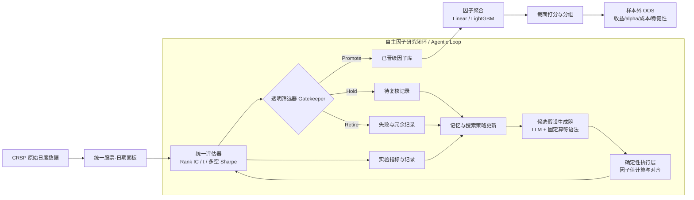

Beyond Prompting: Autonomous Factor Investing via Agentic AI
超详细结构化论文精读｜原文版本：arXiv:2603.14288v2｜作者：Allen Yikuan Huang、Zheqi Fan
原文：https://arxiv.org/html/2603.14288v2
忠实性约定：保留论文 8 个正文章节和附录 A–D 的原始顺序；不另造独立 Discussion；把作者明确披露的事实、表格数值与精读者对可复现性和文内一致性的检查区分。所有表格数值按所指 Exhibit 录入；“未披露”表示在该版本正文或附录中未找到足够具体的实现信息。

Abstract — 摘要
文章提出面向系统性因子投资的自主 Agentic AI 框架，将大语言模型从人工连续提示下的单次金融因子生成器，升级为能够依据目标主动构造假设、执行因子计算、接受回测反馈并修订搜索策略的研究主体。研究对象是美国股票市场的价格、成交量和市场状态等结构化信息；模型输出是具备数学定义、经济理由和可验证历史表现的候选信号，而非直接生成无法核查的投资建议。
【研究定位：重点不是让模型一次产生更多公式，而是把因子研究组织成可循环、可验证的自主科研工作流。】
系统将经济可解释性、统一统计门槛和训练期—测试期隔离嵌入搜索过程，用于控制在巨大表达式空间中产生的虚假发现和过度拟合。作者对美国股票市场的实证显示，线性聚合因子构成的多空组合在主要样本外区间实现年化毛收益 54.81%、年化 Sharpe 2.75。论文由此主张，智能体自主探索可与严格的量化实证程序结合，构成可扩展的因子发现方式。
【结果口径：54.81% 与 2.75 是原文 Exhibit 9 的线性多因子、多空组合、2021—2024 年毛收益口径，而不是单因子平均、净收益或其他图表中的收益率。】
1 Introduction — 引言
1.1 背景：因子研究自动化的研究需求
论文首先回溯量化资产定价从经济学家提出假设、人工构造收益预测变量，到机器学习处理复杂高维金融信息的变化。因子动物园使可选指标数目不断增加；这种丰富性一方面扩展收益规律的发现空间，另一方面也使人工筛选与解释面临更大负担。作为经验研究，因子的有效性最终需要数据和投资组合检验，而非仅依赖文字上的合理性。
【背景铺垫：先建立因子搜索既依赖理论知识又依赖实证验证的任务属性，说明这一工作适合研究具备主动规划能力的智能体。】
1.2 从传统机器学习的预测能力到研究工作流的自主性
作者承认传统机器学习已经擅长处理高维数据、捕捉非线性风险和收益关系，但认为其通常仍需研究人员设定特征工程、训练规则和下一步实验。人类不断编写提示词、改动公式和选择表现良好的结果，会使研究瓶颈从模型拟合转移至上游假设提出，并在反复试错中放大数据挖掘与回测过拟合的风险。
【矛盾设立：把“参数拟合的自动化”与“研究决策的自动化”区分开，以研究过程而非某一种预测器的精度作为创新对象。】
1.3 Agentic AI 的角色变化
原文 Exhibit 1 将传统 AI 描述为以外部提示或明确规则触发的被动分析引擎，而 Agentic AI 被定义为可感知环境、进行多步推理、执行行动并利用观察结果更新下一次行为的自主目标驱动系统。本文把这一差异落实到量化研究：智能体不再仅仅回答“能否构造一个因子”，而是围绕风险调整回报、交易成本和换手约束持续提出并改进信号。
【概念转换：智能体的关键身份是“连续研究工作的执行者”，而不只是具备金融知识的大语言模型。】
1.4 从候选公式到可执行的因子图谱
智能体使用金融语义形成假设，再结合符号运算构造数学表达式、调用确定性计算程序生成股票—日期因子面板、实施统一的筛选统计、将成功与失败反馈写入记忆。每轮搜索结束后，下一轮的候选因子并非独立随机生成，而是受到既有经验状态的影响。这种机制将经济假设、计算执行和证据积累连成一个研究闭环。
【流程确立：引言提前说明方法论的五级操作顺序，后文的公式、算法和架构图均围绕这一顺序展开。】
1.5 因子发现与组合聚合的两阶段设计
作者进一步将信号发现与投资组合构建分开。上游自主研究得到单个信号，下游则用透明线性组合和非线性 LightGBM 聚合，观察它们是否形成稳健的股票排序与多空收益。线性模型强调低复杂度和审计便利，树模型强调交互与条件依赖。以相同数据框架比较两者，有助于辨认收益究竟来自更好的上游信号，还是依赖更复杂的下游拟合。
【贡献拆分：将因子质量与聚合模型能力作为两个可以分别评价的研究环节，避免只报告复杂模型的总体收益。】
1.6 贡献与章节衔接
本文的贡献主张由三个部分形成：自主因子发现的工作流创新；经济理由、统计门槛、样本外隔离等防止虚假发现的程序约束；对美国股票市场单因子和组合收益、风险调整 alpha、持有期、成本与框架对比的系统检验。原文随后依次介绍相关文献、闭环技术方法、数据处理、主实验、数据挖掘防范与因子经济解释、稳健性实验和结论。
【章节逻辑：由因子发现的流程创新出发，以可解释性和样本外投资表现分别支撑方法可信性与应用有效性两项命题。】
2 Related literature — 相关文献
2.1 Financial Factor Models and Technical Signals
本节从 CAPM、Fama–French 多因子模型和 Carhart 动量模型展开，继而介绍技术分析、价格趋势和交易量相关实证文献，如 Brock et al. (1992)、Lo et al. (2000)、Han et al. (2013, 2016)。这些研究为利用价格、成交量等信息预测股票横截面收益提供理论和实证背景。相较于财务特征主导的经典因子，技术信号更接近交易行为、信息反应和流动性冲击。
【知识基础：通过资产定价与技术指标两类研究论证仅使用价格和成交量等原始变量进行因子搜索的学术合理性。】
这些研究中的技术因子往往以人工设计的指标、规则和窗口为起点。随着因子动物园规模增长，人工定义的候选表达式很难穷尽大量复杂组合，也不容易在相同评价规则下持续自我调整。本文希望进一步探索具有经济解释的非线性技术信号及其自动验证过程。
【剩余缺口：已知技术指标可能有效，并不意味着人工定义的因子库已足够；作者据此将固定规则扩展为自主结构搜索。】
2.2 Machine Learning in Asset Pricing
第二组文献以 Gu et al. (2020) 的机器学习比较和 Kelly et al. (2019) 的 IPCA 等为代表，说明神经网络、梯度提升树和动态因子模型可以表达传统线性回归较难捕捉的复杂关系。尽管如此，高维金融预测仍受低信噪比、过拟合、特征预选和经济解释困难制约；高换手策略还可能在交易成本下失去收益优势。
【技术定位：机器学习的贡献主要发生在给定输入变量后的预测函数估计环节，本文希望前移到变量表达式本身的发现。】
作者将方法与遗传规划、符号回归等表达式空间优化技术联系起来：遗传规划有能力在不具备梯度的公式空间中寻找策略，但组合性搜索可能生成大量无经济含义的结构。LLM 所具备的语义金融知识被用于引导可解释的公式组合，而不是让算符随机搜索单独决定搜索路径。
【方案差异：保留自动化公式搜索的灵活性，同时用金融语义和统一验证反馈约束探索方向。】
2.3 Large Language Models and Agentic AI in Finance
第三组文献从金融新闻情绪的文本分析，发展到利用 ChatGPT、金融 BERT 等模型提取金融语义或结构化市场预测信号，再到 LLM 自动生成候选因子的探索。Cheng and Tang (2024) 等研究已经表明语言模型能够参与因子构造，因此本文并非首创“LLM 生成因子”，而是将这种能力扩展到自动代码执行、经验反馈与后续假设更新。
【创新划界：把一次性的因子生成与完整自主研究闭环区别开来，清晰界定本文相对已有 LLM 金融研究的新增环节。】
现有金融 Agent 研究还提示了模型知识过时、网络搜索偏差与自动化建议可靠性不足等风险。本文把 Agent 的行动置于预先定义的数据、算符、统计门槛和时间隔离环境中，使模型需要在可追溯的经验检验中修订研究策略。作者声称，据其所知，这是金融文献中较早将 Agentic AI 直接应用于因子投资的研究。
【综述归宿：相关工作形成“手工静态因子—给定特征的 ML—提示词驱动因子生成—可验证自主因子研究”的渐进论证链条。】
3 Methodology: Agentic AI for Factor Generation — 方法
3.1 System Design and Closed-Loop Workflow
作者将因子研究形式化为轮次为 $k$ 的闭环映射：
\(\mathcal C_k:\mathcal H_k\xrightarrow{\mathrm{Gen}}\mathcal F_k\xrightarrow{\mathrm{Eval}}\mathcal M_k\xrightarrow{\mathrm{Gate}}\mathcal D_k.\)
其中 $\mathcal H_k$ 表示待检验假设集合，$\mathcal F_k$ 表示由假设生成的候选因子，$\mathcal M_k$ 表示统一评价指标，$\mathcal D_k$ 表示筛选决策。每轮使用相同的计算、评价和晋级程序，因而不同轮次的结果具有可比性。反馈通过记忆与搜索策略更新返回假设提出阶段，并不是在主循环之外由人工临时更改检验标准。
【数学定位：公式 (3.1) 的关键是标准化的假设—证据—决策链条，强调探索自由不意味着评估标准可以随搜索结果变化。】
作者强调两项原则：受约束的自主性（固定变量、可用运算符、表达式复杂度及禁止未来信息）和证据积累（研究日志、历史检验结果、成功与失败假设共同参与下一轮搜索）。前者限制非法或难以解释的候选，后者使搜索从完全独立的多次提示变为有状态的迭代过程。
【约束目标：将大模型的创造性限定在可验证的数学表达式空间，将结果驱动的后续搜索限定在历史可用数据和固定评价规则内。】
3.2 Agent Architecture and Functional Modules
原文 Exhibit 2 与 Algorithm 1 共同描述完整运行架构。下图依照数据层、闭环五模块、因子库和组合层重构关键箭头；图中“筛选”“继续观察”“淘汰”对应 Algorithm 1 的三种分支，“记忆更新→再生成”对应自主性来源。

【架构复刻：Exhibit 2 的三个功能层是原始数据转为标准化面板、智能体内部生成—执行—筛选—记忆闭环、已晋级因子进入聚合和样本外检验；智能体不是在测试集上持续更新的在线交易器。】
模块一：受约束的候选假设生成器。 对股票 $i$、日期 $t$，因子被定义为基于过去及当前可观察原始变量的符号组合：
\(f_{i,t}=\mathcal G(\mathbf X_{i,t},\mathbf X_{i,t-1},\ldots,\mathbf X_{i,t-k};\mathcal O).\)
$\mathbf X$ 包括价格、成交量、收益及市场状态等可用基础变量；$\mathcal O$ 为预定义操作符集合，例如移动均值、滞后、滚动统计和算术变换。表达式深度受限，目的是让因子具备明确的计算步骤且能够由研究者核对。
【生成规则：搜索对象是由原始信息和允许的函数复合而成的数学表达式，不是自由文本的买卖意见，也不是对大模型参数进行二次训练。】
模块二：确定性执行与数据对齐。 生成器输出具体因子公式后，由代码执行环境把表达式计算为股票—日期面板。截面运算在同一交易日的不同股票上完成，时间序列运算只访问该股票截至当天的历史数据。原文 Algorithm 1 将计算值先进行 1%—99% 缩尾，再实施截面 Z-score，使不同表达式的尺度具有可比性。
\(\tilde f_{i,t}=\frac{\operatorname{winsorize}(f_{i,t})-\mu_t}{\sigma_t}.\)
【计算隔离：大模型决定“计算什么”，确定性程序决定“如何计算”，从而将语言生成的不稳定性与指标执行的数值一致性分离。】
模块三：统一评估器。 所有候选因子使用相同的 Rank IC、统计显著性、多空组合收益和回撤等指标，不允许对表现欠佳的因子临时改变打分逻辑。日度 Rank IC 定义为因子分数和下一期收益的横截面 Spearman 相关：
\(IC_t=\mathrm{Corr}\bigl(\mathrm{rank}(f_{i,t}),\mathrm{rank}(R_{i,t+1})\bigr),\qquad t_{IC}=\frac{\overline{IC}}{\sigma_{IC}/\sqrt T}.\)
【检验目的：Rank IC 衡量股票排序质量，t 统计量衡量跨时间序列的稳定性；二者与可交易收益指标互补，而非互相替代。】
多空收益取最高分组与最低分组的平均收益差；其年化 Sharpe 为 $\sqrt{252}$ 倍日均多空收益除以日收益标准差：
\(R_{LS,t}=\frac{1}{|Q_{top}|}\sum_{i\in Q_{top}}R_{i,t}-\frac{1}{|Q_{bottom}|}\sum_{i\in Q_{bottom}}R_{i,t},\quad SR_{LS}=\sqrt{252}\frac{\mathbb E[R_{LS,t}]}{\operatorname{Std}(R_{LS,t})}.\)
【双重评价：相同排序模型既要具备统计上的未来收益识别能力，也要在由排序形成的头尾组合中产生具有经济意义的收益差。】
模块四：透明筛选器。 每个候选因子的命运仅由预先给定的指标门槛决定：
\mathrm{Promote},&t_{IC}\ge\tau_{sig}\ \text{且}\ SR_{LS}\ge\tau_{econ};\\
\mathrm{Retire},&t_{IC}<\tau_{fail};\\
\mathrm{Hold},&\text{其他情况}.
\end{cases}$$

晋级者进入因子库；表现边缘的因子被保留待复核；明显失败的因子被记录为淘汰。Algorithm 1 并没有把算法训练成新的模型参数，而是把实验评价映射为后续可审计的候选管理决策。

【门槛治理：**质量控制是与候选生成解耦的明确规则集，限制模型在观察到回测结果后自行修改晋级标准。**】

**模块五：记忆与策略更新。** 每轮将因子定义、验证结果、晋级状态和失败情况写入结构化日志，下一轮通过语言模型结合现有策略状态进行自我反思：

$$\mathcal S_{k+1}=\operatorname{LLM}(\mathcal S_k,\mathcal E_k,\mathcal L_k).$$

其中 $\mathcal E_k$ 为评价反馈，$\mathcal L_k$ 为有成功和失败标签的历史记录。系统一方面局部改写有效因子以利用已有发现，另一方面探索不同类别信号以保持多样性。

【自进化实质：**原文的“自进化”明确对应外部研究策略和上下文记忆更新，而不是模型权重自训练；大模型每轮读取前次日志并重新生成探索方案。**】

**Algorithm 1 的工作顺序。** 输入是原始数据 $\mathbf X$、运算符 $\mathcal O$、因子语法 $\mathcal G$、门槛集合 $\Theta$ 和样本内时期 $T_{IS}$；系统初始化因子库和金融研究先验，对 $k=1,\ldots,K$ 重复生成、归一化计算、IC/Sharpe 评估、三类筛选和 LLM 搜索策略更新；循环结束输出晋级因子库 $\mathcal L_{final}$。原文采用算法伪代码说明步骤，但没有完整报告每轮生成数量、总轮数 $K$、具体 LLM 名称、上下文提示模板、工具运行成本和所有门槛的最终数值。

【复现边界：**方法机制的结构定义较完整，但从示意算法到逐轮重跑需要的系统实现参数并未全部公开，不能据此擅自填写模型版本或采样温度。**】

### 3.3 Evaluation and Selection Protocol

作者规定样本内时期和样本外时期严格按时间顺序排列：$T=T_{IS}\cup T_{OOS}$ 且 $\max(T_{IS})<\min(T_{OOS})$。因子晋级只能依据样本内历史计算：

$$D(f)=\Psi\left(\{f_{i,t},R_{i,t+1}\}_{t\in T_{IS}}\right).$$

同时，每个因子必须对当期信息集 $\mathcal F_t$ 可测：

$$f_{i,t}\in\mathcal F_t=\sigma(\{\mathbf X_{j,s}\}_{j\in\mathcal N,s\le t}).$$

因此，生成器不能以未来收益、跨未来区间统计量或样本外数据作为构造因子的输入。特征计算、因子选择与样本外报告在时间上保持顺序。

【防泄漏设计：**同时隔离特征信息与模型选择信息，防止以训练时不可获得的未来变量构造指标，或借测试集收益选择晋级因子。**】

作者将截面 1%/99% 缩尾、截面标准化、同一评价器下的 IC 显著性、多空收益、Sharpe 和分组单调性作为固定流程。对于 IC 表现边缘者进行进一步复核，失败者明确退役。这种协议使不同因子的绩效可以直接比较，但也意味着实际复现实验必须获得准确的预承诺门槛、样本切分与组合收益计算规则。

【统计控制：**固定实验协议旨在减少“看到好结果再更换评价方法”的研究者自由度，其有效程度仍取决于是否真实记录全部搜索尝试。**】

### 3.4 Iterative Learning, Governance, and Extensibility

每轮的结构化记录既是审计日志，也是下一轮搜索的知识状态。因子能够被追踪到具体表达式、计算数据、评价指标和去留原因；失败经验亦被保留以减少重复无效探索。这种设计强调研究路径的可还原性，而不只保留最终表现优异的因子。

【过程可审计性：**把实验轨迹而非单一最终收益作为治理对象，使复现者原则上可以检查每一个因子何时被提出、依据何种证据被保留。**】

系统将算符集、统计门槛、风险控制和交易成本模型设计为可以独立替换的组件。论文认为模块化有助于将系统延伸到更多市场和实证需求，但该版本并未提供跨资产类别运行结果。

【扩展边界：**模块化说明工程接口可以更换，并不自动证明新资产类别、不同流动性环境下都能维持相同收益表现。**】

## 4 Data and Factor Overview — 数据与因子概览

### 4.1 Source Data and Sample Construction

本文使用美国证券价格研究中心（CRSP）的日度股票级别历史交易记录，时间从 **2004 年 1 月至 2024 年 12 月**。原始数据按股票识别码和交易日处理为一致的股票—日期面板。研究仅保留 NYSE、AMEX、NASDAQ 上市的普通股，进一步要求股票价格不低于 5 美元、单只股票至少有 252 个历史观测值。采用这类常见筛选旨在减弱极低价格、薄交易以及滚动技术统计量数据不足造成的干扰。

【样本构建：**样本筛选并非单纯减少计算量，而是使不同股票上的技术变量计算与收益排序具有相对一致的市场质量和历史深度。**】

**Exhibit 3：2004—2024 年 CRSP 股票日度样本筛选**

| 逐步筛选条件 | 观测数（百万） | 股票数（千） |
|---|---:|---:|
| Raw universe 原始样本 | 39.59 | 20.37 |
| Eligible exchanges 合格交易所 | 32.91 | 15.69 |
| Common shares 普通股 | 21.78 | 10.10 |
| Price ≥ USD 5 | 16.66 | 9.57 |
| History ≥ 252 days | **16.51** | **8.05** |

【表格解读：**原始 3959 万条股票日记录经筛选保留约 1651 万条；原文进一步明确最终涉及 8052 只股票。保留股票的质量和历史长度优先于机械扩大股票池。**】

在时间划分上，作者允许智能体使用截至 **2020 年 12 月** 的历史数据进行因子发现和晋级选择，将 **2021 年 1 月至 2024 年 12 月** 的四年共 **1004 个交易日**作为主要样本外检验窗口，并提出 2023 年 1 月之后的更近期子样本可用于更严格的稳健性检查。关键要求是 2021—2024 年的收益不能反向参与智能体候选选择和经验更新。

【时间识别：**早期数据用于发现和定稿，后期数据用于冻结策略后的检验；在涉及 LightGBM 的滚动训练描述时，还必须额外区分已冻结的因子表达式与可能滚动更新的聚合估计器。**】

**Exhibit 4：股票数量随时间变化图。** 横轴为 2004—2024 年交易日期，纵轴为日度可用股票数量，蓝色曲线对应原始 CRSP 股票池，紫色曲线对应规则筛选后的股票池，阴影用于展示覆盖范围。筛选后曲线整体位于原始样本下方；该图主要检查筛选对时间序列股票覆盖范围的影响，论文没有把两条曲线的差距归因为单一经济事件。

【图像功能：**通过持续的日度样本覆盖检查，补充说明研究并非仅在一个固定股票集合上作静态测试，而是在逐日变化的可投资股票池上形成指标。**】

### 4.2 Target and Predictor Set

预测目标是股票下一交易日收益 $R_{i,t+1}$。基准预测变量共十种：股票滞后收益、市场收益、绝对股价、成交量、相对于近期历史的成交量比率、20 日已实现波动率、股价相对移动均线的比率、市场波动率、成交量增长率，以及报价数据可用时的买卖价差代理。它们都可由 CRSP 股票记录或市场收益状态获得，再经滞后、滚动矩、算术运算、截面排序等规则组成候选因子。

【特征设计：**研究选择相对精简但允许时间窗口和组合变换的市场变量，不以大量外部财务文本或宏观特征堆叠取胜，从而使收益来源更容易定位于因子公式本身。**】

**Exhibit 5：主要变量描述性统计（2004—2024）**

| 变量 | 单位 | 观测（百万） | 均值 | 标准差 | 中位数 | P99 |
|---|---|---:|---:|---:|---:|---:|
| Daily stock return | % | 16.50 | 0.086 | 3.499 | 0.000 | 8.885 |
| Stock price | USD | 16.51 | 118.05 | 5051.21 | 23.12 | 327.95 |
| Share volume | 百万股 | 16.51 | 1.280 | 5.333 | 0.246 | 16.817 |
| VW market return | % | 16.51 | 0.043 | 1.150 | 0.080 | 2.980 |
| S&P return | % | 16.51 | 0.038 | 1.153 | 0.070 | 2.986 |

【统计解读：**股票收益表现出显著横截面离散性，股价和成交量的均值远大于中位数；这些分布特征支撑逐日截面缩尾、尺度统一和 Rank IC 评价的必要性。**】

### 4.3 Data Pipeline and Reproducibility

数据处理管线坚持相同变量定义、相同筛选和变换顺序、确定性公式计算与固定训练测试隔离。每次因子生成、数值执行、性能评估及门槛判定均应写入实验轨迹。作者把这种可重复性视为识别因子改进效果的必要条件：若允许每次候选生成时自行修改数据清洗或检验方式，则无法判断业绩变化究竟来自新因子还是来自规则切换。

【数据治理：**方法部分的固定统计协议在数据层落实为固定样本和转换过程，进而使多轮候选比较具有共同的实验基准。**】

## 5 Empirical Results — 核心实证结果

### 5.1 Single-Factor Portfolios

单因子检验用于在聚合之前评价候选信号本身的排序能力和交易价值。作者使用 2021 年 1 月至 2024 年 12 月的样本外数据，逐日根据单因子分数形成组合。Exhibit 6 的多空组合定义为做多得分排名前 50% 的股票、做空后 50% 股票，**与后续 Exhibit 7 的最高十分位数减最低十分位数组合不同**。这一口径区别意味着不同表中的年化收益不应直接逐项对齐。

【验证设置：**先区分单因子对股票收益的整体二分排序表现和更极端的十分位数组合表现，避免由分组口径变化误判原文数字。**】

**Exhibit 6：12 个智能体生成因子的单因子表现，2021—2024**

| 因子 | Sharpe | IC | ICIR | ICL | ICLIR | Sortino | Calmar | 年化收益 | 最大回撤 |
|---|---:|---:|---:|---:|---:|---:|---:|---:|---:|
| Factor 1 | 2.8593 | 0.0068 | 4.8432 | 0.0033 | 1.0371 | 3.7811 | 3.5915 | 0.1754 | -0.0488 |
| Factor 2 | -0.1767 | 0.0011 | 0.7986 | -0.0022 | -0.6969 | -0.2528 | -0.0898 | -0.0107 | -0.1190 |
| Factor 3 | 2.4140 | 0.0098 | 5.1572 | 0.0061 | 3.4130 | 3.1564 | 2.3044 | 0.2402 | -0.1042 |
| Factor 4 | 0.6535 | 0.0051 | 2.0167 | 0.0003 | 0.1371 | 0.9670 | 0.4057 | 0.0768 | -0.1894 |
| Factor 5 | 1.4069 | 0.0059 | 3.4047 | 0.0003 | 0.1080 | 2.0108 | 1.3124 | 0.1196 | -0.0911 |
| Factor 6 | 2.2597 | 0.0071 | 4.9613 | 0.0036 | 1.5999 | 3.2242 | 1.8383 | 0.1543 | -0.0839 |
| Factor 7 | 0.7182 | -0.0003 | -0.1433 | -0.0000 | -0.0045 | 1.0096 | 0.5023 | 0.0527 | -0.1048 |
| Factor 8 | 1.6628 | 0.0271 | 5.3121 | 0.0131 | 2.6462 | 2.7148 | 1.9476 | 0.3928 | -0.2017 |
| Factor 9 | 1.9421 | 0.0055 | 3.3963 | -0.0008 | -0.3131 | 2.8600 | 2.2886 | 0.1317 | -0.0575 |
| Factor 10 | 1.4424 | 0.0049 | 2.9661 | 0.0004 | 0.1513 | 2.1149 | 1.5943 | 0.1078 | -0.0676 |
| Factor 11 | 0.6228 | 0.0016 | 0.4784 | -0.0000 | -0.0012 | 0.9339 | 0.5539 | 0.0817 | -0.1475 |
| Factor 12 | 0.8362 | 0.0033 | 2.3195 | -0.0002 | -0.1094 | 1.2785 | 0.6246 | 0.0541 | -0.0867 |

【表格解读：**Factor 1 在二分多空 Sharpe 上最高（2.8593），Factor 8 的 IC 最高（0.0271）且年化收益指标最高（0.3928），但最大回撤也较明显；Factor 2 多空 Sharpe 和年化收益为负。结果表明生成的 12 个因子质量并不均匀。**】

原文公式 (5.1) 还定义了 ICIR 为 IC 序列均值与标准差的比率，Sortino 用下行风险标准差替代总体波动率，Calmar 将组合回报与最大回撤比较。由于 IC 更侧重排序、Sharpe 更侧重收益与总风险、Sortino 更侧重下行风险，且最大回撤反映最不利路径，不同指标产生的最佳因子并不完全相同。

【指标识别：**使用一组互补而非冗余的指标描绘因子的预测质量、风险调整收益和投资可执行性。**】

**Exhibit 7：单因子十分位数组合收益（按原表数值列示）**

| 因子 | Low | D2 | D3 | D4 | D5 | D6 | D7 | D8 | D9 | High | High−Low | High−Low t |
|---|---:|---:|---:|---:|---:|---:|---:|---:|---:|---:|---:|---:|
| Factor 1 | 7.6080 | 9.3167 | 11.5033 | 9.1529 | 12.3174 | 12.6893 | 13.7833 | 12.6944 | 13.9916 | 23.9337 | 16.3258 | 5.7073 |
| Factor 2 | 12.7183 | 10.5950 | 12.0842 | 12.7672 | 11.3010 | 13.7137 | 12.8309 | 15.3788 | 13.8296 | 11.7832 | -0.9351 | -0.3526 |
| Factor 3 | 5.5370 | 7.4050 | 9.4599 | 11.6211 | 11.5141 | 9.7888 | 12.5611 | 15.7002 | 15.9265 | 27.4833 | 21.9463 | 4.8185 |
| Factor 4 | 10.8439 | 10.0526 | 9.0151 | 11.5517 | 11.7319 | 14.1782 | 13.1807 | 11.5061 | 15.9148 | 19.0283 | 8.1844 | 1.3043 |
| Factor 5 | 8.8644 | 8.3713 | 7.8395 | 11.2448 | 11.8396 | 12.5005 | 14.1687 | 14.2334 | 17.4292 | 20.5067 | 11.6424 | 2.8083 |
| Factor 6 | 6.5800 | 9.1634 | 11.6692 | 11.6242 | 13.0579 | 12.3224 | 11.9336 | 12.3290 | 17.1525 | 21.1415 | 14.5615 | 4.5105 |
| Factor 7 | 12.5296 | 11.5006 | 10.8795 | 12.0201 | 11.0813 | 12.0757 | 11.4794 | 13.8562 | 13.6509 | 17.9456 | 5.4160 | 1.4335 |
| Factor 8 | -13.7849 | -0.1989 | 7.2228 | 12.6352 | 22.0386 | 21.0944 | 17.6189 | 19.6974 | 19.2048 | 21.6353 | 35.4202 | 3.3190 |
| Factor 9 | 7.7250 | 5.7652 | 9.8208 | 12.3451 | 12.0076 | 13.8103 | 14.2841 | 15.4949 | 15.4298 | 20.3107 | 12.5857 | 3.8764 |
| Factor 10 | 8.6473 | 8.2489 | 10.1795 | 11.2505 | 12.5063 | 12.9636 | 12.1496 | 14.9647 | 16.9427 | 19.1523 | 10.5051 | 2.8791 |
| Factor 11 | 8.2225 | 9.1330 | 11.2494 | 10.7664 | 13.8119 | 13.5295 | 11.0894 | 13.7121 | 18.3941 | 17.0931 | 8.8706 | 1.2432 |
| Factor 12 | 11.4317 | 9.9040 | 10.9462 | 11.5047 | 12.2840 | 12.8936 | 12.0737 | 14.1727 | 14.8922 | 16.9192 | 5.4875 | 1.6691 |

【表格解读：**Factor 8 的头尾收益差为 35.4202，Factor 3 为 21.9463，Factor 1 为 16.3258；Factor 2 的差值为负且 t 统计量不显著。部分因子中间十分位数并不逐组单调，支持原文关于排序能力存在异质性的判断。表格按原文 Exhibit 7 单位原样列示，需注意其表注称“decimal form”与数值规模的文字表达存在辨读歧义。**】

**Exhibit 8：单因子在不同资产定价基准下的风险调整 Alpha**

每格以 `alpha (Newey–West t)` 表示，原文表注称 alpha 单位为百分比、并将其描述为年化 alpha。

| 因子 | CAPM | FF3 | FF5 | FF6 |
|---|---:|---:|---:|---:|
| Factor 1 | 0.134 (4.57) | 0.137 (4.71) | 0.138 (4.74) | 0.138 (4.74) |
| Factor 2 | -0.037 (-1.30) | -0.038 (-1.34) | -0.040 (-1.43) | -0.040 (-1.43) |
| Factor 3 | 0.190 (4.22) | 0.196 (4.30) | 0.195 (4.33) | 0.196 (4.37) |
| Factor 4 | 0.054 (0.88) | 0.058 (0.95) | 0.056 (0.93) | 0.057 (0.95) |
| Factor 5 | 0.088 (2.18) | 0.089 (2.21) | 0.088 (2.18) | 0.088 (2.23) |
| Factor 6 | 0.115 (3.61) | 0.118 (3.70) | 0.115 (3.64) | 0.115 (3.65) |
| Factor 7 | 0.023 (0.62) | 0.021 (0.57) | 0.021 (0.57) | 0.022 (0.59) |
| Factor 8 | 0.331 (3.32) | 0.320 (3.26) | 0.315 (3.24) | 0.318 (3.26) |
| Factor 9 | 0.098 (3.08) | 0.099 (3.11) | 0.100 (3.17) | 0.100 (3.21) |
| Factor 10 | 0.077 (2.14) | 0.077 (2.15) | 0.077 (2.18) | 0.078 (2.23) |
| Factor 11 | 0.060 (0.90) | 0.052 (0.77) | 0.053 (0.80) | 0.053 (0.80) |
| Factor 12 | 0.028 (0.83) | 0.026 (0.78) | 0.021 (0.65) | 0.022 (0.67) |

【风险调整检验：**Factor 1、3、6、8、9 在主要多因子调整下保持显著正 alpha，而 Factor 2 等未通过显著性检验。此处最强的实证结论是“部分自主生成因子具有传统风险模型难以解释的收益”，而不是“所有因子都具备稳健独立 alpha”。**】

### 5.2 Multivariate combination

由于单因子强弱不同、可能承载互补信息，作者将发现的因子进一步合成为股票预测评分，比较透明线性聚合与 LightGBM 非线性聚合。两种方法共用同样的候选信号和时间验证原则：前者以较低的估计复杂度整合信息，后者进一步拟合信号之间的交互及状态依赖，最后均按评分形成股票头尾组合。

【实验衔接：**单因子证明信号“可能有用”，多因子则检验这些信息组合后能否形成更稳定的可实施收益。**】

**Exhibit 9：线性组合多空策略主要样本外表现与全部季度毛收益**

| 时期 | 区间收益 (%) | 年化收益 (%) | 年化波动 (%) | Sharpe | 最大回撤 (%) | 天数 |
|---|---:|---:|---:|---:|---:|---:|
| **2021—2024 总计** | **470.43** | **54.81** | **16.40** | **2.75** | **-13.41** | **1004** |
| 2021Q1 | 9.68 | 46.49 | 22.65 | 1.80 | -6.18 | 61 |
| 2021Q2 | 12.61 | 60.81 | 15.22 | 3.20 | -6.90 | 63 |
| 2021Q3 | 12.04 | 56.45 | 12.38 | 3.68 | -5.88 | 64 |
| 2021Q4 | 24.00 | 133.29 | 12.43 | 6.89 | -2.67 | 64 |
| 2022Q1 | 21.25 | 118.82 | 22.03 | 3.67 | -5.80 | 62 |
| 2022Q2 | 18.38 | 98.53 | 22.20 | 3.20 | -6.46 | 62 |
| 2022Q3 | 1.42 | 5.71 | 23.13 | 0.35 | -10.70 | 64 |
| 2022Q4 | 14.08 | 69.39 | 19.94 | 2.74 | -4.40 | 63 |
| 2023Q1 | 1.37 | 5.69 | 17.88 | 0.40 | -10.04 | 62 |
| 2023Q2 | 3.03 | 12.89 | 10.86 | 1.17 | -5.08 | 62 |
| 2023Q3 | 18.04 | 94.17 | 10.92 | 6.14 | -2.52 | 63 |
| 2023Q4 | 4.76 | 20.45 | 14.93 | 1.32 | -9.70 | 63 |
| 2024Q1 | 5.92 | 26.84 | 11.11 | 2.20 | -3.49 | 61 |
| 2024Q2 | 17.29 | 89.25 | 10.35 | 6.22 | -1.88 | 63 |
| 2024Q3 | 17.85 | 90.92 | 15.37 | 4.29 | -5.97 | 64 |
| 2024Q4 | 5.85 | 25.55 | 11.26 | 2.08 | -2.89 | 63 |

【主结果解读：**主要四年样本外线性多空组合的 54.81% 年化毛收益、2.75 Sharpe 和 -13.41% 最大回撤支持原文摘要结论。分季度表中 16 个季度毛收益全部为正，但 2022Q3、2023Q1 的收益与 Sharpe 显著下降，表明结果并非各市场状态下一致强势。**】

**Exhibit 10：多因子聚合组合的风险调整 alpha**

| 组合 | CAPM alpha (t) | FF3 alpha (t) | FF5 alpha (t) | FF6 alpha (t) |
|---|---:|---:|---:|---:|
| Linear long-short | 0.425 (5.334) | 0.417 (5.304) | 0.412 (5.315) | 0.414 (5.324) |
| Linear long-only | 0.293 (4.170) | 0.302 (4.327) | 0.300 (4.340) | 0.300 (4.338) |
| LGBM long-short | 0.315 (6.986) | 0.311 (6.871) | 0.310 (6.917) | 0.311 (6.904) |
| LGBM long-only | 0.240 (3.248) | 0.251 (3.438) | 0.251 (3.451) | 0.250 (3.441) |

【模型比较：**线性多空组合在 FF6 模型下的 alpha 数值高于 LightGBM 多空组合（0.414 对 0.311），但 LightGBM 的 t 统计量更高（6.904 对 5.324），体现收益幅度和统计稳定性之间并非完全同序的关系。**】

**Exhibit 11：Linear 与 LightGBM 的累计收益及回撤图。** 图左侧为线性聚合、右侧为 LightGBM 聚合；每个面板分别展示最高十分位数多头、最低十分位数空头、头尾多空组合以及多空组合最大回撤。横轴为样本外日期，收益路径反映组合收益累计过程。作者观察到两种模型均具有持续正向的多空收益轨迹，且线性策略阶段性回撤较大、LightGBM 曲线相对更平滑。原文图注对各条曲线的累计口径有定义，但没有将该图单独等同于摘要的 54.81% 年化收益。

【曲线比较：**图的主要任务是区分“线性组合能否获利”和“非线性组合能否改善收益路径”，而不是单凭终点的高度宣称 LightGBM 在全部评价指标中都优于线性模型。**】

**Exhibit 12：聚合信号 IC 诊断图。** 该图上排对应线性模型、下排对应 LightGBM，左侧是按时间的日度 Rank IC 及滚动均值，右侧是 Rank IC 的经验分布。作者指出线性模型的 IC 围绕零波动，而 LightGBM 的滚动 IC 在更多时期维持正值、分布整体相对右移，表明非线性聚合在日度横截面排序上具有较强的稳定性。

【机制补证：**组合收益差异通过 IC 的时间路径与分布形态得到额外解释，显示作者同时检验风险收益结果和底层预测信息。**】

**Exhibit 13：多因子聚合评分十分位数组合样本外业绩**

| 组合 | 区间累计收益 (%) | 年化 Sharpe | 交易日 |
|---|---:|---:|---:|
| D1 | -47.01 | -0.505 | 1004 |
| D2 | 6.14 | 0.180 | 1004 |
| D3 | 35.72 | 0.466 | 1004 |
| D4 | 38.48 | 0.507 | 1004 |
| D5 | 48.75 | 0.616 | 1004 |
| D6 | 65.33 | 0.777 | 1004 |
| D7 | 83.99 | 0.934 | 1004 |
| D8 | 87.94 | 0.973 | 1004 |
| D9 | 133.03 | 1.290 | 1004 |
| D10 | 245.72 | 2.313 | 1004 |
| D10−D1 Gross | **465.07** | **2.715** | **1004** |
| D10−D1 Net | **305.57** | **2.211** | **1004** |

【十分位数验证：**从 D1 的 -47.01% 至 D10 的 245.72%，区间累计收益随模型评分上升，支持信号横截面区分能力；使用每日单边 3 基点交易成本后，头尾多空组合的 Sharpe 从 2.715 降至 2.211，表明较高换手的收益折损不可忽略。**】

**Exhibit 14：多因子组合十分位数累计收益曲线。** 横轴为 2021—2024 年日度日期，纵轴为复利累计收益。D10 曲线显著向上、D1 曲线整体下降，各分组随时间形成扇形分离（fan-out）；该图通过持有不同评分股票群组的累计收益差异，图像化呈现预测信号排序效果。

【图表验证目标：**相比只列头尾差价，十条收益路径有助于判断分数排序信息是否集中于少数极端组，或者在较完整的股票横截面中形成方向一致的区分。**】

## 6 Mitigation of Data-Mining Concerns and Economic Rationale — 数据挖掘防范与经济解释

### 6.1 Economic Regularization and the “Lucky Factor” Filter

作者把自动搜索产生“幸运因子”（Lucky Factor）视为核心威胁。因子表达式空间极大，若没有约束，自动程序可能仅因为测试次数众多就找到与历史收益偶然相关的公式。论文借用 Harvey (2017) 对第一类统计错误的讨论指出，人类研究者可能在观察显著回测之后反向寻找能够解释结果的金融故事，即 HARKing；仅用复杂模型替代人工操作，无法自动消除这一问题。

【问题回扣：**本节不是再证明因子组合收益有多高，而是质疑高收益是否只是大规模搜索产生的偶然极值，迫使研究论证转向发现过程本身的有效性。**】

论文的回应是将经济解释作为生成阶段的约束，要求候选表达式和经济动机共同被提出。模型使用既有金融知识将搜索集中于价格压力、流动性、投资者关注及市场微观结构等具有经济含义的方向，避免无限制拼接随机运算符。作者将这种设计类比为贝叶斯先验：事前将可搜索的候选空间收缩至相对合理的区域，从而降低事后寻找经济解释的可能性。

【经济正则化：**解释并非回测成功后新增的包装，而被设计为影响搜索入口和候选允许范围的结构性要求；但语义合理性本身仍不足以替代严格的样本外验证。**】

### 6.2 Strict Statistical Hurdles and Multiple Testing Adjustment

面对大规模隐含重复检验，作者引用 Harvey et al. (2016)，提出比传统近似 $|t|>2$ 更严格的统计门槛：

$$|t\text{-statistic}|>3.0.$$

此外，论文提及评估新增因子能否进一步减少既有基准的定价误差，并联系 Harvey and Liu (2021) 的 Scaled Intercept 指标。在有多项候选并行或连续被测试时，单次显著性不能直接对应整个搜索过程的虚假发现率，严格门槛意在控制因反复挑选产生的错误发现。

【多重检验控制：**提高 t 阈值是避免宽松显著性筛选的一项防护，但原文未提供完整候选数量、p 值分布或 Bonferroni/FDR 调整计算表，因此不能将这一阈值单独理解为已完成显式的全搜索多重比较校正。**】

### 6.3 Multi-Dimensional Robustness Checks

作者要求入库因子不只是有显著回测，还应表现出相对于既有因子的边际信息、不过高的换手负担、不过快的预测收益衰减以及合理的交易实施条件。论文将这些约束与 Deflated Sharpe Ratio、特征重要性和现实交易摩擦等文献概念联系起来，把筛选逻辑称为多目标 gate。

【质量维度：**显著性、独立信息与执行成本构成不同评价维度；增加多个筛选条件的目的，是抑制仅靠某一个收益指标冒尖的候选进入最终投资组合。**】

### 6.4 Strict Temporal and Policy Isolation

全文最重要的实证隔离安排是：截至 2020 年 12 月的历史用于完成因子搜索和智能体学习，2021—2024 年样本外窗口内 **智能体状态与因子库保持冻结**。这一说明限定了本文“自进化”的适用时期：模型在研究阶段自主迭代，最终样本外测试并不允许借测试集结果持续发现、替换因子。

【关键边界：**研究时闭环搜索与投资检验时冻结策略可以共存；样本外阶段不更新自主搜索策略，是保护结果不被反馈泄漏污染的必要安排。**】

### 6.5 The Anatomy and Economic Logic of Agent-Generated Factors

#### 6.5.1 Mechanisms of Autonomous Factor Synthesis

原文将自主因子构造与深度神经网络因子挖掘、遗传规划、LLM 提示词生成因子进行比较，认为自迭代闭环最显著的特征是智能体能够据实证检验修正搜索启发式、积累历史研究轨迹并不断尝试新公式。这一设计并非宣称发现结果超越经济理论，而是用可执行、可审计的数学函数承载经济理论驱动的候选假设。

【机制归纳：**大语言模型负责提出可解释的结构假设，历史数据和筛选程序负责裁定结果；经济动机和回测检验共同约束系统，而非任一环节独立决定结论。**】

#### 6.5.2 Thematic Taxonomy and Financial Rationale: Economic Insights

研究报告的 12 个因子主要围绕订单流、交易需求、流动性冲击、平滑成交量趋势、投资者关注和均值回归等主题。下表依据 **Exhibit 15** 的正式名称及说明翻译，保持其原本的因子编号；这份表格是文章最具体的因子经济语义材料，但并未同时给出 12 个因子的完整数学定义和所有窗口参数。

**Exhibit 15：智能体生成的 12 个因子的经济含义**

| 编号 | 原文因子名称 | 对应经济机制 |
|---|---|---|
| 3 | Composite Liquidity Demand | 综合换手水平与换手加速度，反映当期订单失衡需求；较强且广泛的买盘可能伴随缓慢信息扩散和短期收益延续 |
| 8 | Defensive Mean-Reversion Signal | 股票价格低于近期趋势锚点且已实现风险较低时得分更高，寻找暂时折价且波动可控的均值回归机会 |
| 12 | Delayed Flow Persistence | 使用滞后和平滑后的换手冲击识别持续订单流，联系渐进式信息传播和流动性供给分割 |
| 11 | Flow Acceleration - Concave | 偏重持续交易流加速度，同时降低极端流量尖峰权重，刻画投资者注意力冲击的边际价格影响递减 |
| 1 | Flow Shock - Winsorized | 捕捉异常交易需求冲击，并抑制极端值影响，反映价格尚未充分吸收的关注或流动性变化 |
| 2 | Lagged Flow Pressure | 使用前一日交易流惊讶程度，检验流动性推动的价格压力究竟反转还是延续 |
| 9 | Medium-Horizon Attention | 中等窗口持续换手活动代表投资者关注与交易拥挤程度，可能带来可预测的需求冲击与延迟重估 |
| 5 | Persistent Turnover Intensity | 识别短窗口里持续偏高的相对交易需求强度，与信息到来或投机性需求有关 |
| 6 | Smoothed Flow Shock | 对流动性冲击进行平滑和去噪，以剔除暂时尖峰并保留可能较慢被定价的持续压力 |
| 4 | Stable Turnover Trend | 偏好较高且稳定的换手，惩罚不稳定流动性尖峰，关联更持续的参与和较低不利选择不确定性 |
| 10 | Sustained Liquidity Attention | 捕捉持续交易兴趣，同时约束极高活动股票的影响，描述渐进的关注驱动资金再配置 |
| 7 | Turnover Volatility Risk | 量化短窗口流动性需求不稳定与库存风险转移，关联脆弱流动性状态和时变风险补偿 |

【因子分类解读：**因子库重点落在交易流和流动性机制，而非 12 个彼此完全独立的经济主题；平滑、滞后、非线性衰减、稳定性和波动率过滤构成多种相邻的公式设计思路，因此因子间冗余检验具有现实必要性。**】

**原文内部一致性提示。** 第 6.5 节正文将 Factor 7、10、2、1、8 分别称作 *Delayed Turnover Pressure*、*Medium Horizon Turnover Pressure*、*Friction Adjusted Flow Shock*、*Flow Volatility Imbalance*、*Price Level Persistence*，但 Exhibit 15 对这些编号给出的是不同名称和描述。由于正文与表格的编号—名称映射并不完全一致，本精读保留 Exhibit 15 的正式表格名称，并将正文所举名称作为存在差异的原文记载，不把两者自行统一成一个推测出的公式。

【资料核对：**该问题属于原文不同位置的记述差异，不能通过读者自由重命名解决；若将论文作为复现实验依据，需进一步获得作者提供的完整因子代码和编号映射。**】

## 7 Robustness Tests — 稳健性检验

### 7.1 Longer-horizon predictability

本节将信号预测期限从形成组合后的 1 个交易日扩展至 7 个交易日。对于每个持有期 $H1$ 至 $H7$，作者按对应因子分数进行十分位数排序，计算最高十分位数减最低十分位数组合的收益，报告年化收益及 Newey–West 调整 t 统计量。此实验检验信号是仅存在于极短期的噪声，还是在更长持有期限内保留部分可预测性。

【期限检验：**通过改变投资信号变现的时间尺度，判断因子收益是否快速消散，并检视因子对较低换手实施需求的兼容程度。**】

**Exhibit 16：持有期 H1—H7 的多空组合年化收益及 t 统计量**

各单元为 `年化收益率% (t 值)`，数据直接对应论文原表两行数值。

| 投资组合 | H1 | H2 | H3 | H4 | H5 | H6 | H7 |
|---|---:|---:|---:|---:|---:|---:|---:|
| Linear | 44.87 (5.42) | 33.98 (5.69) | 28.45 (5.92) | 25.08 (6.07) | 22.89 (6.24) | 20.55 (6.18) | 18.95 (6.20) |
| LGBM | 34.24 (7.23) | 26.20 (7.81) | 21.50 (8.02) | 19.23 (8.33) | 16.69 (8.20) | 14.62 (7.97) | 12.90 (7.61) |
| Factor 1 | 16.33 (5.71) | 7.91 (4.06) | 5.35 (3.56) | 3.73 (2.94) | 3.70 (3.30) | 2.51 (2.49) | 1.83 (1.95) |
| Factor 2 | -0.94 (-0.35) | -0.53 (-0.29) | -0.80 (-0.55) | 0.31 (0.25) | -0.44 (-0.40) | -0.81 (-0.80) | -0.86 (-0.91) |
| Factor 3 | 21.95 (4.82) | 12.93 (4.16) | 9.64 (3.91) | 8.22 (4.01) | 7.24 (4.05) | 5.83 (3.68) | 4.82 (3.36) |
| Factor 4 | 8.18 (1.30) | 7.30 (1.66) | 7.23 (2.08) | 6.92 (2.37) | 6.13 (2.43) | 5.54 (2.46) | 5.10 (2.49) |
| Factor 5 | 11.64 (2.81) | 8.42 (2.98) | 6.97 (3.10) | 5.99 (3.10) | 5.55 (3.29) | 5.75 (3.85) | 5.72 (4.24) |
| Factor 6 | 14.56 (4.51) | 10.14 (4.69) | 8.75 (5.03) | 7.16 (4.77) | 5.07 (3.70) | 3.34 (2.71) | 2.44 (2.16) |
| Factor 7 | 5.42 (1.43) | 3.97 (1.53) | 3.82 (1.91) | 2.91 (1.72) | 2.34 (1.57) | 1.97 (1.43) | 2.53 (1.99) |
| Factor 8 | 35.42 (3.32) | 28.65 (3.81) | 24.68 (4.08) | 21.71 (4.16) | 19.51 (4.24) | 18.01 (4.34) | 17.05 (4.48) |
| Factor 9 | 12.59 (3.88) | 10.00 (4.42) | 8.83 (4.88) | 7.68 (4.99) | 6.88 (5.05) | 6.56 (5.25) | 6.63 (5.75) |
| Factor 10 | 10.51 (2.88) | 8.93 (3.50) | 8.20 (4.04) | 7.50 (4.35) | 6.88 (4.53) | 6.31 (4.64) | 6.00 (4.88) |
| Factor 11 | 8.87 (1.24) | 5.58 (1.10) | 3.84 (0.95) | 3.07 (0.89) | 3.36 (1.11) | 3.11 (1.15) | 3.32 (1.35) |
| Factor 12 | 5.49 (1.67) | 2.39 (0.99) | 0.90 (0.47) | 0.47 (0.29) | 0.28 (0.20) | 0.09 (0.07) | 0.56 (0.49) |

【期限结果：**Linear 从 H1 的 44.87% 降至 H7 的 18.95%，LGBM 从 34.24% 降至 12.90%，说明持有期延长通常伴随收益幅度衰减；Factor 8、9 等的 t 值在较长持有期仍显著，说明个别信号具有相对持久的信息含量。不同窗口收益是各自统计口径，不是按日逐个累加的收益。**】

### 7.2 Transaction Costs and Economic Viability

论文对交易成本使用线性近似：每发生单位单边换手，扣除 **3 个基点（0.0003）**，即

$$c_t=0.0003\times\operatorname{Turnover}_t,\qquad r_t^{net}=r_t^{gross}-c_t.$$

该成本用于代表手续费与买卖价差等基本摩擦，而不等于完整市场冲击函数或随交易规模变化的订单簿仿真。因此，成本后收益是基于设定成本假设的经济可行性测试，不能直接外推为任意资金规模下的可成交绩效。

【实施假设：**明确将交易摩擦转换为与每日单边换手成比例的扣减，验证高频价格—成交量因子是否具备足够收益空间覆盖频繁调仓。**】

**Exhibit 17：交易成本前后的累计收益曲线。** 横轴为 2021—2024 年的时间，纵轴为累计收益，蓝色实线为毛收益，红色虚线为扣除交易费用后的净收益。作者在本节文字中描述曲线终点约为 139%（毛）与 75%（净），且两者走势均向上。需要注意，Exhibit 13 同样标记 2021—2024 年，却给出 465.07% 毛累计收益、305.57% 净累计收益；Exhibit 9 给出 470.43% 毛累计收益。由于原文没有提供足够的逐日持仓重建资料用于严格核对三者差异，本精读将三个 Exhibit 的数值分开报告，不认定它们描述完全相同的逐日收益序列。

【口径核查：**不同图表的毛净收益出现明显数值差异，读者应以相应图表的具体组合、成本和累计定义为准，不宜将所有数字拼接为单一“最终净收益率”。**】

### 7.3 Turnover Analysis and Implementation Feasibility

Exhibit 18 报告季度平均每日多空换手及同期毛净收益、毛净 Sharpe。换手率在各季度约为 105.73%—114.43%，说明该信号组合在日度调仓下需要频繁重构持仓；交易成本会显著侵蚀较弱季度的收益表现。作者指出，16 个季度中 14 个季度净收益为正，其中 2022Q3 和 2023Q1 为负。

【换手约束：**该结果同时提供策略可获利性与交易实施负担两种证据：净收益多数时期为正，但高日度换手意味着现实交易容量和价格冲击仍值得单独评估。**】

**Exhibit 18：样本外全部季度换手、毛净收益与 Sharpe**

| 季度 | 平均每日换手 (%) | 毛收益 (%) | 净收益 (%) | 毛 Sharpe | 净 Sharpe |
|---|---:|---:|---:|---:|---:|
| 2021Q1 | 105.7314 | 9.3807 | 7.2873 | 1.7429 | 1.3914 |
| 2021Q2 | 113.0857 | 12.6903 | 10.3115 | 3.2089 | 2.6491 |
| 2021Q3 | 112.3283 | 12.1322 | 9.7434 | 3.6917 | 3.0085 |
| 2021Q4 | 112.7979 | 23.7459 | 21.1027 | 6.7062 | 6.0322 |
| 2022Q1 | 114.4251 | 21.5852 | 19.0321 | 3.7013 | 3.3114 |
| 2022Q2 | 113.6247 | 18.3216 | 15.8532 | 3.1561 | 2.7742 |
| 2022Q3 | 108.3577 | 1.6639 | -0.4296 | 0.3929 | 0.0426 |
| 2022Q4 | 108.8101 | 13.5125 | 11.2048 | 2.6226 | 2.2123 |
| 2023Q1 | 108.2341 | 1.2970 | -0.7221 | 0.3805 | -0.0752 |
| 2023Q2 | 108.4066 | 3.0243 | 0.9678 | 1.1675 | 0.4135 |
| 2023Q3 | 109.3437 | 18.0783 | 15.6682 | 6.0817 | 5.3309 |
| 2023Q4 | 108.6696 | 4.5059 | 2.3825 | 1.2451 | 0.6996 |
| 2024Q1 | 109.9185 | 6.2288 | 4.1142 | 2.2884 | 1.5450 |
| 2024Q2 | 111.1760 | 17.2556 | 14.8230 | 6.1602 | 5.3539 |
| 2024Q3 | 109.9314 | 17.6036 | 15.1524 | 4.2061 | 3.6689 |
| 2024Q4 | 109.5543 | 5.4931 | 3.3327 | 1.9548 | 1.2195 |

【成本验证：**换手几乎持续超过每日 100%，使成本假设对策略净值意义重大；尽管 2021Q4 与 2024Q2 仍有较高净 Sharpe，2022Q3 和 2023Q1 已变为净亏损季度，体现盈利稳定性和实施现实性之间的边界。**】

### 7.4 Comparison of Agentic vs. Traditional AI Frameworks

本节采用 2×2 对照：上游因子来源为 Agentic AI 与 Traditional AI 两种框架，下游聚合器分别为 Linear 和 LightGBM，从而区分“更好的因子发现”与“更复杂的多因子组合”。原文使用 Exhibit 19 的图例给出四组策略样本外年化收益，并展示 2021—2024 年四条头尾多空累计收益曲线。

【对照意图：**在相同类型的聚合器下比较不同因子来源，可观察智能体发现的候选集合是否具有增量价值；在相同因子来源下比较聚合器，可观察非线性交互的附加作用。**】

**Exhibit 19：传统 AI 与 Agentic AI 的四组对照（图中文字）**

| 上游因子生成框架 | 下游聚合器 | 样本外年化收益 (%) |
|---|---|---:|
| Traditional AI | Linear | 30.91 |
| Traditional AI | LightGBM | 50.84 |
| Agentic AI | Linear | **58.80** |
| Agentic AI | LightGBM | **65.42** |

【框架比较：**Agentic Linear 高于 Traditional Linear，Agentic LightGBM 也高于 Traditional LightGBM，支持上游因子质量改善的论证。两种 Agentic 模型中 LightGBM 在此图口径下更高；但 Exhibit 9 的线性模型年化收益为 54.81%，不能用 Exhibit 19 的 58.80% 替换摘要或主实验数字。**】

**Exhibit 19 的累计曲线趋势。** 横轴是 2021—2024 年日历时间，纵轴是最高评分十分位数与最低评分十分位数每日收益差复利累积后的收益；水平虚线标示零收益。作者指出四条曲线自 2022 年起逐步分离，到样本结束时依次为 Agentic LightGBM、Agentic Linear、Traditional LightGBM、Traditional Linear；比较重点是两种下游聚合器中智能体因子来源均表现更强。

【曲线验证：**图表使横向方法比较从一个终点年化收益扩展到整个四年投资路径，但正文未充分披露 Traditional AI 基线的生成提示、候选数量、搜索预算和训练过程细节，限制了机制层面精确归因。**】

**关于消融实验的忠实说明。** 原文有上游框架 × 聚合模型的 2×2 对比、单因子／多因子比较、不同持有期与交易成本等稳健性测试，但没有独立报告去除“经济解释约束”、去除“记忆模块”、关闭“gatekeeper”或限制“搜索迭代轮数”的完整消融实验表。因而不能捏造这些组件移除后的收益、IC 或显著性数字。

【消融缺失：**文章验证了完整 Agentic 管线相对传统基线的总体表现，但未以组件级拆卸实验直接量化各治理和记忆组件的独立贡献。**】

## 8 Conclusion — 结论

本文提出以 Agentic AI 为核心的自主因子研究框架，通过经济假设生成、确定性执行、统一因子评价、质量门槛和经验状态更新形成可审计的因子发现闭环，并以固定信息集和样本外隔离控制过度拟合。其目的不是取代统计金融方法，而是让智能体的自主假设探索受到金融经济学和可重复经验检验的共同约束。

【理论收束：**全文最重要的创新主张是自主工作流与科学验证纪律的结合，将研究者原本手动完成的因子搜索和检验转化为结构化循环。**】

美国股票的样本外检验显示，部分单因子在风险调整后显著，多因子线性组合的主结果为年化毛收益 54.81%、Sharpe 2.75；成本、持有期和对照实验进一步支持这些候选信号具有一定经济意义。作者提出未来应考虑纳入基本面、宏观数据和其他资产类别，扩大系统适用范围。

【实证收尾：**以单因子有效性、组合收益、风险调整、成本与对照作为层层递进的支持证据，同时将跨资产泛化与更广输入变量留作未来工作。**】

## Appendix A A Conceptual Framework for Agentic Factor Discovery — 智能体因子发现的概念框架

### A.1 The Reasoning-Action (ReAct) Framework

附录 A 将上述研究闭环进一步联系到 ReAct（Reasoning and Acting）范式，用形式化符号说明智能体如何根据当前研究状态和历史尝试先形成推理轨迹，再采取构造因子代码的行动：

$$(r_t,a_t)\sim\pi(s_t,h_t),$$

其中 $r_t$ 为金融推理或经济理由，$a_t$ 为因子生成行动，$s_t$ 为当前因子库状态，$h_t$ 为历史尝试轨迹。论文还以条件概率展开推理和行动关系：

$$P(a_t\mid s_t)=\sum_{r_t}P(a_t\mid r_t,s_t)P(r_t\mid s_t).$$

该式的目的不是直接估计一个新的可观察金融结构模型，而是说明因子公式的提出受到先前经济解释的条件约束。把经济理由置于行动之前，是减少随机数学组合和事后编造故事的一种设计方式。

【理论映射：**ReAct 为“先形成假设、再执行代码”提供智能体行为层面的解释；概率展开是概念示意，不对应文中报告了独立估计的概率分布。**】

### A.2 Interaction with the Backtesting Environment

智能体执行行动后获得环境反馈 $o_t$（如 Sharpe、IC 或执行错误），再通过状态转移机制调整下一步状态：

$$s_{t+1}=\mathcal T(s_t,a_t,o_t).$$

原文还给出有限期限下的期望奖励最大化表示：

$$\max_{\pi}\mathbb E_{\pi}\left[\sum_{t=1}^{T}\gamma^t R(s_t,a_t,o_t)\right],$$

其中 $R$ 为奖励函数、$\gamma$ 为折扣系数。这些符号将探索、操作、反馈和目标统一在智能体决策语言中，但论文没有将研究实现描述为显式求解这一优化目标的深度强化学习训练。

【反馈解释：**智能体通过历史回测观察更新搜索行为，而不是必须通过策略梯度或强化学习算法学习一个全新参数化策略网络。**】

### A.3 Note on the Conceptual Framework

作者明确声明，附录 A 的 (A.1)—(A.4) 属于描述 LLM 生成过程的概念框架，不是可直接求解析解的计量经济模型。相关概率由预训练大模型参数及上下文提示隐式决定，论文没有通过最大似然等方法单独估计这些条件分布。

【模型边界：**不能因为附录使用概率与最大化符号，就推断实验运行中存在显式的策略网络训练、强化学习奖励拟合或者对大模型的梯度更新。**】

## Appendix B Factor Aggregation and Portfolio Construction — 因子聚合与组合构建

### B.1 Signal Synthesis and Expected Return Proxies

设 $M$ 个已发现因子构成股票 $i$ 在日期 $t$ 的向量 $\mathbf x_{i,t}$，聚合器将其转化为下一期条件预期收益的代理评分：

$$S_{i,t}\equiv\hat E[r_{i,t+1}\mid \mathbf x_{i,t}]=\mathcal M(\mathbf x_{i,t};\Theta).$$

论文同时介绍简单 Z-score 等权平均的参照方式：

$$S_{i,t}=\frac{1}{M}\sum_{m=1}^{M}z_{i,t,m}.$$

等权聚合的优点是参数少、估计风险小，缺点是默认所有因子的预测贡献近似一致且不能主动处理相互相关结构。可训练聚合器则试图根据历史信息拟合不同信号的预测强度与依赖关系。正文主要比较的是线性模型和 LightGBM，不能将上述等权基准公式无条件认作主实验线性回归的完整参数设定。

【聚合辨析：**附录中的简单等权标准分数是解释聚合思想的参考方案，而主文可训练模型的具体估计权重仍需要额外实施细节才能复原。**】

### B.2 Cross-Sectional Sorting and Portfolio Formation

将每个交易日的 $S_{i,t}$ 按大小排序，分割为 $P$ 个分位数组合：

$$\mathcal P_{p,t}=\{i:\mathrm{Rank}(S_{i,t})\in\mathrm{Quantile}_{p}\},\qquad p=1,\ldots,P.$$

每组下一期收益通过股票权重的收益加总计算：

$$R_{p,t+1}=\sum_{i\in\mathcal P_{p,t}}w_{i,t}r_{i,t+1}.$$

这一做法把连续的预测评分映射为可比较的股票收益群组，使模型的股票排序价值可以通过十分位数组合及其单调性得到检验。原文第 5 章部分表格明确采用等权分组，附录统一写出可容纳不同权重形式的一般表达式。

【投资实现：**分组组合既是排序模型的经济价值检测工具，也是预测分数转化为投资头寸的中间层。**】

### B.3 The Long-Short Spread and Economic Value

作者以最高分位数组合减去最低分位数组合的收益构造多空收益差：

$$R_{HML,t+1}=R_{P,t+1}-R_{1,t+1}.$$

与单纯报告股票收益预测误差不同，这个多空收益差检验评分是否能将未来相对表现较好的股票和较差的股票分开。随后通过 CAPM、FF3、FF5、FF6 的时间序列回归进一步考察该收益差是否可以由经典风险因子解释。

【经济检验衔接：**“预测—排序—多空—风险调整”形成从统计信号到资产定价证据的完整链条，正文单因子与多因子实验共同遵循这一方法。**】

## Appendix C Non-linear Factor Aggregation via LightGBM — LightGBM 非线性聚合

### C.1 The Boosting Estimator

LightGBM 将条件收益预测表示为多棵回归树输出的加权加总：

$$\hat r_{i,t+1}=\sum_{k=1}^{K}\eta f_k(\mathbf x_{i,t};\theta_k),$$

其中 $K$ 为树的数量、$\eta$ 为学习率、$\theta_k$ 为第 $k$ 棵树的分裂变量、阈值和叶结点输出。相较于简单线性聚合，树模型可以根据因子取值区间构造不同预测规则，捕捉非线性交互和条件变化。

【模型选择：**引入 LightGBM 的主要目的，是检验已发现因子的组合关系是否超出线性叠加所能表示的范围。**】

### C.2 Regularized Objective and Splitting Logic

论文给出带复杂度正则的树模型目标：

$$\mathcal L^{(k)}=\sum_{i,t}L\bigl(r_{i,t+1},\hat r_{i,t+1}^{(k-1)}+f_k(\mathbf x_{i,t})\bigr)+\gamma J+\frac12\lambda\sum_{j=1}^{J}w_j^2.$$

其中 $L$ 衡量预测误差，$J$ 为叶子结点数量，$w_j$ 为叶子输出，$\gamma$ 与 $\lambda$ 分别控制结构复杂度和叶子权重惩罚。一个候选分裂的收益由梯度和二阶导数的统计量衡量：

$$G=\frac12\left[\frac{(\sum_{i\in I_L}g_i)^2}{\sum_{i\in I_L}h_i+\lambda}+\frac{(\sum_{i\in I_R}g_i)^2}{\sum_{i\in I_R}h_i+\lambda}-\frac{(\sum_{i\in I}g_i)^2}{\sum_{i\in I}h_i+\lambda}\right]-\gamma.$$

其中 $I_L$、$I_R$ 是候选左右子节点的样本集合，$g_i$、$h_i$ 是对应一阶和二阶梯度。分裂须提供足够的损失改善以补偿模型复杂度，防止树结构随金融噪声无限增长。原文文字将 $\gamma$ 与 $\lambda$ 称为 L1/L2 惩罚，但该式中的 $\gamma J$ 更直接表示叶结点复杂度惩罚；理解该式应优先遵循其具体数学形式。

【正则机制：**树模型表达能力提升的同时，叶节点数和权重惩罚约束拟合复杂度，避免将短期市场噪声当作稳定的因子交互。**】

### C.3 Handling High-Dimensional Factor Spaces

附录介绍 LightGBM 的两项常见技术：GOSS（Gradient-based One-Side Sampling）侧重保留梯度较大的样本以提高训练效率；EFB（Exclusive Feature Bundling）利用互斥特征打包减少有效特征维度。作者以此说明该聚合器处理高维因子集合的算法能力，但这只是 LightGBM 本身的特征，不能将 GOSS 或 EFB 视为本文新提出的算法。

【技术边界：**本文的系统级创新来自智能体因子发现；LightGBM 是已经存在的下游非线性聚合工具。**】

### C.4 Implementation and Out-of-Sample Guardrails

作者说明 LightGBM 采用时间滚动训练思路，依据时间序列交叉验证调整最大深度、叶节点数量、学习率等超参数，同时可以通过 Gain 和 Frequency 理解哪些因子贡献了树模型预测能力。不过，原文未披露完整的树数量、最终超参数组合、滚动窗口长度、验证块长度、每轮重训日期或可供逐项核验的变量重要性数值表。

【复现限制：**附录交代了时序验证和模型复杂度控制原则，但没有提供可直接重现所有 LightGBM 投资组合结果的最终参数清单。**】

## Appendix D Additional tables and figures — 补充图表

**Exhibit 20：单因子的十个十分位数累计收益图。** 不同子图对应不同 Factor 1—12，横轴为日期，纵轴为由各十分位数组合日收益复利累计的收益。该图直观呈现每个因子在各股票分组上的排序效果，是 Exhibit 7 静态排序表在时间维度上的延伸。

【附图功能：**检视单因子收益差究竟贯穿整个样本外时期还是主要由少数时间段驱动，并辅助识别各十分位数的交叉与单调性。**】

**Exhibit 21：单因子多头、空头与多空组合累计收益图。** 各面板绘制最高十分位数组合 `long`、最低十分位数组合空头腿 `short = -D1`、多空腿 `ls = D10−D1` 的累计收益路径，横轴为时间、纵轴为累计收益，零收益水平线提供共同参照。注意空头腿的正负定义必须与多空腿保持一致。

【收益归因：**将头尾两个腿分别绘制，有助于判断收益差来源于买入最高评分股票、做空最低评分股票，还是两者共同贡献。**】

**Exhibit 22：单因子 IC 诊断网格。** 每个因子的上排子图给出 20 日、60 日 Rank IC 滚动均值，下排给出每日 IC 的分布密度；垂直虚线为零 IC 基准。相较于只列全期平均 IC，滚动均值与分布能够进一步呈现信号强弱的时间变化与正负 IC 的集中程度。

【稳定性诊断：**该图考察收益排序能力的时间持续性，补充说明为何一部分单因子显著性较强而另一部分因子表现较为脆弱。**】

---

### 原文证据与复现边界核对（精读审查注：原文未单设 Discussion 章节）

论文确立的研究对象是**因子搜索工作流的自主化及其样本外经济价值**，但该版本仍存在若干需要谨慎区分的问题。其一，LLM 型号、完整提示词、每轮候选与总尝试数量以及全部 gate 超参数没有全部披露；其二，没有完整的因子公式代码库和组件级消融表；其三，第 6.5 节正文与 Exhibit 15 的若干因子命名出现不一致；其四，Exhibit 9、13、17、19 中部分组合收益数字不能仅凭正文说明确认是完全相同的组合、成本和累计口径；其五，交易成本假设是固定单边 3 bps 的线性扣减，尚不足以证明大型资金条件下的容量、订单执行和冲击成本表现。上述问题属于对原文可复现性及证据口径的严格核对，并不意味着否定作者报告的全部实证结果。

【边界说明：**应把已报告的样本外收益证据、论文设计中声称的防过拟合机制以及这些机制是否得到完整组件级实证隔离三件事分开判断。**】

论文最清楚的论证链条是：传统人工研究和被动模型无法完全自动管理因子发现过程，因此作者构建受约束的智能体假设生成与标准化检验闭环；该系统发现的部分因子在单独排序、风险调整后仍有收益信息；将因子聚合可形成较强样本外多空表现；更长持有期、交易成本与传统 AI 对照提供附加支持。论文真正留给后续研究的问题，是如何充分公开完整探索轨迹、量化组件级贡献、严格核对各图表组合定义，以及在更丰富数据和交易现实条件下验证其可迁移性。

【全文收束：**该论文应被理解为一种以经济解释与实证规则治理自主因子发现的系统框架，而非已经严格解决全部金融数据挖掘问题或已证明任何环境下都能实现相同收益的通用投资系统。**】
