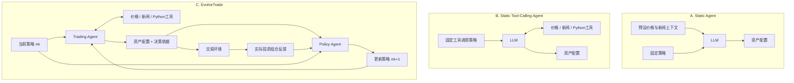
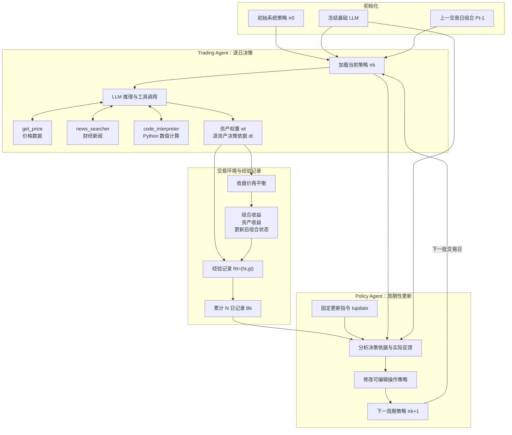
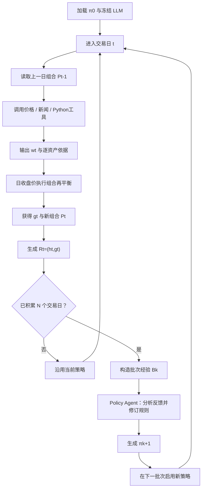
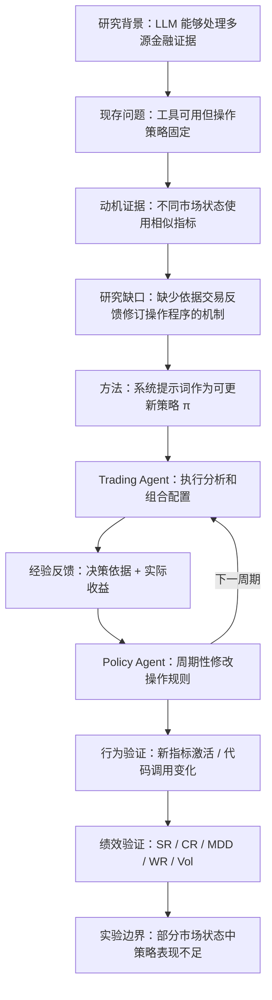

```

```

```

```


```


```

# EvolveTrade：基于交易经验驱动策略优化的自进化大语言模型交易智能体

**论文超详细结构化精读｜原文 v1｜面向技术理解与实验复现**

## 论文基础信息


| 项目       | 信息                                                                                                  |
| ---------- | ----------------------------------------------------------------------------------------------------- |
| 论文标题   | *EvolveTrade: Experience-Driven Policy Refinement for Self-Evolving LLM Trading Agents*               |
| 中文标题   | EvolveTrade：基于经验驱动策略优化的自进化大语言模型交易智能体                                         |
| 作者       | Sehee Kim, Yumin Choi, Minki Kang, Sung Ju Hwang                                                      |
| 机构       | KAIST；Sung Ju Hwang 同时隶属于 DeepAuto.ai                                                           |
| 发表状态   | arXiv 预印本 v1                                                                                       |
| 首次提交   | 2026 年 9 月 15 日                                                                                    |
| 学科分类   | Artificial Intelligence（cs.AI）；Computation and Language（cs.CL）                                   |
| 原文       | https://arxiv.org/html/2609.17632v1                                                                   |
| PDF        | https://arxiv.org/pdf/2609.17632v1                                                                    |
| 代码       | 原文未提供可确认的官方代码仓库链接                                                                    |
| 核心关键词 | LLM Trading Agent、Self-Evolution、Policy Refinement、Tool Use、Trading Experience、Online Adaptation |

**TLDR：** 论文提出 EvolveTrade，将交易智能体的系统提示词视为可更新的自然语言策略，通过周期性分析历史决策依据与实际投资组合反馈，让独立的 Policy Agent 持续优化 Trading Agent 的工具调用、证据验证和风险控制流程，在不更新大模型参数的前提下实现交易策略的在线自进化。

【核心定位：**论文的创新不在于训练新的金融大模型，也不在于直接预测收益率，而在于将交易经验转化为可复用的决策程序改进，使智能体能够改变“如何分析市场和使用工具”，而不仅是改变“下一笔交易买什么”。**】

---

# Abstract

## 摘要：核心内容与研究定位

现有大语言模型交易智能体能够整合金融市场价格、新闻信息和可执行分析工具，但其实际决策行为通常受到部署前人工编写的静态工具使用策略约束。这种预先固定的策略决定了智能体如何获取信息、调用工具、验证信号以及管理投资组合风险。当市场环境发生变化时，即使底层大模型具备广泛的金融知识和分析能力，智能体也难以自主调整其信息处理与决策程序。因此，论文将研究重点从提升大模型本身的金融推理能力转向优化智能体在持续交易过程中采用的操作策略。

【研究背景界定：**作者将金融智能体的适应性问题具体定位为静态操作策略造成的分析能力受限，而不是简单归因于大模型缺少金融知识、上下文信息或工具。**】

为解决这一问题，论文提出 EvolveTrade，核心思想是将 Trading Agent 的系统提示词建模为文本参数化策略（Text-Parameterized Policy）。系统在每个预设更新周期结束后，由独立的 Policy Agent 读取此前交易产生的资产配置记录、逐资产决策依据以及事后投资组合反馈，并据此修改下一周期使用的系统提示词。整个过程中，底层大语言模型的参数和外部工具接口始终保持不变，只有控制信息获取、分析验证和组合构建的自然语言策略被动态更新。

【方法创新定位：**论文将在线学习的对象限定为系统提示词所表示的操作程序，使交易智能体能够在不进行梯度训练或参数微调的情况下，从自身运行反馈中持续修正决策行为。**】

作者采用两个大模型主干、六个不同市场环境窗口，对 EvolveTrade 与静态交易智能体及其他策略演化方法进行比较。实验表明，EvolveTrade 在部分市场环境下显著改善夏普比率与累计收益，并在多数测试窗口优于静态工具调用基线，但并非始终取得最优表现。进一步的行为分析显示，策略演化不仅改变了交易结果，还改变了智能体实际调用的金融指标和工具使用频率，例如增加代码执行分析，并在特定市场环境中启用原有静态智能体从未使用的风险与趋势指标。

【实证论证目的：**摘要建立“策略更新—分析行为变化—资产配置变化—投资结果变化”的证据链，同时将结论限定为多市场环境下的经验性改善，而非保证自进化方法在所有市场状态中占优。**】

---

# 1 Introduction

## 1.1 研究背景：从语言推理能力到金融序贯决策能力

大型语言模型在自然语言理解、复杂推理、指令执行与异构信息整合方面取得了进展，为构建能够自主分析金融市场的智能体提供了技术基础。不同于传统仅利用价格和成交量的数值模型，LLM 可以同时理解财经新闻、市场叙事、金融指标和外部工具返回的信息，使交易决策从固定数值映射扩展为多证据、多步骤的推理过程。

【背景铺垫：**引言首先确认大语言模型具备处理复杂金融信息的技术潜力，为后文讨论自主交易智能体提供基础，而没有直接假定语言推理能力必然转化为交易收益。**】

然而，金融市场决策具有连续性、反馈滞后性和非平稳性。智能体必须在不同交易日反复获取信息、辨别噪声信号、处理相互冲突的市场证据，并根据已经形成的持仓承担后续风险。一次决策是否有效，往往需要在之后的市场变化中才能得到部分验证，而且盈利与亏损本身并不能直接证明决策程序是否正确。因此，金融智能体面临的问题不仅是单次回答质量，而是长期连续运行中的程序适应能力。

【任务特殊性：**作者借助金融决策的非平稳性和事后反馈的不确定性，将研究问题从静态金融问答推进到具有连续状态、工具行为和外部结果反馈的序贯决策任务。**】

## 1.2 现有进展：从静态信息输入到自主工具调用

已有研究逐步发展出两种交易智能体范式。第一种范式由外部系统预先收集价格、新闻和组合状态，再将这些信息作为固定观察上下文提供给 LLM，由模型在给定信息范围内完成分析和交易判断。第二种范式进一步赋予 LLM 主动调用市场数据接口、新闻搜索和分析工具的能力，使其能够根据任务自行补充信息。

【研究演进梳理：**作者通过区分固定观察式智能体与自主工具调用式智能体，建立后续比较的技术层次：信息是预先提供的，还是由模型主动获取的。**】

工具调用确实扩大了智能体可以访问的信息和计算能力，但工具可用不等于工具使用合理。交易智能体仍然需要决定应该检索哪些数据、使用多长的历史价格窗口、计算哪些风险指标、如何验证新闻与价格信号之间的关系，以及何时减少或增加风险暴露。如果这些规则在部署前就被写入系统提示词，并在后续运行过程中保持不变，那么智能体虽然能够调用工具，其实际分析程序却可能长期停留在开发者预设的范围内。

【核心矛盾揭示：**论文将“具有工具使用能力”和“能够根据经验改进工具使用方式”严格区分，指出工具扩展解决的是能力可达性，策略适应解决的则是能力如何被有效组织和激活。**】

## 1.3 研究缺口：Static Policy 限制动态分析能力

论文认为，静态工具使用策略是现有 LLM 交易智能体的重要瓶颈之一。固定提示词通常明确规定价格回溯窗口、需要计算的金融指标、新闻检索方式以及组合输出结构。模型因此可能在震荡、下跌和上涨市场中反复执行相同的分析步骤，而不会主动根据历史交易结果重新评价这些步骤是否仍然适用。

【研究缺口构建：**作者并未否认固定流程具有可控和稳定的优势，而是强调其缺少基于实际运行经验修订分析程序的机制，进而造成不同市场环境下的分析覆盖范围趋同。**】

这一缺口决定了本文的研究对象。作者认为，相比直接记忆某次交易结果或者针对下一交易日临时改变持仓，更值得持续优化的是一套能够跨交易日重复使用的程序规则。例如，模型应当在什么条件下计算尾部风险、是否必须验证新闻信号、怎样利用不同时间跨度的收益指标调整仓位，以及何时需要执行组合级约束检查。这些规则决定了后续一系列交易决策的形成方式。

【优化对象转移：**论文将优化目标从单次交易动作提升到生成交易动作的可复用程序，体现了从行动层适应向程序层适应的研究定位。**】

## 1.4 核心方案：EvolveTrade 的在线策略自进化

针对上述问题，EvolveTrade 引入独立的 Policy Agent，使交易系统形成两个相互衔接的环节：Trading Agent 根据当前系统提示词执行市场分析和资产配置，Policy Agent 则在交易完成并获得真实反馈后，检查已有策略与实际决策行为之间的联系，并重写下一周期使用的提示词。

这种更新并不改变 LLM 的神经网络参数，也不修改价格接口、新闻搜索工具或代码解释器，而是修改支配这些工具如何参与决策的自然语言操作规则。因此，整个系统的演化表现为连续的策略文本变化，而非传统意义上的模型再训练。

【机制引入：**作者通过引入独立策略更新智能体，将执行交易与修订交易程序分离，使系统能够在固定基础模型上实现外部策略层面的持续适应。**】

## 1.5 Figure 1：三类交易智能体的概念差异

原文 Figure 1 对比三种系统：


| 维度          | (A) Static Agent   | (B) Static Tool-Calling Agent | (C) EvolveTrade    |
| ------------- | ------------------ | ----------------------------- | ------------------ |
| 市场数据      | 外部系统预先提供   | 智能体主动检索                | 智能体主动检索     |
| 新闻数据      | 预设观察内容       | 智能体主动检索                | 智能体主动检索     |
| 代码工具      | 不使用             | 可使用                        | 可使用             |
| 决策依据      | 固定上下文与提示词 | 固定操作策略                  | 动态更新的操作策略 |
| 交易经验反馈  | 不用于更新程序     | 不用于更新程序                | 用于策略更新       |
| 系统提示词    | 固定               | 固定                          | 按周期演化         |
| 基础 LLM 参数 | 固定               | 固定                          | 固定               |

【图示解读：**Figure 1 采用逐层增加系统能力的比较方式，突出 EvolveTrade 相对于工具调用智能体新增的是反馈驱动的策略更新环节，而非额外增加一种市场信息来源。**】

以下 Mermaid 对应 Figure 1 的三种信息流，属于根据原文模块关系进行的结构化重建。



【结构创新解读：**从 A 到 B 的变化是信息获取方式的自主化，从 B 到 C 的变化则是操作程序本身的可学习化；第三种系统额外建立了决策记录与实际结果共同驱动的策略反馈回路。**】

## 1.6 贡献预览

论文的主要贡献可以归纳为三个层次。首先，将系统提示词明确建模为可在线更新的文本策略，使冻结参数的大模型具备程序级自进化能力。其次，提出基于逐资产决策依据与事后组合表现的策略更新方法，将交易经验转换为后续工具调用、证据验证和风险配置规则的调整。最后，通过多个市场窗口中的收益比较、指标调用热力图、工具调用频率和具体持仓案例，检验策略演化是否真正改变模型的行为及其经济结果。

【贡献组织逻辑：**引言的贡献按照“新优化对象—新反馈更新机制—行为与绩效验证”展开，使读者能够区分方法层创新与实验层证据。**】

---

# 2 Related Work

原文相关工作分为两个研究方向：*LLM Agents for Financial Trading* 与 *Self-evolving LLM Agents*。前者说明现有金融交易智能体的能力边界，后者说明语言模型及其工作流如何利用反馈进行持续优化。

【综述结构定位：**作者并未按照技术模型逐篇排列文献，而是围绕应用领域和自进化方法建立两个研究脉络，最终将二者交汇处确定为本文的创新位置。**】

## 2.1 LLM Agents for Financial Trading

金融交易智能体研究已经从单个语言模型的市场解释发展为具有记忆、工具、专业角色和复杂执行流程的系统。


| 研究方向           | 原文代表工作                                  | 核心设计                     | 主要能力                 | 相对于本文研究问题的不足               |
| ------------------ | --------------------------------------------- | ---------------------------- | ------------------------ | -------------------------------------- |
| 记忆增强           | FinMem                                        | 分层保存历史市场观察         | 利用跨会话市场信息       | 记忆增强不等同于更新工具使用程序       |
| 多智能体协作       | TradingAgents、TradExpert                     | 专业角色分工与协商           | 多视角分析与决策         | 角色结构或分析流水线通常预先定义       |
| 模拟环境与交易代理 | StockAgent、QuantAgent                        | 交易环境及代理式决策         | 在金融任务中执行序贯操作 | 并不必然具备在线程序改写能力           |
| 多模态与工具增强   | FinAgent 及相关平台                           | 多源信息与金融工具整合       | 扩展信息覆盖和执行能力   | 工具可用性与工具调用策略适应是不同问题 |
| 真实环境评估       | AI-Trader、LiveTradeBench、FinAgentBench      | 接近实际市场的任务与评价     | 检验交易表现及运行能力   | 重点在评估，未直接解决策略持续更新     |
| 可靠性研究         | 文献中的来源可信性、Ticker 记忆与时间泄漏研究 | 分析金融智能体的潜在错误来源 | 识别金融推理可靠性风险   | 不直接提供在线修改操作程序的机制       |

【文献分类依据：**这些研究分别提高了信息保留能力、任务分工能力、工具可用性和评估真实性，但作者强调，丰富的信息来源及复杂的角色结构并不必然解决静态操作策略在环境变化时的适应性问题。**】

这一研究方向的共同缺口是：智能体通常能够依据观察结果生成不同交易动作，但控制这些动作如何产生的系统级程序，例如何时使用某种指标、何时交叉验证市场证据、如何组织工具调用，仍由开发者在部署前规定。论文因此将后续改进对象明确限定为操作层面的策略程序，而不是简单追加更多记忆或市场数据。

【综述收束：**金融智能体研究证明了 LLM 可以执行复杂交易分析，却没有充分证明其能够从自身交易经验中持续优化信息获取与验证程序，为引入在线策略更新提供了依据。**】

## 2.2 Self-evolving LLM Agents

第二类文献关注 LLM 系统如何根据执行轨迹、任务表现和外部反馈改进后续行为。ReAct 和 Toolformer 等工作为工具使用与语言推理的结合提供基础，而之后的研究进一步将优化对象扩展到提示词、工作流、经验记忆和智能体决策程序。


| 方法类别           | 代表方法                           | 自适应对象               | 方法特征                     | 本文强调的区别                                       |
| ------------------ | ---------------------------------- | ------------------------ | ---------------------------- | ---------------------------------------------------- |
| 提示词与程序优化   | ProTeGi、DSPy、TextGrad 等相关方向 | 提示词、LM 程序          | 从反馈中优化指令或执行程序   | 通常不专门建模部署期间的金融交易反馈闭环             |
| 工作流搜索与演化   | AFlow 等                           | 工作流结构               | 搜索或演化多步骤执行流程     | 不以交易智能体在线操作策略更新为核心                 |
| 反思与经验记忆     | Reflexion 及相关工作               | 反思记录、经验、推理程序 | 将成功和失败转换为可复用经验 | 与直接改写当前系统操作策略存在差别                   |
| 金融策略自适应     | ATLAS、SHARP                       | 交易提示词或结构化策略   | 依据市场反馈改进策略         | 并非都聚焦可调用工具的全流程在线更新                 |
| 工具组织与策略优化 | AlphaQuanter、FLAG-Trader          | 工具编排或策略机制       | 改善工具使用或交易决策       | 与持续依据自身实际交易轨迹改写完整操作程序的目标不同 |

【方法谱系解读：**作者将已有自进化研究按优化对象进行区分，说明“会反思”“有经验记忆”“能优化提示词”与“能在部署过程中持续改写金融操作程序”并不是完全相同的技术命题。**】

EvolveTrade 与这些研究的核心区别，在于将部署中的 Trading Agent 的当前系统提示词直接作为可变策略，并用该智能体自身产生的决策记录及其后续组合表现作为更新依据。更新内容不限于高层交易观点，还可以涉及价格回溯方式、工具调用顺序、风险指标选择、跨来源验证规则以及最终权重生成程序。

【研究缺口定位：**本文强调同时满足在线更新、实际交易反馈、可调用工具和操作程序级优化四个特征，将策略演化落实为运行过程中的程序修订，而不仅是离线搜索或经验文本累积。**】

需要区分原文论断与文献事实：论文确实将上述区别作为自身创新定位，但这并不意味着所有既有方法均完全缺少在线适应能力。ATLAS、SHARP 等已有策略自适应研究，因此本文的差异更准确地落在可修改操作程序的范围、反馈来源以及对工具调用行为的具体优化上。

【综述准确性边界：**本文的研究贡献应理解为特定金融智能体架构与反馈机制的组合改进，而不应扩大表述为首次提出提示词进化或首次研究交易智能体自进化。**】

---

# 3 Problem Setup: Tool-Using Trading Agent

## 3.1 任务形式化：连续交易决策

论文首先定义一个由交易日 $t=1,\ldots,T$ 组成的序贯决策环境。每个交易日开始时，Trading Agent 的初始化状态包含当前操作策略、交易日期、上一日投资组合状态和可用工具集合：

$$
S_t=(\pi_t,t,P_{t-1},\mathcal T)
\tag{1}
$$

其中，$\pi_t$ 表示第 $t$ 日生效的自然语言操作策略，$P_{t-1}$ 表示前一交易日的组合状态，$\mathcal T$ 表示外部工具集合。传统静态方法中，所有交易日使用相同的 $\pi_0$；EvolveTrade 则允许该策略随着历史交易经验持续更新。

【状态建模作用：**通过将系统提示词直接纳入交易智能体的状态定义，论文为后文的策略更新建立了统一数学对象，也使固定策略与自进化策略可以在同一决策环境下进行比较。**】

## 3.2 文本策略与冻结大模型之间的关系

论文将 LLM 的参数记为 $\theta$，对应固定的模型 $p_\theta$。交易动作的生成不仅取决于大模型参数，还取决于当前上下文、外部工具以及系统提示词 $\pi_t$。因此，改变 $\pi_t$ 可以在不改变模型参数的情况下，影响大模型搜索哪些信息、计算哪些指标以及如何确定最终投资组合。

$$
\theta_t=\theta_0,\qquad
\mathcal T_t=\mathcal T_0,\qquad
\pi_t\ \text{可更新}
$$

以上是对原文固定参数与固定接口设定的概括，并非原文单列的公式。

【参数边界澄清：**所谓 Self-Evolving 并非神经网络权重自更新，而是在模型参数及工具接口均冻结的条件下，通过自然语言系统策略的变化实现运行行为适应。**】

## 3.3 三类外部工具

本文实际实现的工具集合为：

$$
\mathcal T=\left\{t_{\mathrm{price}},t_{\mathrm{news}},t_{\mathrm{code}}\right\}
$$


| 工具              | 原文实现名称       | 输入与功能                                          | 决策作用                             |
| ----------------- | ------------------ | --------------------------------------------------- | ------------------------------------ |
| 市场价格获取      | `get_price`        | 按股票与日期范围检索历史日收盘价                    | 提供可计算的市场数据                 |
| 财经新闻搜索      | `news_searcher`    | 检索资产及宏观经济相关信息                          | 补充定性证据与市场背景               |
| Python 代码解释器 | `code_interpreter` | 执行 Python，支持通过内置`get_price` 获取 DataFrame | 计算收益、风险、相关性及组合分析指标 |

代码解释器使用持久化内核，并提供可直接从 Python 环境获取价格数据的函数。与静态观察式方法不同，Trading Agent 并非只能消费事先注入的价格与新闻上下文，而是能够在推理过程中主动决定调用工具并处理其返回结果。

【工具接口设计：**三个工具分别对应结构化行情数据、非结构化市场信息和可执行数值分析，使智能体能够形成数据获取、指标计算、证据综合及权重决策的完整信息处理链。**】

## 3.4 交易动作与资产配置约束

智能体在每日决策结束时输出一个投资组合权重向量：

$$
w_t\in\mathcal W
$$

其中，$\mathcal W$ 表示满足约束的投资组合集合。本文实验主要采用仅允许非负权重的多头组合，并包含现金资产。对应的基本可行性条件可以写成：

$$
w_{i,t}\geq 0,\qquad \sum_i w_{i,t}=1
$$

这一约束意味着不使用负权重表示卖空，并要求股票和现金的配置比例之和为 100%。需要注意，论文对规则型基线额外规定了每只股票 $1/15$ 的持仓上限，但不能将该上限误认为所有 LLM 方法都采用的统一约束。

【决策空间定义：**作者将 LLM 生成的自然语言交易判断转化为满足组合约束的权重向量，使模型行为能够进入标准化的资产配置回测环境进行绩效评价。**】

## 3.5 决策轨迹：将交易结果与生成依据绑定

Trading Agent 不仅需要输出组合权重，还必须提供针对每项资产的决策依据。论文定义：

$$
h_t=(w_t,d_t^{\mathrm{dec}})
\tag{2}
$$

其中，$w_t$ 是资产配置结果，$d_t^{\mathrm{dec}}$ 是逐资产决策理由。后者用于记录智能体如何利用金融证据解释对应权重，使后续 Policy Agent 不必仅根据每日收益猜测决策过程。

【可追溯性设计：**逐资产决策依据构成经验更新的解释性输入，它把最终资产权重与前序分析行为联系起来，为后续定位操作策略的潜在缺陷提供依据。**】

需要特别指出，原文形式化定义的 $h_t$ 仅包含配置结果及逐资产理由。论文虽然使用 tool-use traces 或 trajectories 描述智能体运行经验，但并没有在这一公式中显式定义完整的原始工具调用日志，因此复现时不能自行假定 Policy Agent 一定接收全部 Python 执行记录和 API 返回原文。

【形式化边界辨析：**应区分智能体实际运行时存在的工具交互与策略更新器被明确定义为接收的记录内容，以避免在复现中引入原文未确认的额外输入。**】

---

# 4 Motivation: Static Policy Locks the LLM into a Fixed Analytic Coverage

## 4.1 动机实验设置

作者并未直接进入自进化方法设计，而是首先构建一项诊断实验，用以检验静态操作策略是否真的限制了交易智能体的分析方式。实验使用 GPT-5-mini 作为主干模型，固定系统提示词 $\pi_t\equiv\pi_0$，并选择三种不同的市场环境：2025 年 1 月的震荡行情、2025 年 4 月的显著下跌及 V 形恢复行情，以及 2025 年 9 月的持续上涨行情。

作者关注的主要对象不是最终收益，而是智能体在 Python 代码解释器中实际调用了哪些金融分析指标，以及这些指标是否随市场状态发生变化。

【动机验证设计：**通过固定模型和策略、改变外部市场环境，作者试图识别静态提示词是否使智能体在不同状态下重复采用相同的分析工具和指标集合。**】

## 4.2 Figure 2：静态策略下的指标调用热力图

Figure 2 使用三个按月份划分的热力图展示指标调用行为。每张图的横轴是该月连续交易日，纵轴是金融分析指标，并按总体调用频率排序。某一日期与指标对应的单元格表示该日是否在 Python 工具调用中使用对应指标，右侧数字则统计相应指标在该市场窗口内出现的交易日数量。

原文显示，五个核心指标在三种市场状态下始终占据主导地位：


| 指标                  | 含义                 | 静态智能体表现 |
| --------------------- | -------------------- | -------------- |
| Sharpe                | 风险调整后收益表现   | 高频使用       |
| 20-day Return         | 过去 20 个交易日收益 | 高频使用       |
| 60-day Return         | 过去 60 个交易日收益 | 高频使用       |
| Annualized Volatility | 年化收益波动率       | 高频使用       |
| Drawdown              | 资产或组合回撤       | 高频使用       |
| Correlation           | 资产相关性           | 偶尔使用       |
| ATR                   | 平均真实波幅         | 偶尔使用       |
| Momentum              | 动量指标             | 偶尔使用       |
| RSI                   | 相对强弱指标         | 未实际使用     |
| EMA                   | 指数移动平均         | 未实际使用     |
| VaR                   | 在险价值             | 未实际使用     |
| Signal Normalization  | 信号归一化           | 未实际使用     |

前五个指标的调用覆盖率约为各市场窗口交易日的 90%–100%。尽管三个窗口的市场走势明显不同，指标组合仍高度相似。新闻检索也趋于固定的股票代码及新闻关键词组合，价格数据回溯窗口基本维持在约六个月。

【图表发现：**Figure 2 证明静态智能体的指标调用具有明显的跨市场状态重复性：实际分析覆盖范围主要由初始提示词确定，而非根据不同市场环境充分重组。**】

## 4.3 静态分析程序为什么存在局限

作者进一步指出，2025 年 4 月市场出现约 -9.8% 的下跌，而 2025 年 9 月表现为持续上涨，两种环境下有用的分析指标并不完全相同。对于较大下跌风险，VaR 等风险度量可能提供更多信息；对于趋势明显的市场，EMA、SMA 和 RSI 等技术指标则可能帮助刻画价格方向与动量状态。固定提示词却使智能体长期重复计算相同的基础指标，没有主动扩展这些分析维度。

【机制问题定位：**作者利用不同市场状态下分析需求的差异，说明静态策略导致的不只是工具调用次数固定，更是分析指标集合缺少针对市场情境的调整。**】

更关键的问题是，已有交易结果无法反向修订这一程序。即使某个市场窗口中的收益表明某种信号组合失效，静态智能体下一次仍可能重复执行同样的检索和分析流程。因此，作者认为需要一种周期性策略更新机制，将事后交易经验转化为针对未来信息获取和决策行为的程序调整。

【方法引出：**本节将观察到的分析行为固定化现象转化为方法需求：系统必须能够利用历史决策与真实反馈，调整后续金融指标选择、工具使用方式和组合决策规则。**】

---

# 5 EvolveTrade

## 5.1 方法总体设计

EvolveTrade 的核心是一个双智能体在线更新架构。系统包含负责日常投资组合决策的 Trading Agent，以及负责周期性修改操作策略的 Policy Agent。两者使用相同的基础模型系列，但承担不同任务：Trading Agent 在当前策略约束下调用外部工具、分析市场、输出权重；Policy Agent 则利用已完成交易的决策依据和实际收益反馈，识别当前策略中值得保留或需要修订的程序规则，并生成下一版本的提示词。

【架构设计原则：**EvolveTrade 将交易执行与程序更新分离，通过共享的文本策略连接两个智能体，使反馈信息能够在不修改基础模型参数的情况下影响后续交易行为。**】

方法可以理解为两个时间尺度不同的决策过程。内层是每天运行的市场分析和资产配置过程，外层是每隔若干交易日执行一次的策略更新过程。在同一更新周期中，策略文本保持不变；完成该周期后，Policy Agent 根据累计经验修订策略，并将新策略投入下一周期。论文将这种过程称为 Online Policy Self-Evolution。

【双时间尺度设计：**内层负责在已有规则下形成具体交易动作，外层负责根据多次动作及其结果调整规则本身，避免将每个交易日的持仓变化误认为系统策略已经发生进化。**】

## 5.2 核心架构与完整数据流

依据原文 Section 3、Section 5、Figure 1 以及附录中的操作提示词，可以将 EvolveTrade 的系统结构复刻如下。



图中的“冻结基础 LLM”表示各实验运行期间基础模型参数固定；Trading Agent 与 Policy Agent 使用同一主干模型，但执行独立的任务调用。“下一周期策略”表示经过更新的系统操作指令，而不是新训练得到的模型参数。

【全局架构解读：**信息流依次经历市场数据检索、工具辅助推理、资产配置、交易执行、结果反馈、经验汇总和策略重写。反馈形成的是跨交易周期的程序更新闭环，不是直接通过交易收益对基础模型进行反向传播。**】

## 5.3 Trading Experience as Policy Feedback

### 5.3.1 为什么不能直接用收益更新策略

交易结果存在噪声和归因歧义。某次交易亏损可能来自不充分的信息获取，也可能来自无法预测的市场冲击；某次交易盈利也可能是市场方向恰好有利，而非分析程序正确。因此，单独使用收益率作为策略修订依据，容易将随机的价格波动误认为某项工具使用规则有效或无效。

【反馈信号辨析：**作者承认金融收益并不是直接、无噪声的策略质量标签，因此不能简单地根据某笔交易盈利或亏损决定增加或删除对应操作规则。**】

### 5.3.2 交易后反馈的定义

当交易智能体生成权重 $w_t$ 并完成对应交易后，环境将投资组合状态从 $P_{t-1}$ 更新为 $P_t$，同时产生交易后反馈 $g_t$。论文规定该反馈记录包含当日投资组合收益、各可交易资产收益，以及更新后的资产配置与组合状态。

$$
g_t=\{\text{组合收益、逐资产收益、配置与组合状态}\}
$$

这里使用集合形式概括反馈字段；原文并未为 $g_t$ 给出更细的数学元组表达。

【反馈内容设计：**作者同时记录组合层面的实际表现和资产层面的收益变化，使后续分析不仅可以判断组合整体结果，还可以结合具体资产权重解释收益差异。**】

### 5.3.3 联合决策轨迹与实际收益

EvolveTrade 将每日的决策轨迹与事后反馈绑定：

$$
\mathcal R_t=(h_t,g_t)
$$

其中：

$$
h_t=(w_t,d_t^{\mathrm{dec}})
$$

因此，单个经验记录至少建立了三种信息之间的联系：最终采取了什么资产配置、智能体给出了什么决策依据，以及事后实际出现了什么市场与投资组合结果。


| 记录层次 | 变量                 | 具体内容                     | 对策略更新的作用             |
| -------- | -------------------- | ---------------------------- | ---------------------------- |
| 决策结果 | $w_t$                | 逐资产组合权重               | 明确实际采取的配置动作       |
| 决策依据 | $d_t^{\mathrm{dec}}$ | 逐资产证据和配置理由         | 识别生成动作所依赖的分析逻辑 |
| 实际反馈 | $g_t$                | 组合收益、资产收益、组合状态 | 提供事后评价背景             |
| 联合经验 | $\mathcal R_t$       | 决策轨迹与交易反馈           | 支持操作程序问题诊断         |

【经验表示机制：**将决策依据与交易结果配对，是从纯粹结果驱动转向结果与过程联合分析的关键，使更新器能够讨论哪些分析行为可能需要修订。**】

### 5.3.4 从经验记录到程序性改进

论文希望 Policy Agent 不仅识别单次交易中哪些资产上涨或下跌，还能够从决策记录中寻找可能具有重复性的程序缺陷。例如，当历史轨迹表明智能体经常依据新闻信号直接增加某项资产配置，却没有进行价格层面的交叉验证时，策略更新器可以在后续提示词中加入增加仓位前的信号验证要求。

这里的“新闻验证规则”是论文用于解释更新机制的示例，并不是一项固定在所有演化策略中的统一规则。

【程序修订逻辑：**经验记录的最终用途并非重写上一笔交易结论，而是将可定位的决策问题转化为未来多个交易日可以重复执行的工具调用和证据验证规则。**】

## 5.4 Online Policy Self-Evolution

### 5.4.1 固定周期的批量策略更新

论文设置策略更新间隔 $N\geq1$，表示每经过 $N$ 个交易日才允许执行一次提示词更新。交易周期被划分为多个批次，第 $k$ 个批次覆盖：

$$
t=(k-1)N+1,\ldots,kN
$$

同一批次内所有交易日使用完全相同的策略：

$$
\pi_{(k-1)N+1}=\cdots=\pi_{kN}
$$

实验的默认设置是 $N=5$，即每五个交易日更新一次系统操作策略，而不是每天自动改写。

【更新频率控制：**批量更新让 Policy Agent 在一次修订前积累多日决策与收益反馈，避免系统策略因单一交易日的随机结果频繁改变。**】

### 5.4.2 批次经验的构建

在第 $k$ 个交易批次结束时，系统收集该批次内所有每日经验记录：

$$
\mathcal B_k=\left\{\mathcal R_{(k-1)N+1},\ldots,\mathcal R_{kN}\right\}
\tag{3}
$$

其中，$\mathcal B_k$ 是本次 Policy Agent 更新时使用的交易经验集合。在本文的默认设置下，一个完整批次包含五个交易日的经验记录。

【时间窗口设计：**批次经验为策略修订提供一个固定长度的近期反馈窗口，使更新依据从单日事件扩展为一个局部连续交易过程。**】

### 5.4.3 策略更新函数

论文将策略更新表示为：

$$
\pi_{kN+1}=f_{\mathrm{update}}(\pi_{kN},\mathcal B_k)
\tag{4}
$$

其中，$\pi_{kN}$ 是当前批次最后一个交易日使用的策略，$\mathcal B_k$ 是该批次积累的经验集合，而 $\pi_{kN+1}$ 则是下一批次第一个交易日开始使用的新策略。

这一公式的本质是一个以历史策略和近期反馈为输入、以更新策略文本为输出的映射过程。它没有要求策略必须沿某个数值梯度方向更新，也没有定义显式的强化学习奖励梯度或神经网络参数优化步骤。

【优化机制定义：**策略演化被实现为离散的自然语言程序修订过程，更新方向由 Policy Agent 对交易经验的解释决定，而非传统梯度下降计算。**】

### 5.4.4 Policy Agent 的实际实现

更新函数通过一次 LLM 调用实现：

$$
f_{\mathrm{update}}(\pi,\mathcal B)=\mathrm{LLM}(I_{\mathrm{update}},\pi,\mathcal B)
\tag{5}
$$

这里，$I_{\mathrm{update}}$ 是固定的策略更新指令，用于规定 Policy Agent 如何利用交易经验修改现有策略。每次更新时，Policy Agent 需要读取当前策略和近期交易记录，找出可能影响表现的具体操作规则，并返回更新后的策略内容。

【实现方式澄清：**Policy Agent 本身不是通过训练得到的专门优化网络，而是使用冻结大模型执行一次受固定更新指令约束的策略分析和文本生成调用。**】

## 5.5 Policy Agent 的内部处理机制

### 5.5.1 经验分析与规则归因

Policy Agent 首先比较当前策略中的操作要求、逐资产决策依据及交易后的实际表现，寻找具体决策行为与操作规则之间的联系。论文要求更新依据尽可能明确，能够指出某条规则如何可能影响某次证据收集、信号判断或仓位分配，而不是直接根据收益好坏给出笼统建议。

【规则归因设计：**将已有提示词与实际决策行为对应起来，是从抽象绩效反馈转化为可修改程序位置的必要步骤。**】

### 5.5.2 基于证据的定向修订

更新提示词明确要求优先执行具有具体证据支持的编辑，并避免没有交易记录支持的泛化重写。Policy Agent 可以修改的内容包括工具选择方式、数据查询规则、信号解释方法、交叉验证程序、风险控制要求以及最终输出结构。

这意味着 EvolveTrade 不只优化金融市场判断结论，还能够改变后续计算和验证这些判断所依赖的程序。

【可编辑范围设计：**论文允许操作策略跨多个分析环节发生变化，以避免自进化能力仅局限于信号权重或持仓比例等高层交易规则。**】

### 5.5.3 输出更新后的策略文本

附录 Figure 9 给出的更新提示词要求 Policy Agent 输出一个 JSON 对象，主要包含 `reasoning` 和 `policy` 两个字段。前者用于解释观察到了哪些交易行为、为何需要修改对应规则以及具体做了什么修改；后者用于承载完整的更新策略文本。


| 输出字段    | 作用                         | 所在层次     |
| ----------- | ---------------------------- | ------------ |
| `reasoning` | 记录反馈分析与规则修订理由   | 更新过程解释 |
| `policy`    | 保存下一周期可执行的操作策略 | 更新结果     |

【更新结果结构：**通过将更新依据与更新后的策略分开保存，论文使策略演化不仅有新的文本结果，也保留了用于解释规则变化的分析内容。**】

## 5.6 可更新策略与固定约束的区别

虽然正文将 EvolveTrade 描述为对完整操作策略进行修改，但附录 Figure 9 显示，实验实现中存在明确的固定约束区块（Fixed Block）。Policy Agent 不应复制或改写这一固定区块，而应只修改可编辑的策略部分；系统之后会自动将固定约束附加到更新结果中。

固定区块包括可交易资产、组合权重求和约束、输出 JSON 的最低要求、价格与新闻数据的时间可用性、现金资产处理以及以前一日组合为基准控制不必要换手等规则。

【约束边界说明：**EvolveTrade 所谓完整策略更新，是相对于 EvolveStrategy 仅允许修改高层策略部分而言；实验实现仍保留不可更新的环境约束，并未允许 Policy Agent 任意改写所有系统规则。**】

## 5.7 初始 Trading Agent 策略的可复现细节

根据附录 Figure 8，EvolveTrade 的初始提示词包含以下明确要求。


| 设计项   | 原文设置                                        |
| -------- | ----------------------------------------------- |
| 角色     | Professional Portfolio Manager                  |
| 工具调用 | 生成最终配置前必须使用全部三种工具              |
| 价格检索 | 对全部股票一次性检索，历史回溯窗口为 3–12 个月 |
| 代码计算 | 至少计算 20 日收益、年化波动率、Sharpe Ratio    |
| 扩展计算 | 可计算 60 日收益、动量、回撤等其他指标          |
| 新闻搜索 | 对各资产进行搜索，可补充宏观经济关键词          |
| 决策记录 | 每项资产提供单行证据与权重理由                  |
| 输出格式 | JSON，至少包含`allocations`                     |
| 数据约束 | 价格可用至交易日，新闻最多可用至前一交易日      |
| 现金处理 | `CASH` 价值保持 1.0，不调用价格工具             |
| 权重限制 | 所有资产权重之和必须等于 1                      |
| 换手控制 | 参考上一日组合，仅在分析支持必要调整时改变权重  |

【初始策略复现：**这些规定构成自进化过程的初始行为约束，特别是三种工具的强制调用、基础指标要求和数据截止日期，决定了初始智能体能够执行的分析范围。**】

## 5.8 一次完整自进化周期的运行过程

下图将每日交易循环与五日策略更新循环结合，重点展示原文公式对应的先后关系。



【闭环运行解读：**一次交易只产生新的组合状态与经验记录，只有累积达到更新间隔后才产生新操作策略；因此交易决策频率与策略演化频率在系统中是两个独立控制量。**】

## 5.9 演化策略实例：从基础指标计算到约束化组合调整

附录 H 展示了实验中表现较好的演化策略文本。GPT-5-mini 在 2025 年 1 月的一份策略样例已经不再局限于初始提示词要求的基础指标，而是扩展为多时间跨度金融分析、组合边际收益风险计算、优化器一致性检验和显式风险约束的复杂操作程序。


| 演化内容       | 附录策略样例                                 |
| -------------- | -------------------------------------------- |
| 多时间尺度收益 | 20 日、60 日和 120 日收益                    |
| 波动率         | 至少计算 20 日和 60 日年化波动率             |
| Sharpe 计算    | 60 日为主要窗口，20 日辅助比较               |
| 组合协方差     | 默认使用 252 个交易日                        |
| 协方差稳健化   | 包含样本协方差与对角矩阵的 98%/2% 收缩变体   |
| 数值稳定性     | 针对边际 Sharpe 与优化计算要求多次确定性运行 |
| 单资产上限     | 15%                                          |
| 前三大持仓     | 总权重不超过 40%                             |
| 持仓数量       | 至少 6 只股票                                |
| 高波动资产     | 默认限制为 8%，例外情形需要附加证据          |
| 现金配置       | 常规区间为 3%–15%，特定波动紧急情形可提高   |
| 再平衡纪律     | 设置调仓阈值、微调预算和冷却规则             |

这些数值是附录展示的**特定实验运行中生成的策略实例**，并非所有交易窗口都强制采用的全局超参数。尤其不能将演化策略中的 15% 单股票上限与规则型基线的 $1/15$ 上限混为一谈。

【策略演化实例解读：**该实例显示，Policy Agent 可以将初始的开放式工具使用要求逐步转化为更具体的计算、优化和风险检查程序；但这些复杂规则的合理性仍需通过相应实验表现验证，不能仅因规则更加详细就认定其效果更好。**】

## 5.10 方法核心机制总结

EvolveTrade 的方法可以压缩为以下关系：

$$
\boxed{\text{Trading Agent 决策}\rightarrow\text{实际反馈}\rightarrow\text{经验汇总}\rightarrow\text{Policy Agent 修订}\rightarrow\text{新策略执行}}
$$

其中，策略演化的对象是 $\pi$，外部反馈的来源是交易环境，核心可解释输入是逐资产决策依据，更新操作由独立 LLM 调用完成。作者因此将系统的可学习性建立在自然语言操作策略上，而不是建立在金融预测网络或组合优化器的参数学习上。

【方法创新归纳：**本方法最关键的技术转变，是将大模型交易智能体的操作程序本身视为可以根据真实运行经验持续修订的对象，从而让工具调用、指标选择和风险配置机制具备跨交易周期的适应能力。**】

---

# 6 Experiment

## 6.1 Experiment Setup

### 6.1.1 实验目标与整体评价设计

实验主要检验三个问题：第一，动态修改操作策略是否能够改善 LLM 交易智能体的投资表现；第二，绩效变化是否伴随着实际工具调用和金融分析行为的改变；第三，策略更新频率、持续运行时间及交易摩擦是否影响方法效果。为此，论文同时设计了静态基线比较、不同策略演化方式比较、工具行为分析、个股案例分析、长期运行实验和更新周期敏感性实验。

【实验体系定位：**作者不是仅通过最终收益评价方法，而是将绩效比较、行为变化、机制案例和运行稳定性结合起来，以检验策略演化是否产生可观察的程序性改变及其实际结果。**】

### 6.1.2 交易环境与数据来源

论文采用基于 LiveTradeBench 的每日收盘价模拟交易环境。回测系统跟踪投资组合状态，每个交易日接收 Trading Agent 输出的目标配置比例，并在当日收盘价执行再平衡。投资范围为 15 只美国大型股票及现金资产。

根据附录 Figure 8，可交易资产的完整列表如下：


| 资产代码 | 公司或资产         |
| -------- | ------------------ |
| AAPL     | Apple              |
| MSFT     | Microsoft          |
| NVDA     | NVIDIA             |
| JPM      | JPMorgan Chase     |
| V        | Visa               |
| JNJ      | Johnson & Johnson  |
| UNH      | UnitedHealth Group |
| PG       | Procter & Gamble   |
| KO       | Coca-Cola          |
| XOM      | Exxon Mobil        |
| CAT      | Caterpillar        |
| WMT      | Walmart            |
| META     | Meta Platforms     |
| TSLA     | Tesla              |
| AMZN     | Amazon             |
| CASH     | 现金               |

【数据范围界定：**该实验是固定股票池上的日频资产配置任务，而不是股票筛选、全市场选股或高频交易；模型每日需要在指定股票与现金之间分配权重。**】

原文说明使用 `get_price` 和 `news_searcher` 获取数据，但没有充分给出底层行情供应商、新闻数据库名称、完整原始新闻数量及各股票历史行情记录总数。因此，不能将 Yahoo Finance、Polygon、Alpha Vantage 或其他数据供应商自行补充为本文确定的数据来源。

【数据来源完整性：**论文明确给出了数据类型、访问工具和股票池，但原始数据服务、完整数据快照与新闻检索结果未充分披露，这些信息对于逐日一致复现仍然重要。**】

### 6.1.3 六组市场环境与评估时间

主实验使用两个基础大模型，对应六个一个月左右的独立评估窗口。


| Backbone Model   | 评估窗口      | 原文市场状态描述                       | 研究目的                     |
| ---------------- | ------------- | -------------------------------------- | ---------------------------- |
| GPT-5-mini       | 2025 年 1 月  | Sideways，震荡行情                     | 检验横盘环境中的策略适应     |
| GPT-5-mini       | 2025 年 4 月  | Drawdown and Recovery，下跌及 V 形恢复 | 检验风险冲击下的适应能力     |
| GPT-5-mini       | 2025 年 9 月  | Uptrend，持续上涨                      | 检验趋势行情中的分析策略调整 |
| Gemini-2.5-Flash | 2025 年 11 月 | Bearish，偏空行情                      | 验证不同主干模型及熊市状态   |
| Gemini-2.5-Flash | 2026 年 2 月  | Sideways，震荡行情                     | 验证不同时间段的横盘行情     |
| Gemini-2.5-Flash | 2026 年 4 月  | Bullish，上涨行情                      | 检验强势市场中的适应能力     |

作者根据不同模型的知识截止时间选择后续市场窗口，以减轻模型预训练知识与评估数据之间的时间重叠问题。论文没有逐项列出六个月度窗口的所有有效交易日期与日级数据规模，因此不能将每个窗口的交易日数统一设定为 20 或 21 天。

【时间切分逻辑：**评估采用按时间顺序推进的在线交易窗口，不是将完整数据随机划分为传统训练集、验证集和测试集；不同模型的时间窗口选择同时考虑了市场状态多样性与知识截止时间。**】

### 6.1.4 数据时间约束与预处理

系统在每个交易日只允许访问当时可用的数据。附录中明确规定，价格数据可以包含当前交易日的收盘价，新闻数据只能包含前一交易日及更早的信息，不能访问交易日当天或之后的新闻。Trading Agent 对历史价格使用 3–12 个月的检索窗口，初始策略至少要求计算 20 日收益、年化波动率和 Sharpe Ratio。

论文未进一步系统列出缺失行情填充、停牌数据处理、复权调整、新闻去重、新闻实体匹配以及异常价格过滤等完整预处理细节。

【时序一致性设计：**价格与新闻数据分别施加时间截止约束，意在避免未来信息进入决策；但原文对数据清洗和统一数据快照的披露不足，限制了独立实验的精确重建。**】

### 6.1.5 模型与实验配置


| 配置项             | 论文设置                              |
| ------------------ | ------------------------------------- |
| 基础模型 1         | GPT-5-mini                            |
| 基础模型 2         | Gemini-2.5-Flash                      |
| Trading Agent      | 使用当前策略执行逐日组合决策          |
| Policy Agent       | 使用相同主干模型执行策略更新          |
| LLM 参数更新       | 不进行                                |
| 工具集合           | 价格获取、新闻搜索、Python 代码解释器 |
| 默认更新间隔       | $N=5$ 个交易日                        |
| 主实验评估长度     | 每个市场窗口约一个月                  |
| 单组重复次数       | 3 次                                  |
| 结果统计           | LLM 方法报告 3 次运行均值             |
| 独立扩展实验       | 50 个交易日                           |
| 交易成本稳健性实验 | 10 bps 比例成本                       |
| 默认组合形式       | 多头股票及现金权重配置                |

原文没有完整报告模型采样温度、随机种子、最大生成 Token 数、每日最大工具调用次数、推理预算和更新 Agent 的调用费用。因此，这些参数不能被视为已有明确的复现设置。

【实现配置解读：**实验控制了基础模型参数和工具接口，将主要变化放在策略文本的更新机制上；但调用级随机性和模型执行预算未完整披露，复现时仍需额外建立统一记录。**】

### 6.1.6 Baselines：对照方法设计

论文使用六种规则型基线及四种 LLM 对照配置，与 EvolveTrade 进行比较。


| 方法              | 使用 LLM | 自主工具调用 | 策略更新 | 更新对象                   |
| ----------------- | -------- | ------------ | -------- | -------------------------- |
| SPY               | 否       | 否           | 否       | 固定市场基准               |
| B&H               | 否       | 否           | 否       | 固定等权持仓               |
| MACD              | 否       | 否           | 否       | 固定 MACD 交易规则         |
| KDJ&RSI           | 否       | 否           | 否       | 固定技术指标规则           |
| ZMR               | 否       | 否           | 否       | 固定均值回复规则           |
| SMA               | 否       | 否           | 否       | 固定移动平均规则           |
| Static Base Agent | 是       | 否           | 否       | 静态观察式提示词           |
| Static TC Agent   | 是       | 是           | 否       | 固定工具调用策略           |
| EvolveBase        | 是       | 否           | 是       | 无工具模式下的提示词       |
| EvolveStrategy    | 是       | 是           | 是       | 高层交易策略和相应输出部分 |
| EvolveTrade       | 是       | 是           | 是       | 可编辑的完整操作策略       |

【对照体系设计：**Static Base 与 Static TC 用于观察主动工具调用的影响；EvolveBase 用于检验没有工具时的策略演化；EvolveStrategy 与 EvolveTrade 则主要比较高层策略更新和操作程序更新的差异。**】

其中，EvolveStrategy 的 Policy Agent 设计借鉴 ATLAS，但两者不能简单视为完全相同的方法。论文中的 EvolveStrategy 保留工具调用协议和其他固定部分，主要更新 Signal Combination、Position Sizing、Risk Management 和 Decision Logic 等高层交易规则及相关输出说明。EvolveTrade 则可以在不可变环境约束之外修改更广泛的操作策略。

【消融比较逻辑：**EvolveStrategy 与 EvolveTrade 的核心差别是可编辑策略范围，因而这一对照最直接检验将自进化扩展到工具调用与操作程序是否具有额外价值。**】

### 6.1.7 评价指标及数学定义

论文使用五个主要指标评价交易表现。令 $V_t$ 为第 $t$ 个交易日收盘后的组合价值，每日组合收益率为：

$$
R_t=\frac{V_t-V_{t-1}}{V_{t-1}}
\tag{6}
$$

**Sharpe Ratio（SR）** 表示单位收益波动对应的平均收益，原文使用 252 个交易日进行年化：

$$
\mathrm{SR}=\sqrt{252}\frac{\bar R}{\sigma_R}
\tag{7}
$$

其中：

$$
\sigma_R=\sqrt{\frac{1}{T-1}\sum_{t=1}^{T}(R_t-\bar R)^2}
$$

论文评价阶段没有扣除无风险利率，理由是主要实验窗口较短且各方法使用相同评估区间。SR 越大，表示在这一指标定义下风险调整后收益越高；当平均收益为负时，SR 可以为负值。

【指标选择逻辑：**SR 用于避免仅凭累计收益判断策略质量，但一个月窗口下的年化 SR 对短期收益和波动变化较敏感，因此需要结合其他风险指标解读。**】

**Cumulative Return（CR）** 表示评估周期内组合总收益：

$$
\mathrm{CR}=\left(\frac{V_T}{V_0}-1\right)\times100
\tag{8}
$$

**Maximum Drawdown（MDD）** 表示组合价值从历史最高点到之后某一低点的最大跌幅：

$$
\mathrm{MDD}=\max_{1\le t\le T}\left(\frac{\max_{0\le s\le t}V_s-V_t}{\max_{0\le s\le t}V_s}\right)\times100
\tag{9}
$$

CR 越高越好，MDD 越低越好。

【收益风险配对：**CR 衡量投资组合实际增长，MDD 衡量持有过程中的极端历史损失，两者共同补充 SR 无法完整表达的收益规模与下行风险信息。**】

**Win Rate（WR）** 衡量获得正组合收益的交易日比例：

$$
\mathrm{WR}=\frac{1}{T}\sum_{t=1}^{T}\mathbb I[R_t>0]\times100
\tag{10}
$$

**Volatility（Vol）** 使用每日组合收益的样本标准差，并以百分数形式报告：

$$
\mathrm{Vol}=\sqrt{\frac{1}{T-1}\sum_{t=1}^{T}(R_t-\bar R)^2}\times100
\tag{11}
$$

需要特别强调，原文报告的 Vol 是**日收益波动率**，并非年化波动率；WR 是正收益交易日比例，并非逐笔交易胜率。

【评价口径澄清：**五个指标分别描述风险调整收益、总收益、最大下行损失、正收益频率和日常波动，不应只根据单一指标宣布某一方法在所有维度最优。**】

---

## 6.2 Main Result

### 6.2.1 主实验结果的比较方式

原文 Table 1 分为两个模型面板，每个模型各包含三个市场窗口。为避免一张包含 15 个指标列的宽表影响阅读，以下按原文六个窗口拆分展示；所有方法与五项指标均保留。

SR 越高越好，CR 越高越好，MDD 越低越好，WR 越高越好，Vol 越低越好。规则型方法与 LLM 方法之间不应仅按是否获得最高单月收益判断自进化机制是否有效，还应关注相同工具条件下的直接对照。

【主实验阅读规则：**论文的首要机制比较对象是 LLM 方法，尤其是 Static TC Agent；规则型策略则用于补充衡量金融绩效竞争力，而非替代自进化机制的因果对照。**】

### 6.2.2 GPT-5-mini：2025 年 1 月

**原文 Table 1｜2025 年 1 月｜Sideways**


| 方法            |    SR ↑ |   CR% ↑ |  MDD% ↓ |   WR% ↑ |  Vol% ↓ |
| --------------- | -------: | -------: | -------: | -------: | -------: |
| SPY             |     2.77 |     2.94 |     2.50 |     63.2 |     0.90 |
| B&H             |     4.21 |     4.11 |     2.06 |     52.6 |     0.81 |
| MACD            |     3.16 |     1.05 |     1.02 |     52.6 |     0.28 |
| KDJ&RSI         |     4.98 |     1.34 |     0.54 |     57.9 |     0.22 |
| ZMR             |     5.62 |     3.70 |     0.58 |     63.2 |     0.55 |
| SMA             |     5.14 |     3.27 |     1.46 |     68.4 |     0.53 |
| Static Base     |     1.55 |     1.89 |     2.82 |     47.4 |     1.07 |
| Static TC       |     2.87 |     3.30 |     2.79 |     50.9 |     0.97 |
| EvolveBase      |     1.41 |     1.82 |     3.17 |     46.7 |     1.06 |
| EvolveStrategy  |     3.86 |     4.70 |     3.18 |     49.1 |     1.01 |
| **EvolveTrade** | **5.12** | **5.10** | **2.39** | **57.0** | **0.84** |

【结果表解读：**EvolveTrade 在所有 LLM 方法中同时取得最高 SR 和 CR，并相对 Static TC 降低 MDD 与 Vol；但在全部规则型和 LLM 方法中，ZMR 的 SR 为 5.62，仍高于 EvolveTrade 的 5.12，因此不能将其表述为该窗口所有指标的全方法最优。**】

从数值看，EvolveTrade 的 SR 由 Static TC 的 2.87 提高至 5.12，CR 由 3.30% 提高至 5.10%。这一结果支持在震荡市场中修改操作策略可能比仅提供工具访问获得更好的风险收益表现，同时说明没有工具的 EvolveBase 在这一窗口并未优于对应静态基线。

【验证目标：**检验在线操作策略修订是否能够在震荡环境下提升收益表现，并通过 EvolveBase 对照说明单独增加提示词更新并不必然带来绩效改善。**】

### 6.2.3 GPT-5-mini：2025 年 4 月

**原文 Table 1｜2025 年 4 月｜Drawdown and Recovery**


| 方法            |     SR ↑ |    CR% ↑ |  MDD% ↓ |   WR% ↑ |  Vol% ↓ |
| --------------- | --------: | --------: | -------: | -------: | -------: |
| SPY             |     -0.02 |     -1.15 |    12.05 |     60.0 |     3.41 |
| B&H             |     -0.44 |     -2.48 |    10.90 |     50.0 |     3.01 |
| MACD            |     -1.45 |     -1.37 |     4.38 |     35.0 |     0.73 |
| KDJ&RSI         |      2.22 |      5.13 |     4.33 |     50.0 |     1.91 |
| ZMR             |      1.23 |      3.49 |     7.82 |     55.0 |     2.64 |
| SMA             |     -3.99 |     -2.43 |     2.67 |     40.0 |     0.49 |
| Static Base     |     -1.66 |     -5.06 |     9.86 |     41.7 |     2.26 |
| Static TC       |     -1.54 |     -4.71 |     9.77 |     51.7 |     2.23 |
| EvolveBase      |     -2.87 |     -7.58 |    10.30 |     44.4 |     2.01 |
| EvolveStrategy  |     -3.09 |     -6.85 |     8.07 |     45.0 |     1.74 |
| **EvolveTrade** | **-2.53** | **-6.60** | **9.13** | **46.7** | **2.01** |

【结果表解读：**EvolveTrade 在这一窗口未能超越 Static Base 或 Static TC 的 SR 与 CR。尽管其波动率低于两者、最大回撤略小，但累计收益更差，说明更强的风险收缩并未转化为更高的风险调整收益。**】

这是论文必须保留的关键负结果。相对 Static TC，EvolveTrade 的累计收益由 -4.71% 降至 -6.60%，并未获得预期改善。规则型 KDJ&RSI 在这一窗口取得 5.13% 的正累计收益，进一步说明自进化的 LLM 方法没有在所有环境中超越简单固定规则。

【验证目标：**检验策略自进化在剧烈下跌及恢复环境中的适应边界，并识别程序演化可能产生过度防御或错失恢复行情的问题。**】

### 6.2.4 GPT-5-mini：2025 年 9 月

**原文 Table 1｜2025 年 9 月｜Uptrend**


| 方法            |    SR ↑ |   CR% ↑ |  MDD% ↓ |   WR% ↑ |  Vol% ↓ |
| --------------- | -------: | -------: | -------: | -------: | -------: |
| SPY             |     8.22 |     4.34 |     1.32 |     65.0 |     0.41 |
| B&H             |     8.35 |     5.79 |     0.82 |     75.0 |     0.54 |
| MACD            |     5.72 |     2.29 |     0.58 |     65.0 |     0.32 |
| KDJ&RSI         |     3.54 |     0.38 |     0.21 |     40.0 |     0.09 |
| ZMR             |     5.82 |     1.13 |     0.30 |     55.0 |     0.15 |
| SMA             |     9.58 |     5.31 |     0.43 |     75.0 |     0.43 |
| Static Base     |     5.88 |     4.15 |     1.06 |     66.7 |     0.55 |
| Static TC       |     6.45 |     4.86 |     1.37 |     78.3 |     0.59 |
| EvolveBase      |     5.29 |     3.80 |     1.04 |     69.8 |     0.54 |
| EvolveStrategy  |     7.76 |     4.78 |     0.65 |     70.0 |     0.48 |
| **EvolveTrade** | **8.43** | **6.84** | **1.26** | **81.3** | **0.65** |

【结果表解读：**EvolveTrade 实现全部方法中最高的 CR 和 WR，同时在 LLM 方法中获得最高 SR；但 SMA 规则的 SR 为 9.58，高于 EvolveTrade，且 EvolveTrade 的日波动率高于其他 LLM 对照，显示其收益优势不意味着所有风险指标同步最优。**】

在持续上涨环境中，EvolveTrade 的 CR 达到 6.84%，高于 Static TC 的 4.86% 与 EvolveStrategy 的 4.78%。论文后续利用该窗口的指标调用热力图及单日仓位构建案例，说明策略演化不仅产生了收益差异，也改变了代码工具实际计算和使用指标的方式。

【验证目标：**评估工具使用程序自适应是否有助于把趋势性市场证据转化为资产配置，并检验演化策略相对静态工具调用及高层策略更新的增益。**】

### 6.2.5 Gemini-2.5-Flash：2025 年 11 月

**原文 Table 1｜2025 年 11 月｜Bearish**


| 方法            |     SR ↑ |    CR% ↑ |  MDD% ↓ |   WR% ↑ |  Vol% ↓ |
| --------------- | --------: | --------: | -------: | -------: | -------: |
| SPY             |      0.08 |      0.01 |     4.51 |     61.1 |     0.99 |
| B&H             |      0.16 |      0.09 |     3.68 |     55.6 |     0.79 |
| MACD            |      3.99 |      0.92 |     0.34 |     55.6 |     0.20 |
| KDJ&RSI         |      3.63 |      1.39 |     1.38 |     55.6 |     0.34 |
| ZMR             |      2.80 |      1.15 |     1.39 |     55.6 |     0.37 |
| SMA             |     -1.04 |     -0.70 |     2.62 |     61.1 |     0.57 |
| Static Base     |     -1.89 |     -1.73 |     4.24 |     46.3 |     0.79 |
| Static TC       |     -1.99 |     -2.24 |     5.22 |     50.0 |     0.97 |
| EvolveBase      |     -2.28 |     -2.16 |     4.07 |     49.1 |     0.78 |
| EvolveStrategy  |     -1.04 |     -1.16 |     4.00 |     51.9 |     0.91 |
| **EvolveTrade** | **-1.03** | **-1.07** | **4.49** | **53.7** | **0.86** |

【结果表解读：**EvolveTrade 在 LLM 方法中获得最高 SR 与 CR，但两者仍为负值，且多种传统规则策略取得正收益，因此这里的最优只能理解为 LLM 组内部相对最优，而不是获得了正向投资表现。**】

该窗口的价值主要在于跨主干模型验证。与 GPT-5-mini 不同，Gemini-2.5-Flash 使用另一套模型参数和后续市场窗口。EvolveTrade 仍然能够相对静态工具调用方法减少亏损，支持策略更新机制不完全依赖单一模型实现。

【验证目标：**检验程序级策略演化在第二种语言模型及偏空市场环境下是否仍具有相对改善效果，同时区分相对基线领先与绝对收益为正。**】

### 6.2.6 Gemini-2.5-Flash：2026 年 2 月

**原文 Table 1｜2026 年 2 月｜Sideways**


| 方法            |    SR ↑ |   CR% ↑ |  MDD% ↓ |   WR% ↑ |  Vol% ↓ |
| --------------- | -------: | -------: | -------: | -------: | -------: |
| SPY             |    -1.34 |    -1.35 |     2.56 |     44.4 |     0.86 |
| B&H             |     0.33 |     0.23 |     1.80 |     55.6 |     0.75 |
| MACD            |    -5.82 |    -1.80 |     2.38 |     33.3 |     0.27 |
| KDJ&RSI         |     0.68 |     0.23 |     0.69 |     50.0 |     0.30 |
| ZMR             |    -1.49 |    -0.96 |     1.92 |     50.0 |     0.56 |
| SMA             |     2.26 |     1.09 |     0.78 |     55.6 |     0.43 |
| Static Base     |    -2.04 |    -1.83 |     3.03 |     40.7 |     0.78 |
| Static TC       |     2.70 |     2.29 |     2.10 |     48.1 |     0.75 |
| EvolveBase      |    -1.70 |    -1.38 |     3.19 |     40.4 |     0.67 |
| EvolveStrategy  |     3.92 |     3.52 |     2.02 |     51.9 |     0.78 |
| **EvolveTrade** | **2.75** | **2.92** | **2.66** | **51.9** | **0.95** |

【结果表解读：**EvolveTrade 的 SR 和 CR 均高于 Static TC，但低于 EvolveStrategy。其 MDD 与 Vol 也高于 EvolveStrategy，说明在这一市场状态下，全面修改操作策略并未取得比仅更新高层交易策略更好的表现。**】

该结果说明，允许修改更多操作规则并不自动保证更优的结果。EvolveStrategy 在这一窗口中表现更好，表明自进化对象的范围与方法绩效之间可能存在市场状态依赖。

【验证目标：**通过两个均具备自进化能力的方法之间的比较，识别全流程操作策略更新相对于高层策略更新的有效边界。**】

### 6.2.7 Gemini-2.5-Flash：2026 年 4 月

**原文 Table 1｜2026 年 4 月｜Bullish**


| 方法            |    SR ↑ |   CR% ↑ |  MDD% ↓ |   WR% ↑ |  Vol% ↓ |
| --------------- | -------: | -------: | -------: | -------: | -------: |
| SPY             |     9.80 |     9.68 |     0.85 |     70.0 |     0.75 |
| B&H             |    11.30 |     9.23 |     0.45 |     65.0 |     0.62 |
| MACD            |    10.63 |     7.39 |     0.53 |     70.0 |     0.54 |
| KDJ&RSI         |     5.10 |     0.98 |     0.32 |     60.0 |     0.15 |
| ZMR             |    11.35 |     4.10 |     0.21 |     85.0 |     0.28 |
| SMA             |     5.72 |     1.37 |     0.52 |     60.0 |     0.19 |
| Static Base     |     9.07 |    11.64 |     1.27 |     78.3 |     0.97 |
| Static TC       |     6.62 |     4.73 |     0.78 |     60.0 |     0.55 |
| EvolveBase      |     7.98 |    10.50 |     1.40 |     69.8 |     0.96 |
| EvolveStrategy  |     3.66 |     2.23 |     1.09 |     50.0 |     0.49 |
| **EvolveTrade** | **4.73** | **3.69** | **0.94** | **55.0** | **0.59** |

【结果表解读：**EvolveTrade 在这一上涨窗口中明显落后于 Static Base、EvolveBase 及 Static TC 的 SR 和 CR。尤其是 Static Base 的 CR 达到 11.64%，而 EvolveTrade 仅为 3.69%，说明复杂工具使用和在线策略更新不一定优于简单静态观察式决策。**】

论文在附录 F 中进一步分析了该窗口的现金配置，发现 EvolveTrade 的平均现金权重显著高于较强静态基线。因此，作者将过度保守的权益配置视为可能造成收益不足的一个解释方向，而没有声称策略更新在上涨行情中始终有效。

【验证目标：**识别全面操作策略演化在强势行情中可能产生的防御性偏差，为后续讨论自进化规则的稳定性与适应性提供负面证据。**】

### 6.2.8 主实验综合分析

六个窗口中，EvolveTrade 在三个模型—市场组合上取得 LLM 方法中最高的 SR 与 CR：GPT-5-mini 的 2025 年 1 月和 9 月，以及 Gemini-2.5-Flash 的 2025 年 11 月。在 Gemini-2.5-Flash 的 2026 年 2 月窗口中，EvolveTrade 位居第二；而在两个 4 月窗口中，EvolveTrade 均未优于对应较强静态方法。


| 模型与市场窗口  | EvolveTrade SR | EvolveTrade CR | 相对 Static TC | LLM 方法中的 SR / CR 排位 |
| --------------- | -------------: | -------------: | -------------- | ------------------------- |
| GPT：2025-01    |           5.12 |          5.10% | 两项均更优     | 第 1 / 第 1               |
| GPT：2025-04    |          -2.53 |         -6.60% | 两项均更差     | 第 3 / 第 3               |
| GPT：2025-09    |           8.43 |          6.84% | 两项均更优     | 第 1 / 第 1               |
| Gemini：2025-11 |          -1.03 |         -1.07% | 两项均更优     | 第 1 / 第 1               |
| Gemini：2026-02 |           2.75 |          2.92% | 两项均更优     | 第 2 / 第 2               |
| Gemini：2026-04 |           4.73 |          3.69% | 两项均更差     | 第 4 / 第 4               |

【主实验归纳：**EvolveTrade 在六个窗口中的四个窗口同时优于 Static TC 的 SR 和 CR，但真正位居 LLM 组第一的窗口为三个。这一结果支持方法具有条件性有效性，却不支持其在所有市场环境中系统性领先。**】

---

## 6.3 Analysis

### 6.3.1 Figure 3：演化策略是否真正激活新的分析指标

作者首先通过指标调用热力图分析方法机制。Figure 3 比较 GPT-5-mini 下的 Static TC 与 EvolveTrade，观察每个交易日哪些金融指标实际出现在 Python 代码调用中。

图中的编码规则为：


| 颜色 | 含义                        |
| ---- | --------------------------- |
| 红色 | 只有 Static TC 使用该指标   |
| 紫色 | 两种方法均使用该指标        |
| 蓝色 | 只有 EvolveTrade 使用该指标 |

横轴表示交易日，纵轴表示分析指标，右侧数字以 Static TC / EvolveTrade 的顺序统计相应指标的使用天数。

【图形编码解读：**Figure 3 不是金融指标取值或收益变化图，而是工具使用行为的二值比较图；颜色表示哪些方法调用了指标，并不表示指标预测结果的方向或正确性。**】

实验发现，Static TC 在三个窗口中均未调用 EMA、RSI、VaR 和 Signal Normalization，而 EvolveTrade 在策略自进化开始后启用了这些此前未被使用的计算。2025 年 4 月的下跌环境中，新增调用主要体现为 VaR 和信号归一化；2025 年 9 月的上涨环境中，则出现 SMA、EMA 和 RSI 等趋势相关指标。

【行为变化证据：**策略更新确实改变了模型在可执行代码层面的金融分析范围，因此观察到的演化并非只有提示词文字变化，也体现在后续实际运行的指标集合中。**】

此外，图中还存在只有 Static TC 调用而 EvolveTrade 未调用的指标记录，说明 EvolveTrade 并非简单地在原有分析程序上不断追加更多计算，还可能减少某些重复或当前不需要的指标调用。不过，该图只能证明指标使用方式发生改变，不能单独证明每次新增计算都具有预测价值。

【机制证据边界：**调用频率变化为操作策略自适应提供了直接行为证据，但金融指标是否真正提高预测准确率仍需要结合资产配置与最终收益分析。**】

### 6.3.2 Figure 4：工具调用频率变化

Figure 4 比较两种方法在三类工具上的每日平均调用次数。横轴按工具类型及市场窗口组织，纵轴为每日平均调用频率，柱状值由三次运行取均值得到。


| 工具               | Static TC     | EvolveTrade        | 主要变化     |
| ------------------ | ------------- | ------------------ | ------------ |
| `get_price`        | 接近每天 1 次 | 接近每天 1 次      | 基本不变     |
| `code_interpreter` | 约每天 1 次   | 约每天 2.6–4.5 次 | 显著增加     |
| `news_searcher`    | 有新闻检索    | 有新闻检索         | 总体没有增加 |

【工具行为解读：**EvolveTrade 的最明显变化集中在可执行数值分析工具，而不是行情检索或新闻搜索次数的全面增加，这说明更新机制更倾向于改变信息处理与验证方式。**】

结合 Figure 3，论文将这一行为变化解释为从重复获取文本信息转向增加代码计算和可量化证据检查。EvolveTrade 并非单纯调用更多 API，而是改变了各工具在决策程序中的作用分配。

【验证目标：**区分真正的分析程序重组与简单增加工具调用次数，说明策略演化改变的是工具使用结构，而不仅是总调用量。**】

### 6.3.3 Figure 5：NVDA 下跌案例

论文选择 2025 年 1 月 24 日的 NVIDIA 持仓决策作为具体案例。Static TC 根据 NVDA 过去 20 日约 +2.1% 的收益、约 1.1 的 20 日 Sharpe 以及正面的 AI 新闻信号，配置了平均 10.7% 的 NVDA 权重。

EvolveTrade 则依据经过更新的策略，赋予较长期风险调整指标更高的重要性，将短期收益和新闻信号主要作为辅助验证，并在增加高波动资产配置前考虑组合改善与换手情况。最终，EvolveTrade 的 NVDA 配置仅为 2.9%。

【案例决策差异：**两种方法面对相同股票，形成不同仓位的关键不只是市场观点不同，而是经过演化的策略改变了短期证据、长期风险指标及组合层面检查之间的优先关系。**】

**原文 Figure 5｜NVDA 持仓和随后收益比较**


| 指标                   | Static TC | EvolveTrade |
| ---------------------- | --------: | ----------: |
| 2025-01-24 NVDA 权重   |     10.7% |        2.9% |
| 下一交易日 NVDA 涨跌幅 |    -17.0% |      -17.0% |
| 下一交易日组合收益     |    -1.11% |      -0.03% |

【案例结果解读：**EvolveTrade 在 NVDA 大幅下跌前配置了更低的仓位，因此下一交易日的组合损失明显较小。此案例为“更新风险配置规则—降低个股暴露—减少特定冲击损失”的作用链提供了可观察证据。**】

两个配置的 NVDA 权重相差 7.8 个百分点。按该股随后约 17.0% 的跌幅衡量，这一权重差异对应约 1.33 个百分点的个股收益贡献差异；但两个组合实际总收益相差 1.08 个百分点，二者不能直接等同，因为其他持仓及组合结构也会影响最终结果。

【收益归因辨析：**案例中的 1.33 个百分点反映 NVDA 权重差异对应的局部贡献，而组合实际收益差包含其他资产配置影响；不能把单只股票的贡献直接表述为全部投资组合的净收益改善。**】

这一案例并不能证明 EvolveTrade 事先预测到了 NVDA 的极端跌幅。论文展示的是一种更审慎的仓位确定程序如何在该次冲击中降低损失，而非模型具备对单日个股暴跌的确定性预测能力。

【案例结论边界：**论文提供了从操作规则到配置结果再到收益差异的可追踪过程，但该结果是特定市场事件中的事后分析，不能独立证明演化策略具有普遍的极端事件预测能力。**】

### 6.3.4 长周期实验：50 个交易日

为了检验反复策略更新是否导致系统性能下降，论文在 GPT-5-mini 上额外开展 50 个交易日的连续实验，评估区间为 2025 年 9 月 2 日至 2025 年 11 月 10 日。

**原文 Table 2｜50 个交易日的绩效比较**


| 方法            |    SR ↑ |    CR% ↑ |  MDD% ↓ |   WR% ↑ |  Vol% ↓ |
| --------------- | -------: | --------: | -------: | -------: | -------: |
| Static Base     |     1.82 |      4.51 |     4.70 |     68.0 |     0.82 |
| Static TC       |     2.94 |      8.88 |     4.40 |     63.3 |     0.95 |
| EvolveBase      |     2.41 |      4.79 |     3.00 |     65.3 |     0.65 |
| EvolveStrategy  |     3.27 |      6.94 |     2.82 |     65.3 |     0.68 |
| **EvolveTrade** | **4.00** | **10.56** | **2.96** | **67.3** | **0.81** |

【长周期结果解读：**EvolveTrade 在 50 个交易日内取得最高 SR 和 CR，说明在该测试窗口中，反复更新提示词并未导致绩效必然退化；但其 MDD 和 Vol 并不是所有方法中最低的。**】

作者进一步通过 Figure 6 观察策略文本长度的变化。图中横轴为 50 个连续交易日，纵轴为 Policy Length，即当前系统策略文本长度；不同曲线对应三次独立运行。实验观察到，策略长度随新规则引入而增长，但并非严格单调增加，而是出现阶段性缩短。

【文本演化观察：**策略更新过程既可能追加新的操作规则，也可能压缩已有内容，说明文本演化不完全等同于持续堆积提示词；不过，原文没有证明策略压缩必然保持全部既有规则的有效性。**】

### 6.3.5 策略更新频率敏感性实验

作者进一步改变策略更新间隔，比较每 1、3、5、7 个交易日更新一次策略的效果。实验在 2025 年 1 月、4 月和 9 月三个窗口上进行，并报告跨窗口平均表现。

**原文 Table 3｜Policy Update Interval Sensitivity**


| 更新间隔   |    SR ↑ |   CR% ↑ |  MDD% ↓ |   WR% ↑ |  Vol% ↓ |
| ---------- | -------: | -------: | -------: | -------: | -------: |
| 1 day      |     1.92 |     0.16 |     4.58 |     61.5 |     1.13 |
| 3 days     |     3.25 |     0.97 |     4.46 | **62.7** | **1.13** |
| **5 days** | **3.67** | **1.78** | **4.26** |     61.7 |     1.17 |
| 7 days     |     3.50 |     1.54 |     4.55 |     60.6 |     1.21 |

【敏感性结果解读：**五日更新在平均 SR、CR 和 MDD 上表现最好；三日更新的 WR 最高，Vol 与一日更新并列最低。不同指标并不完全同步，不能简单地把五日更新解释为所有评价维度的绝对最优。**】

每日更新的 SR 和 CR 最低。作者据此认为，过于频繁的策略修订可能使更新器过度响应个别交易日的噪声，而适度积累多日反馈有利于在适应性与稳定性之间取得平衡。

【更新机制验证：**更新频率与绩效之间呈现非单调关系，说明更多更新次数并不必然提高效果，也表明策略演化需要适当的反馈积累。**】

---

# 7 Conclusion

论文提出 EvolveTrade，将 LLM 交易智能体的系统提示词视为文本参数化的操作策略，并构建 Trading Agent 与 Policy Agent 协同运行的在线更新过程。Trading Agent 使用当前策略完成市场信息获取、数值分析和组合配置；Policy Agent 周期性分析历史决策依据与真实组合反馈，修订下一阶段使用的操作规则。整个系统不要求重新训练基础语言模型，也不改变外部工具接口。

【研究成果收束：**论文最终确立了以自然语言操作策略为在线适应对象的技术路线，将交易智能体的自进化能力实现为持续更新决策程序，而非底层模型参数学习。**】

实验表明，在两个基础模型及多个市场状态下，EvolveTrade 能够在部分窗口改善风险调整收益和累计收益。指标使用热力图及工具调用频率比较进一步显示，演化策略改变了智能体实际采用的计算与信息验证方式。NVDA 案例则将策略修订与具体仓位变化、事后组合收益差异联系起来，支持自进化机制不仅停留在提示词文字层面。

【证据链收尾：**结论将收益比较、行为变化和个案归因联系起来，形成从操作策略更新到实际金融决策变化的经验性论证。**】

同时，主实验中存在明确的表现不足窗口，因此论文提供的证据更适合支持“经验驱动的操作策略更新是一条具有潜力的交易智能体改进路径”，而不是“自进化必然优于所有静态金融策略”。

【结论适用范围：**本文验证的是特定模型、固定股票池和有限评估窗口中的策略自适应效果，研究贡献主要落在智能体程序优化机制及其可观察行为改变上。**】

---

# Limitations / Discussion

> 原文在 Section 7 Conclusion 之后单独设置 Limitations，以下保留原文次序。

## 局限一：策略更新频率仍然固定

原文的第一项明确局限是更新间隔在单次运行中保持固定。虽然敏感性实验比较了多种间隔，但实际系统并没有根据市场波动、当前反馈质量或策略稳定性动态决定何时触发更新。作者将能够响应市场变化的动态更新调度视为未来研究方向。

【更新调度边界：**EvolveTrade 实现了策略内容的动态变化，但尚未实现策略更新时机本身的自适应控制。**】

## 局限二：交易执行摩擦建模不完整

论文在附录 D 中对 10 bps 比例交易成本进行稳健性检验，但明确指出这类处理不能完全覆盖滑点、市场冲击和流动性约束。实际交易中，订单执行价格及可实现成交量可能受到市场状态和交易规模影响，因此比例成本调整后的结果仍不能等同于真实可执行收益。

【交易真实性边界：**实验已考虑基础比例成本，但尚未建立包含成交冲击、滑点与流动性限制的完整执行环境。**】

## 局限三：收盘价决策与执行假设

根据附录中的运行设置，系统允许 Trading Agent 使用截至交易日 $t$ 的收盘价格，并假设在同一收盘价完成决策和交易执行。这是一个明确的模拟环境假设。它与允许智能体在正式收盘价确定后再执行真实收盘价订单的实际市场机制并不完全一致。

这一问题属于根据原文实验设置可识别的执行边界，而非作者在 Limitations 中单独展开的第三项正式局限。

【执行假设审查：**在复现实验时必须保留或明确修改这一收盘价执行假设，否则不同时间可用性和成交价格处理可能造成结果不可比较。**】

## 局限四：经验反馈与规则修订的归因不确定性

论文指出盈利和亏损不一定直接反映决策质量，因此将逐资产决策依据和事后反馈共同输入 Policy Agent。该设计有助于定位可能的程序缺陷，但更新函数仍依赖 LLM 解释反馈，并没有在形式化方法中定义能够唯一识别某条规则因果贡献的估计器。

【反馈归因边界：**经验记录增强了更新的可解释性，却没有将复杂市场结果与操作规则之间的相关性自动转化为严格的因果识别。**】

## 局限五：市场状态适应并不充分

两个 4 月窗口均显示 EvolveTrade 相对较强静态方法存在绩效不足。论文附录 F 发现，这些窗口中 EvolveTrade 的平均现金比例明显偏高，并将较低的股票暴露视为可能造成错失上涨或恢复行情的原因。

【状态适应边界：**自进化策略可能学习到有助于防御下跌的规则，但这些规则在行情恢复或持续上涨时不一定能够及时放松，从而形成过度保守的配置。**】

## 局限六：复现实验所需信息仍有缺失

论文公开了股票池、市场窗口、模型、主要提示词、指标定义以及核心评价结果，但没有完整披露所有原始行情数据快照、新闻搜索语料、模型调用随机种子及生成配置。这些缺失不改变已报告的实验数值，却意味着仅依靠正文和附录仍难以保证逐日调用与最终结果的完全一致。

【可复现性边界：**论文提供了较完整的策略机制和提示词级实现信息，但数据服务和模型执行层面的部分细节仍需进一步补充才能支持严格的独立复现。**】

---

# Appendix A — Rule-Based Baseline Definitions

附录 A 说明六种规则型基线的具体含义。SPY 为市场 ETF 买入持有基准，B&H 在实验开始时对股票池等权配置并维持持仓；MACD、KDJ&RSI、ZMR 和 SMA 分别依据相应技术指标或均值回复信号决定风险资产进入和退出。

对于主动规则型策略，论文规定每只股票的配置上限为 $1/15$，约等于 6.7%。当某只股票产生买入信号时，分配约 6.7% 的组合权重；当出现卖出信号时，将其权重归零，未配置资金保留为现金且现金收益为零。

【规则基线复现：**规则型策略采用离散的买入、持有和退出规则，且具有统一单资产持仓上限；其权重生成机制与 LLM 自由输出组合权重的方法不同。**】

---

# Appendix B — Evaluation Metric Definitions

附录 B 给出 SR、CR、MDD、WR 和 Vol 的完整数学定义，已在 Section 6.1.7 按照原文公式 (6)–(11) 还原。需要特别区分，最终回测指标的 Sharpe 不进行无风险利率调整，而附录 H 中某一演化提示词样例要求智能体在内部分析时采用 4% 年化无风险利率代理；前者是实验评价口径，后者是特定运行生成的分析程序要求，两者不应混淆。

【指标口径辨析：**策略内部的金融指标计算规则可以随提示词演化而变化，但最终方法比较必须使用统一的外部评价定义。**】

---

# Appendix C — Main Results with Standard Deviation

附录 C 在主实验均值之外，报告三次运行的 SR 与 CR 标准差。以下完整还原原文 Table 4 和 Table 5。

## Table 4：GPT-5-mini，均值 ± 标准差


| 方法            | Jan SR         | Jan CR%        | Apr SR          | Apr CR%         | Sep SR         | Sep CR%        |
| --------------- | -------------- | -------------- | --------------- | --------------- | -------------- | -------------- |
| Static Base     | 1.55±0.14     | 1.89±0.15     | -1.66±0.25     | -5.06±0.66     | 5.88±0.63     | 4.15±0.52     |
| Static TC       | 2.87±0.19     | 3.30±0.17     | -1.54±0.11     | -4.71±0.36     | 6.45±0.87     | 4.86±0.56     |
| EvolveBase      | 1.41±0.40     | 1.82±0.64     | -2.87±0.75     | -7.58±0.77     | 5.29±1.02     | 3.80±0.76     |
| EvolveStrategy  | 3.86±1.51     | 4.70±1.84     | -3.09±1.42     | -6.85±3.13     | 7.76±0.47     | 4.78±1.07     |
| **EvolveTrade** | **5.12±0.51** | **5.10±0.72** | **-2.53±0.47** | **-6.60±1.19** | **8.43±1.68** | **6.84±0.70** |

【重复实验解读：**EvolveTrade 在 1 月和 9 月取得较高平均表现，但不同窗口的运行间波动并不相同。尤其是 9 月 SR 标准差为 1.68，说明不能仅用一次演化轨迹代表全部运行结果。**】

## Table 5：Gemini-2.5-Flash，均值 ± 标准差


| 方法            | Nov SR          | Nov CR%         | Feb SR         | Feb CR%        | Apr SR         | Apr CR%        |
| --------------- | --------------- | --------------- | -------------- | -------------- | -------------- | -------------- |
| Static Base     | -1.89±0.16     | -1.73±0.19     | -2.04±0.26    | -1.83±0.21    | 9.07±0.60     | 11.64±0.96    |
| Static TC       | -1.99±0.18     | -2.24±0.10     | 2.70±0.23     | 2.29±0.25     | 6.62±0.78     | 4.73±1.11     |
| EvolveBase      | -2.28±0.23     | -2.16±0.26     | -1.70±0.68    | -1.38±0.50    | 7.98±0.59     | 10.50±0.22    |
| EvolveStrategy  | -1.04±0.47     | -1.16±0.52     | 3.92±1.03     | 3.52±1.13     | 3.66±1.49     | 2.23±0.84     |
| **EvolveTrade** | **-1.03±0.39** | **-1.07±0.40** | **2.75±0.29** | **2.92±0.25** | **4.73±1.48** | **3.69±1.83** |

【稳健性解读：**第二种主干模型的结果再次显示，EvolveTrade 并不是在所有市场状态中最优。附录通过均值和标准差增加了重复运行证据，但未报告置信区间或正式的显著性检验，因此不能据此直接断言所有均值差异具有统计显著性。**】

---

# Appendix D — Main Results with Trading Friction

作者对交易摩擦进行额外分析，采用 10 bps，即成交金额的 0.10%，作为比例交易成本，重新计算 SR 与 CR，同时报告投资组合换手指标 TO。下表将原文 Table 6 按模型拆分，完整保留各窗口数值。

## Table 6A：GPT-5-mini，加入交易成本后


| 方法            |   Jan TO |   Jan SR |  Jan CR% |   Apr TO |    Apr SR |   Apr CR% |   Sep TO |   Sep SR |  Sep CR% |
| --------------- | -------: | -------: | -------: | -------: | --------: | --------: | -------: | -------: | -------: |
| Static Base     |     1.08 |     1.47 |     1.78 |     1.72 |     -1.72 |     -5.23 |     1.09 |     5.72 |     4.04 |
| Static TC       |     2.25 |     2.68 |     3.06 |     2.53 |     -1.63 |     -4.95 |     1.90 |     6.19 |     4.66 |
| EvolveBase      |     0.70 |     1.39 |     1.74 |     1.08 |     -2.98 |     -7.68 |     0.56 |     5.35 |     3.74 |
| EvolveStrategy  |     2.22 |     3.66 |     4.46 |     3.32 |     -3.24 |     -7.16 |     2.98 |     7.30 |     4.47 |
| **EvolveTrade** | **1.05** | **5.01** | **4.99** | **1.20** | **-2.58** | **-6.71** | **1.68** | **8.21** | **6.67** |

【成本调整结果：**引入 10 bps 成本后，EvolveTrade 在 1 月和 9 月仍取得 LLM 方法中最高 SR 与 CR，但 4 月表现不足的结论没有改变。其换手指标在三个窗口中均低于 Static TC 与 EvolveStrategy。**】

## Table 6B：Gemini-2.5-Flash，加入交易成本后


| 方法            |   Nov TO |    Nov SR |   Nov CR% |   Feb TO |   Feb SR |  Feb CR% |   Apr TO |   Apr SR |  Apr CR% |  |
| --------------- | -------: | --------: | --------: | -------: | -------: | -------: | -------: | -------: | -------: | -: |
| Static Base     |     2.71 |     -2.19 |     -2.00 |     2.48 |    -2.32 |    -2.08 |     2.43 |     8.86 |    11.37 |  |
| Static TC       |     2.32 |     -2.20 |     -2.47 |     2.27 |     2.44 |     2.06 |     3.21 |     6.15 |     4.39 |  |
| EvolveBase      |     2.91 |     -2.65 |     -2.44 |     2.94 |    -2.11 |    -1.67 |     2.36 |     8.01 |    10.24 |  |
| EvolveStrategy  |     3.27 |     -1.36 |     -1.48 |     3.04 |     3.58 |     3.21 |     4.39 |     2.94 |     1.78 |  |
| **EvolveTrade** | **1.93** | **-1.23** | **-1.26** | **1.44** | **2.62** | **2.77** | **1.90** | **4.48** | **3.49** |  |

【摩擦稳健性解读：**在第二个模型中，EvolveTrade 保留了 11 月 LLM 组最优以及 2 月第二的主要排序，并在三个窗口中实现低于 Static TC 和 EvolveStrategy 的换手指标。结果支持其优势并非完全来自更激进的组合再平衡。**】

论文没有给出包含滑点、冲击成本和流动性约束的真实成交模拟，因此附录 D 的结论应严格限定为比例交易成本设定下的稳健性。

【交易成本验证目标：**检验 EvolveTrade 的主要收益优势能否在加入基础换手成本后保留，而不是证明系统已经能够在真实证券市场无损执行。**】

---

# Appendix E — Specific-Day Return Comparison for EvolveTrade

附录 E 补充了 2025 年 9 月的单日案例。两种方法都在 2025 年 9 月 10 日收盘时形成投资组合，并按照 9 月 11 日收盘时的市场变化评价结果。

Static TC 将代码计算得到的金融指标主要作为描述性证据，再通过定性的行业和资产判断分配权重。EvolveTrade 则进一步将代码用于指标计算、信号校准、目标权重构建以及结果验证。两种方法的区别由此延伸到权重生成程序本身。

【案例机制定位：**作者通过比较同一决策日的两套方法，展示可执行分析如何从辅助解释工具转变为资产权重构建程序的一部分。**】

原文 Figure 7 展示了最终持仓配置、相关资产收益与组合收益之间的关系。附录文字明确指出，EvolveTrade 对 JPM、CAT、WMT 和 TSLA 配置了更高权重，这些配置差异解释了其随后交易日的收益优势。该图意在解释收益差异产生的中间机制，而不是表明智能体在 9 月 10 日已经获得了 9 月 11 日的未来价格。

【图形结论：**这一案例将代码调用行为进一步连接到实际资产权重，是对 Figure 3 和 Figure 4 中工具使用变化的补充验证；原文正文没有逐项给出所有持仓柱形的精确数值，因此不应自行从趋势描述生成不存在的精确持仓表。**】

---

# Appendix F — Underperformance in the April Regimes

附录 F 专门分析了 EvolveTrade 在两个 4 月窗口中表现不足的原因。作者将每个模型对应的强静态基线作为比较对象，并检查不同市场窗口中的平均现金配置比例。

**原文 Table 7｜平均现金配置比较**


| 评估窗口    | 基线 CASH% | EvolveTrade CASH% | 差值（百分点） |
| ----------- | ---------: | ----------------: | -------------: |
| 2025-01     |        9.0 |              12.9 |           +4.0 |
| **2025-04** |   **17.1** |          **27.1** |      **+10.1** |
| 2025-09     |        8.7 |               8.0 |           -0.7 |
| 2025-11     |        9.7 |              16.1 |           +6.4 |
| 2026-02     |        5.1 |              10.7 |           +5.6 |
| **2026-04** |    **4.3** |          **40.1** |      **+35.9** |

GPT-5-mini 的三个窗口使用 Static TC 作为比较基线；Gemini-2.5-Flash 的三个窗口使用 Static Base。差值列采用论文报告的舍入后数值。

【负结果归因：**两个 4 月窗口的 EvolveTrade 现金配置显著高于对应基线，2026 年 4 月尤其达到 40.1%。这与其在恢复行情和上涨行情中相对较低的收益表现相一致，提示风险防御规则可能在这些窗口中限制了权益敞口。**】

作者没有将更高的现金权重视为已被严格证明的唯一原因，而是指出它可能导致 EvolveTrade 在上涨或恢复阶段错失部分收益。该结果揭示了策略自进化中的潜在矛盾：更强的风险控制程序可以降低部分冲击损失，也可能损害风险释放阶段的参与程度。

【失败机制解释：**策略更新存在过度防御的潜在风险，说明自进化不仅需要从亏损中学习风险控制，还需要避免将局部风险事件形成的保守规则长期应用于后续不同市场状态。**】

---

# Appendix G — Operational Prompts

附录 G 提供 EvolveTrade 和 EvolveStrategy 的初始策略与更新提示词，是理解实际工程实现的重要部分。


| 原文图号  | 内容                                     | 作用                                   |
| --------- | ---------------------------------------- | -------------------------------------- |
| Figure 8  | EvolveTrade 初始 Trading Agent Prompt    | 规定工具使用、指标分析、输出和固定约束 |
| Figure 9  | EvolveTrade Policy Update Prompt         | 规定经验分析与完整可编辑策略修订       |
| Figure 10 | EvolveStrategy 初始 Trading Agent Prompt | 在固定工具程序之外定义高层交易策略     |
| Figure 11 | EvolveStrategy Strategy Update Prompt    | 更新高层策略及相应输出要求             |

【提示词材料定位：**附录将完整操作策略更新与高层交易策略更新落实为不同的提示词模板，使方法差异不仅停留在概念定义，还对应可检查的系统实现范围。**】

对于 EvolveTrade，初始提示词要求强制调用全部三种工具，并为每项资产提供可追踪的决策证据；更新提示词则要求结合历史结果识别相关规则，执行有证据支持的修改，并输出新的 `policy` 字段。

EvolveStrategy 则将 Signal Combination、Position Sizing、Risk Management 和 Decision Logic 作为主要更新对象。其工具使用程序仍由固定部分控制，不允许自由修改整个操作流程。

【实现差异确认：**两种自进化方法的关键区别是哪些策略部分允许更新，而不是是否都使用 Policy Agent；这一设计使操作程序优化相对于交易规则优化的效果能够被直接比较。**】

---

# Appendix H — Updated Policy Examples

附录 H 展示两种主干模型下实验中表现较好的实际演化策略。GPT-5-mini 的样例对应 Figures 12–14，Gemini-2.5-Flash 的样例对应 Figures 15–16，展示时排除了固定结构区块。

GPT-5-mini 的演化策略样例将初始要求进一步发展为明确的多窗口分析、协方差估计、边际组合 Sharpe 评估、优化器可重复运行、持仓集中度限制、组合波动检查以及换手纪律。其目的在于为 Trading Agent 提供更具体、可检查的程序要求，使资产配置决策不只依赖笼统的市场判断。

【演化结果展示：**附录中的实际策略实例说明，Policy Agent 能够产生具有量化阈值和执行约束的详细操作程序，从而为正文中观察到的工具行为变化提供文本层面的对应证据。**】

但这些样例是按照实验表现选出的演化策略实例，不能将其理解为论文预先设计、适用于所有运行的最优固定模板。尤其是某些复杂数值校验与组合优化规则，只能证明更新后的提示词要求执行这些操作，不能仅凭文本就证明代码执行结果在每个交易日都完全满足这些规则。

【复现解释边界：**附录 H 体现演化后策略文本的实际内容，但提示词中的约束要求与工具执行时的真实遵循情况仍属于两个不同层次的证据。**】

---

# 全文核心论证链条复盘



【全文写作逻辑：**论文按照能力背景、静态策略缺口、动机实验、策略自进化机制、行为层证据、绩效层证据及失败边界的顺序组织论证。最有特点的是先证明静态分析行为存在问题，再解释自进化如何改变这种行为，最后考察这种改变是否对应实际投资表现。**】

## 最终精读总结

EvolveTrade 对大语言模型交易智能体提出了一个明确的研究方向：当底层语言模型具备金融分析与工具使用能力时，系统性能的改进对象不必局限于模型权重或单次交易预测，也可以是控制整个决策过程的可复用操作程序。

其实现机制由冻结基础模型、主动工具调用、逐资产决策记录、事后投资组合反馈和周期性策略文本更新共同构成。方法的主要价值在于将交易经验转化为后续可执行的程序规则，并通过代码指标调用、工具频率、资产配置和交易结果等多个层面检验演化过程。

实验同时说明，这种策略自进化能力并非无条件有效。不同市场状态下的最佳分析与配置方式可能不同，而经验驱动的程序修订也可能产生过度保守的风险规则。因而，本文的实证结论应理解为：**在不微调基础大模型的情况下，对工具使用及组合决策程序进行在线经验驱动更新，能够在部分市场环境下带来可观察的行为变化与绩效改善，但其适应稳定性和市场状态泛化能力仍存在明确边界。**

【最终研究定位：**论文的核心贡献是将 LLM 交易智能体的自进化研究从单纯的预测、记忆或交易策略调整，推进到反馈驱动的操作程序更新，并提供了连接策略文本、工具行为、组合配置与实际收益的经验性评价框架。**】

---

**原始论文：** [EvolveTrade（arXiv HTML）](https://arxiv.org/html/2609.17632v1) · [PDF](https://arxiv.org/pdf/2609.17632v1)

*整理范围：EvolveTrade arXiv:2609.17632v1 正文 Section 1–7、Limitations 及 Appendix A–H。论文数值表对应原文 Table 1–7。*
