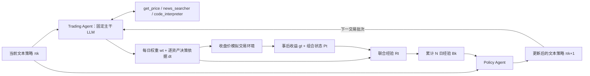
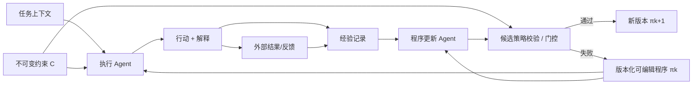

# EvolveTrade 论文精读：七个核心问答、可复现指南、研究范式与后续研究设计

> 阅读对象：**EvolveTrade: Experience-Driven Policy Refinement for Self-Evolving LLM Trading Agents**（arXiv:2609.17632v1）  
> 原文：https://arxiv.org/html/2609.17632v1  
> 阅读目标：理解研究问题—方法—证据闭环，区分可复现事实与缺失信息，并提炼可迁移的研究设计。  
> **来源约定**：“论文事实”依据原文及附录；“进一步研究建议”是基于论文提出的研究设计，不是作者已验证的结论。

---

# 1. 论文基础元信息

| 项目 | 内容 |
|---|---|
| 论文标题 | **EvolveTrade: Experience-Driven Policy Refinement for Self-Evolving LLM Trading Agents** |
| 作者 | Sehee Kim、Yumin Choi、Minki Kang、Sung Ju Hwang |
| 机构 | KAIST；Sung Ju Hwang 同时标注 DeepAuto.ai |
| 发表会议/期刊 | arXiv 预印本 v1（2026-09-15）；论文页面未标明正式会议或期刊 |
| 论文链接 | https://arxiv.org/html/2609.17632v1 |
| PDF | https://arxiv.org/pdf/2609.17632v1 |
| 代码链接 | 在所核对的 v1 正文与附录中未发现可确认的官方代码链接 |
| 关键词 | LLM Trading Agent；Tool Use；Self-Evolution；Policy Refinement；Experience Feedback；Online Adaptation；Portfolio Allocation |

**摘要（忠于原文的精修）：** 现有 LLM 交易智能体能够融合行情、新闻和可执行分析，但其操作行为往往由部署前写好的固定工具策略支配，无法根据不同市场环境修订证据获取、工具调用、信号验证和风险控制流程。EvolveTrade 把 Trading Agent 的系统提示词定义为可更新的文本策略；每隔一个更新周期，独立的 Policy Agent 读取近期逐资产决策依据及已实现组合反馈，并重写后续交易日使用的策略。整个过程固定基础模型参数与工具接口，只演化自然语言程序。跨两个主干模型、六个市场环境的实验观察到部分窗口中的收益和 Sharpe 改善，同时发现代码执行分析增加、此前没有使用的指标被激活；但两个 4 月窗口中存在明确的表现不足。

**TLDR：** **以“历史决策依据 + 实际结果”为反馈，周期性改写智能体的系统操作程序，而不是微调大模型或只调整当次交易动作。**

---

# 2. 核心精读问答

## Q1. 研究问题：这篇论文试图解决什么问题？

### 2.1 研究背景

LLM 已具备综合数值行情、财经文本和外部计算结果的能力。引入检索工具与 Python 执行器后，交易智能体可以主动获取数据、计算指标并根据市场信息调整权重。但是，**会使用工具不代表会根据过往经验改进工具使用程序**。当观察窗口、代码计算清单与新闻查询模板长期固定，模型只会在预设分析程序内部改变结论，无法改变分析程序自身。

### 2.2 原文指出的现存痛点

1. **分析词汇固化**：Figure 2 显示，静态工具调用 Agent 在 2025 年 1 月震荡、4 月下跌恢复、9 月上涨三种市场状态下，仍高频调用相同的 Sharpe、20/60 日收益、年化波动率和回撤指标。
2. **潜在能力未被激活**：EMA、RSI、VaR、信号归一化等计算虽然可通过 Python 完成，但在静态策略运行中没有被使用。
3. **结果难以回流到操作层**：已有交易是否盈利，并不会改变下一批交易日的检索、验证和风险配置程序。
4. **延迟且含噪的反馈**：单日收益不是可靠的决策质量标签，盈利可能来自运气，亏损可能来自不可预见的冲击。

**原文 Figure 2：静态策略下的指标使用热力图。** 横轴：交易日；纵轴：金融指标；红色：该交易日使用该指标；右侧：调用天数。


**图后解读：** 这是一张“智能体行为证据图”，不是收益比较图。它专门用于证明静态策略导致跨市场状态的分析覆盖范围近乎不变，从而为后续自进化方法提供问题依据。

### 2.3 研究动机与研究目标

作者希望让大模型学习的对象从“某日应该持有哪只股票”转移到“持续产生交易决策的可复用操作程序”。因此提出研究问题：**能否只通过历史决策轨迹及其实际反馈，持续更新冻结 LLM 的文本操作策略，从而使信息获取、证据验证、计算与风险配置过程具备在线适应能力？**

该问题强调的是**程序级适应（procedural adaptation）**，而非模型参数学习、收益率预测模型训练或固定规则的手工调参。

**研究逻辑：** `工具能力已具备 → 操作策略仍固定 → 指标与检索流程固化 → 无法利用实际经验修订流程 → 提出策略文本在线自进化`。

---

## Q2. 相关研究：已有方法如何分类？

论文 Section 2 将相关工作分为 **LLM Agents for Financial Trading** 与 **Self-evolving LLM Agents** 两条主线。

| 方向 | 代表研究（原文提及） | 主要思路与优势 | 相对本文的缺口 |
|---|---|---|---|
| 金融智能体的记忆 | FinMem | 保存跨交易会话的市场信息与历史上下文 | 保存记忆不必然修改未来工具调用协议 |
| 多角色金融分析 | TradingAgents、TradExpert | 角色分工与多阶段决策，丰富决策视角 | 角色和工作流多由开发者预先设计 |
| 交易模拟和工具平台 | StockAgent、QuantAgent、FinAgent | 支持真实或模拟任务中的自主交互 | 工具可调用与工具程序可进化不同 |
| 金融 Agent 评测 | AI-Trader、LiveTradeBench、FinAgentBench | 统一评价连续决策表现、时间约束及风险 | 评测平台本身不提供持续程序更新 |
| 通用提示词/程序优化 | ProTeGi、DSPy、TextGrad、GEPA 等相关工作 | 借助反馈改进指令、程序或工作流 | 不专门面向部署中金融交易经验反馈 |
| 经验反思与自进化 | Reflexion 等 | 把成功失败转化为经验或反思 | 经验文本不必然成为完整工具执行程序 |
| 金融策略更新 | ATLAS、SHARP | 更新策略文本或结构化交易策略 | 更新范围不一定包括检索、验证、代码和输出全过程 |
| 工具编排与交易优化 | AlphaQuanter、FLAG-Trader | 改进工具组织或策略优化 | 与本文的在线、冻结模型、经验驱动全流程文本策略修订组合不同 |

**研究缺口的精准表述：** EvolveTrade 并非首次提出 Prompt Optimization 或金融策略自进化，而是把**部署后真实决策反馈、工具调用轨迹、可编辑系统操作策略、冻结基础模型**组合为连续运行的更新机制。本文使用 EvolveStrategy（主要更新高层交易规则）作为关键对照，用以测试操作程序级更新的额外价值。

**阅读提醒：** 论文对其他方法的缺陷属于作者基于研究定位作出的归纳，不应扩展为所有已有方法都完全没有在线适应能力。

---

## Q3. 解决方案：论文如何解决这个问题？

### 3.1 整体架构

系统包含：**Trading Agent（执行者）**、**工具集（行情、新闻、代码）**、**交易环境（组合收益反馈）**、**经验记录**和**Policy Agent（程序修订者）**。内层逐日执行决策，外层按固定间隔更新操作策略。

**原文 Figure 1：三种架构对比（Static Agent / Static Tool-Calling Agent / EvolveTrade）。**


**图后解读：** A→B 增加主动工具调用，B→C 才增加反馈驱动的 Policy Agent。本文的核心对照应是 B 与 C，因为这两者具备相同类型的工具能力，但只有 C 会修改程序策略。

### 3.2 按原文公式复刻的闭环



**图后解读：** 文本策略是唯一可学习对象；价格工具、新闻工具和 Python 执行器是固定的外部能力接口；Policy Agent 不直接执行交易，而是改写下一批次 Trading Agent 的工作程序。

### 3.3 模块一：状态与文本参数化策略

**是什么：** 在交易日 $t$，系统状态表示为：

$$
S_t=(\pi_t,t,P_{t-1},\mathcal T),\qquad
\mathcal T=\{t_{\mathrm{price}},t_{\mathrm{news}},t_{\mathrm{code}}\}.
$$

$\pi_t$ 为系统提示词表示的自然语言操作策略，$P_{t-1}$ 为上一日组合状态。交易动作由基础 LLM $p_\theta$、当前策略和信息上下文共同诱导。

**为什么用：** 把提示词形式化为状态变量后，可以明确“模型能力保持不变，操作规则随时间改变”的研究对象。它避免把最终持仓的变化与学习行为混为一谈。

**本文怎么用：** 令主干参数 $\theta$ 固定、工具接口固定；只允许 $\pi_t$ 在批次边界发生改变。同一批次内连续交易日均使用相同的 $\pi$。

### 3.4 模块二：Trading Agent 与三类工具

**是什么：** Trading Agent 在系统策略约束下自主调用 `get_price`、`news_searcher` 和 `code_interpreter`，利用工具返回结果生成日频权重与逐资产解释。

**为什么用：** 行情工具提供结构化事实，新闻工具提供非结构化证据，Python 解释器提供可执行金融计算。仅有查询能力而缺少程序层的工具协调，难以保证证据处理方式随环境调整。

**本文怎么用：** 初始策略（原文 Figure 8）要求三种工具全部调用；`get_price` 一次查询所有股票，历史窗口 3–12 个月；Python 至少计算 20 日收益、年化波动率与 Sharpe；新闻按股票和必要宏观词搜索。最终输出 JSON，包括 `allocations` 和逐资产 `traceability`；组合总权重为 1，包含现金。代码解释器为持久 Python 内核，可使用预定义 `get_price()` 返回 `pandas.DataFrame`。

### 3.5 模块三：Traceability 与反馈对齐

**是什么：** 论文把单日智能体决策记录定义为：

$$h_t=(w_t,d_t^{\mathrm{dec}}),$$

其中 $w_t$ 是组合权重，$d_t^{\mathrm{dec}}$ 是逐资产决策理由；环境反馈 $g_t$ 包含组合收益、资产收益、更新后的配置和组合状态。联合经验为：

$$\mathcal R_t=(h_t,g_t).$$

**为什么用：** 仅看最终收益不能推断决策为什么成功或失败。将权重与产生权重的证据说明绑定，能够为策略更新提供“可能需要修改哪条操作规则”的文本依据。

**本文怎么用：** Policy Agent 比较当前策略要求、逐资产决策理由和事后真实结果，寻找有明确历史证据支持的规则更新点。必须区分“记录了逐资产解释”与“证明了解释的因果正确性”：后者没有被论文形式化解决。

### 3.6 模块四：经验批次与 Policy Agent

**是什么：** 每 $N$ 个交易日收集一次：

$$
\mathcal B_k=\{\mathcal R_{(k-1)N+1},\ldots,\mathcal R_{kN}\},
$$

再用 Policy Agent 更新：

$$
\pi_{kN+1}=f_{\mathrm{update}}(\pi_{kN},\mathcal B_k),
$$

$$
f_{\mathrm{update}}(\pi,\mathcal B)=\mathrm{LLM}(I_{\mathrm{update}},\pi,\mathcal B).
$$

**为什么用：** 批量经验可以降低仅依据某一交易日噪声反复改写策略的风险；单独的更新智能体把“执行任务”与“改进任务程序”分开。

**本文怎么用：** 默认 $N=5$。Policy Agent 通过固定的 `I_update` 查找与表现有关的当前策略条款，要求提供具体证据支持的定向修订，不接受笼统的“更加谨慎”式改写。其输出为 JSON：`reasoning`（更新解释）与 `policy`（更新文本）。

### 3.7 模块五：操作约束与 Fixed Block

**是什么：** 附录 Figure 9 明确区分可变的操作策略与不能修改的固定约束区块。固定内容包括股票池、权重求和、输出结构、现金处理、时间信息边界和减少无必要换手等要求。

**为什么用：** 如果更新器可以任意删除任务约束，短期绩效改进可能来自违反交易任务、读取未来数据或输出无效格式，而不是程序能力改进。

**本文怎么用：** Policy Agent 只返回可编辑策略；固定区块由系统自动追加。这里的“更新 entire policy”应理解为可编辑操作程序的范围更广，不是所有指令完全无边界可修改。

### 3.8 EvolveTrade 与相关实现的准确区别

| 对比 | Static TC | EvolveStrategy | EvolveTrade |
|---|---|---|---|
| 外部三类工具 | 有 | 有 | 有 |
| 反馈更新 | 无 | 有 | 有 |
| 更新高层信号与仓位规则 | 否 | 是 | 是 |
| 更新工具查询、证据验证、操作程序 | 否 | 不作为主要可编辑范围 | 是 |
| 底层 LLM 训练 | 无 | 无 | 无 |
| 固定约束区块 | 有 | 有 | 有 |

**总结：** EvolveTrade 不是 Teacher–Student 参数蒸馏、不是梯度强化学习，也不是依赖专门训练的收益预测网络；它是**冻结 LLM 驱动的外部文本程序更新系统**。

---

## Q4. 可复现细节：数据、模型、训练与实验配置

### 4.1 数据类型与来源

| 维度 | 已披露内容 | 未披露或尚不能确认的内容 |
|---|---|---|
| 运行基准 | 基于 LiveTradeBench 的日收盘价模拟交易环境 | 完全一致的环境版本、代码提交号 |
| 行情 | 历史日收盘价，经 `get_price` 获取 | 底层行情供应商、复权方式、完整快照 |
| 新闻 | 股票及宏观相关新闻，经 `news_searcher` 获取 | 新闻供应商、原始文本语料、去重及检索快照 |
| 可交易范围 | 15 只美国大型股票和 CASH | 股票池外的泛化效果 |
| 时间范围 | GPT：2025-01、2025-04、2025-09；Gemini：2025-11、2026-02、2026-04 | 每窗口所有原始调用数据与完整日级日志 |
| 经验数据 | 每日权重、逐资产决策解释、逐资产及组合实现收益 | 全量标准化轨迹文件未提供 |
| 数据划分 | 六个时间顺序评估窗口；每月运行期间在线更新 | 不存在本文需要的传统随机训练/验证/测试拆分 |

**完整股票池：** AAPL、MSFT、NVDA、JPM、V、JNJ、UNH、PG、KO、XOM、CAT、WMT、META、TSLA、AMZN，以及 CASH。

**样本规模口径：** 六个主实验窗口各约一个月；静态策略动机 Figure 2 中 2025 年 1 月为 20 个交易日，4 月和 9 月为 21 个交易日。50 日扩展实验为 2025-09-02 至 2025-11-10。论文没有提供可将新闻条数、工具调用数或训练样本总量统一汇总成独立数据集规模的完整统计。

### 4.2 时序预处理与防泄漏

- `get_price` 最多访问决策交易日 $t$ 的收盘价，新闻最多访问 $t-1$。
- `CASH` 固定为价格 1、零波动，不请求股票价格。
- 每个交易日以上一日组合状态作为配置基准，目标权重总和为 100%。
- 初始价格回溯窗口为 3–12 个月，基础数值计算含 20 日收益、年化波动率与 Sharpe。
- **重要执行假设：** 更新提示词原文规定“Decision, execution, and evaluation all happen at the same closing price (t)”。真实市场中，当日正式收盘价公布后不能再无摩擦按同一价格成交，复现论文时应忠实记录这项模拟假设；面向真实投资应用时应另建可执行时间轴（例如 $t$ 收盘决策、$t+1$ 可成交价格执行）。

### 4.3 模型结构与训练配置

| 配置项 | 原文情况 | 复现解释 |
|---|---|---|
| 主干模型 | GPT-5-mini、Gemini-2.5-Flash | 两组分别独立运行 |
| Agent 结构 | Trading Agent + Policy Agent | 同一次运行中共享同一主干模型类别 |
| LLM 参数量 | 未在论文中报告 | 不应猜测 |
| 神经网络特殊层 | 无新增网络结构 | 方法不修改网络结构 |
| 优化器、学习率、损失函数 | 不适用 | 没有梯度训练 |
| Epoch / Batch Size | 不适用于模型训练 | $N=5$ 是策略更新间隔，不是 SGD mini-batch |
| 更新方式 | LLM 文本修订调用 | $\pi_{k+1}=f_{\mathrm{update}}(\pi_k,\mathcal B_k)$ |
| 硬件/GPU | 未充分披露 | 依赖 LLM 推理及 Python 执行工具，不能自行声明设备 |
| 温度 / seed / token 限制 | 未充分披露 | 精确重复仍依赖补足模型调用配置 |
| 重复实验 | 每个 LLM 方法 3 次 | Table 1 报告均值；附录 C 报告部分标准差 |

### 4.4 实验指标

$$R_t=\frac{V_t-V_{t-1}}{V_{t-1}};\quad
\mathrm{CR}=\left(\frac{V_T}{V_0}-1\right)\times100;$$

$$\mathrm{SR}=\sqrt{252}\frac{\overline R}{\sigma_R};\qquad
\mathrm{MDD}=\max_t\left(1-\frac{V_t}{\max_{s\le t}V_s}\right)\times100.$$

WR 为组合正收益交易日的比例，Vol 为**日收益率**标准差（百分数），不是年化 Vol。主实验的 SR 未进行无风险利率扣减。若内部演化提示词另有风险自由利率设置，不应与外部统一评价口径混淆。

### 4.5 最小复现流程

```text
input:
  market_windows, asset_universe, initial_prompt π0,
  update_instruction I_update, frozen_backbone,
  get_price, news_searcher, code_interpreter,
  update_interval N=5

for each market_window and random_run:
    π = π0
    portfolio = initial_portfolio
    buffer = []
    for t in chronological_trading_days:
        context = {date=t, previous_portfolio=portfolio,
                   price_cutoff=t, news_cutoff=t-1}
        (weights, rationale, tool_log) = TradingAgent(π, context, tools)
        assert long_only(weights) and sum(weights) == 1
        (feedback, portfolio) = daily_close_simulator(weights, portfolio, t)
        buffer.append({weights, rationale, feedback})
        if len(buffer) == N:
            update_json = PolicyAgent(I_update, π, buffer)
            π_candidate = update_json["policy"]
            π = append_and_validate_fixed_block(π_candidate)
            buffer = []
    evaluate(SR, CR, MDD, WR, Vol, turnover)
```

**注意：** 上述为依据论文关系编写的复现级伪代码，非作者公开的原始实现。作者的更新提示词还包含今日交易结果和前一日表现的具体组织方式，正式复现应以 Appendix G Figure 8/9 为准。

### 4.6 复现坑点

1. **数据可得时间和实际可成交时间不同**：不能把收盘价同步决策/成交假设当成真实可执行策略。
2. **策略自进化没有“训练集”**：每个交易月是一段顺序运行、边执行边更新的轨迹，测试期间发生文本策略更新。
3. **反馈日期对齐**：输出动作、当日成交、下一持有区间收益、策略更新使用的反馈都需逐日明确。
4. **固定区块不能被更新器改写**：否则会造成约束泄漏或任务改变。
5. **工具调用预算未充分披露**：EvolveTrade 调用 Python 更多，比较收益之外应同步比较 token 成本、调用次数和延迟。
6. **不同重复运行的轨迹不可替换为一个最优 Prompt**：论文的 Appendix H 是表现较优的演化案例，不是默认策略或跨窗口统一最优程序。
7. **有观测归因不等于因果证明**：交易解释文本只是可观察依据，不能自动识别个别提示词条款的真实因果贡献。
8. **用真实成本替换 10 bps 时应重算收益**：论文的成本分析尚不包含滑点、成交冲击和流动性。
9. **新闻检索需要快照或重放**：事后重新搜索新闻可能获得与原交易时不同的文本和排名。
10. **必须记录完整版本轨迹**：包括 Prompt 哈希、策略差异、决策 JSON、工具输入输出、运行时间戳和组合状态。

---

## Q5. 实验部分：论文做了哪些实验？

### 5.1 主实验：六个市场窗口、多类基线

**目的：** 同时比较工具能力、策略演化与操作程序演化的作用。GPT-5-mini 在 2025 年 1/4/9 月运行，Gemini-2.5-Flash 在 2025 年 11 月、2026 年 2/4 月运行，各 LLM 配置 3 次取均值。传统规则基线包括 SPY、B&H、MACD、KDJ&RSI、ZMR、SMA；LLM 基线为 Static Base、Static TC、EvolveBase、EvolveStrategy。

**原文 Table 1 的主要直接对照（SR / CR%）：**

| 模型与窗口 | Static TC：SR / CR | EvolveStrategy：SR / CR | **EvolveTrade：SR / CR** | 结果解释 |
|---|---|---|---|---|
| GPT 2025-01 | 2.87 / 3.30 | 3.86 / 4.70 | **5.12 / 5.10** | EvolveTrade 优于两种直接对照 |
| GPT 2025-04 | -1.54 / -4.71 | -3.09 / -6.85 | **-2.53 / -6.60** | 低于静态 TC，明显负结果 |
| GPT 2025-09 | 6.45 / 4.86 | 7.76 / 4.78 | **8.43 / 6.84** | EvolveTrade 领先 LLM 对照 |
| Gemini 2025-11 | -1.99 / -2.24 | -1.04 / -1.16 | **-1.03 / -1.07** | LLM 中最优，但收益仍为负 |
| Gemini 2026-02 | 2.70 / 2.29 | 3.92 / 3.52 | **2.75 / 2.92** | 不及 EvolveStrategy |
| Gemini 2026-04 | 6.62 / 4.73 | 3.66 / 2.23 | **4.73 / 3.69** | 不及 Static TC 和 Static Base |

**结论：** EvolveTrade 在六个窗口中有四个同时优于 Static TC 的 SR 和 CR；在三个窗口中获得全部 LLM 方法的最高 SR 与 CR。不能宣称六个窗口全部最优。**参见原文 Table 1、附录 C Table 4–5**（均值和运行标准差）。

### 5.2 行为分析：指标调用热力图

**目的：** 验证提示词演化是否真正改变了执行程序，而不只是最终收益波动。Figure 3 的横轴为交易日，纵轴为分析指标；红色表示只有 Static TC 使用、紫色两者都使用、蓝色仅 EvolveTrade 使用。EvolveTrade 在 4 月更多激活 VaR 与 Normalize，在 9 月引入趋势类 SMA、EMA 和 RSI 指标。


**图后解读：** 行为变化存在于实际 Python 调用层，构成对“策略程序已经发生变化”的机制证据；但是否每项指标都提高了预测能力，仍不能仅凭该图判断。

### 5.3 工具调用频率对照：Figure 4

**目的：** 判断策略演化是简单增加工具调用量，还是重新分配工具的分析作用。作者发现 `get_price` 仍接近每日 1 次，代码解释器从约每日 1 次上升至 2.6–4.5 次，新闻调用总量没有增加。**结论：** 更新主要将分析转向可执行代码计算和验证，而非增加外部文本搜索频率。

### 5.4 风险控制个案：Figure 5（NVDA）

| 指标 | Static TC | EvolveTrade |
|---|---:|---:|
| 2025-01-24 的 NVDA 配置 | 10.7% | 2.9% |
| 下一交易日 NVDA 收益 | -17.0% | -17.0% |
| 下一交易日组合收益 | -1.11% | -0.03% |

**案例机制：** 静态程序较依赖 20 日收益和正面新闻；演化后的规则更重视长期风险调整指标与组合检查，因而降低 NVDA 权重。持仓差异 7.8 个百分点乘以 -17% 跌幅，约对应 1.33 个百分点的局部贡献差异。**注意**：组合实际收益差为 1.08 个百分点，不等于 NVDA 单项贡献，不能直接把 1.33 个百分点写成组合真实超额收益。

### 5.5 长周期实验：Table 2、Figure 6

50 个交易日：2025-09-02—2025-11-10，GPT-5-mini。

| 方法 | SR | CR% | MDD% | WR% | Vol% |
|---|---:|---:|---:|---:|---:|
| Static Base | 1.82 | 4.51 | 4.70 | 68.0 | 0.82 |
| Static TC | 2.94 | 8.88 | 4.40 | 63.3 | 0.95 |
| EvolveBase | 2.41 | 4.79 | 3.00 | 65.3 | 0.65 |
| EvolveStrategy | 3.27 | 6.94 | 2.82 | 65.3 | 0.68 |
| **EvolveTrade** | **4.00** | **10.56** | **2.96** | **67.3** | **0.81** |

**结论：** 在这个 50 日窗口中，SR 与 CR 最优；Figure 6 的策略文本长度既增长也阶段性缩短。但单个 50 日窗口不足以证明长期环境变化下始终稳定。

### 5.6 更新间隔敏感性：Table 3

| 更新周期 | SR | CR% | MDD% | WR% | Vol% |
|---|---:|---:|---:|---:|---:|
| 每 1 日 | 1.92 | 0.16 | 4.58 | 61.5 | 1.13 |
| 每 3 日 | 3.25 | 0.97 | 4.46 | **62.7** | **1.13** |
| **每 5 日** | **3.67** | **1.78** | **4.26** | 61.7 | 1.17 |
| 每 7 日 | 3.50 | 1.54 | 4.55 | 60.6 | 1.21 |

**结论：** 平均 SR、CR、MDD 在五日更新时最好；每日更新反而最弱。说明更新频率与绩效不是简单单调关系，过于频繁的修订可能过拟合噪声。

### 5.7 交易摩擦：Appendix D Table 6

作者引入 **10 bps** 的比例交易成本，报告调成本后的 SR、CR 与换手指标 TO。EvolveTrade 在原本领先的 GPT 1 月、9 月及 Gemini 11 月窗口保留其相对优势，并在六个窗口中均比 Static TC 和 EvolveStrategy 具有更低的换手指标。**适用边界：** 不包括滑点、冲击和流动性限制。

### 5.8 失败案例：Appendix F Table 7

| 窗口 | 选择的静态对照现金占比 | EvolveTrade 现金占比 | 观察 |
|---|---:|---:|---|
| 2025-04 | 17.1% | **27.1%** | 下跌后恢复阶段配置更保守 |
| 2026-04 | 4.3% | **40.1%** | 上涨窗口显著降低权益暴露 |

**结论：** 风险规则的进化可能导致过度保守，因而在市场恢复或上涨阶段错失收益。论文提供的是具有解释力的关联分析，不能把现金比例证明为唯一因果原因。

---

## Q6. 创新点与可借鉴点

### 6.1 理论与问题表述层面

**贡献一：把策略演化对象从行动转向程序。** 交易动作 $w_t$ 是当次决策结果，可更新策略 $\pi_t$ 则支配多个未来动作的生成方式。本文把“学习什么”明确定位在可重复使用的操作程序。这属于问题对象和系统建模上的创新，不宜夸大为全新优化理论定理。

**贡献二：把实际经验表示为结果与解释的联合体。** $\mathcal R_t=(h_t,g_t)$ 区分“做了什么、基于什么、结果如何”，为规则定位和程序修改提供反馈接口。不过，这是一种归因线索，并非严格的因果估计器。

### 6.2 方法创新

**贡献三：双时间尺度的策略更新闭环。** 内层每日执行，外层按 $N$ 日批次修订，既允许环境适应，也避免每次行动立即修改规则。

**贡献四：可编辑操作策略与不可变系统约束分离。** Policy Agent 可以更新工具查询、验证、代码计算和输出组织等程序，但资产范围、时间约束、权重求和等由 Fixed Block 锁定。

**贡献五：以真实工具调用作为机制验证。** 不只比较收益，也比较计算指标集合、调用频率、个案仓位和更新后策略文本。

### 6.3 工程实现创新

- 不需要微调底层大模型：适用于调用固定外部 LLM 的智能体架构。
- `policy` 与 `reasoning` 分离：支持版本记录和更新原因审计。
- 复用既有价格/新闻/Python 工具：降低迁移至已有 Agent 的改造范围。
- 逐资产 traceability：提供相对结构化的行为证据，便于诊断。

### 6.4 可迁移到其他任务的具体经验

不要机械复制“交易后更新提示词”，而要保留四个最关键的设计原则：**（1）明确可学习的程序对象；（2）把任务输出和事后反馈成对记录；（3）限制可编辑范围并设置安全约束；（4）同时检验行为是否改变和最终目标是否改善。**

对于具有长期目标和个体异质性的财富管理任务，更合理的迁移对象是**财富规划程序**，而非短期择时交易规则。可把程序更新范围定义为：客户信息核验、目标优先级、流动性检查、风险承受能力一致性、产品适配及定期复盘逻辑。冻结的则是事实来源边界、适当性监管约束、禁止类规则和人工审核条件。

---

## Q7. 论文不足与局限性

> **区分：原文明确承认的局限**与**根据实验设计可进一步识别的研究边界**。

| 类别 | 具体问题 | 证据/原因 | 影响 |
|---|---|---|---|
| 原文局限 | 更新周期固定 | 只离线比较 1/3/5/7 日，但运行中不动态触发 | 无法根据环境变化自动平衡稳定与适应 |
| 原文局限 | 成交模型不完整 | 仅检查 10 bps 成本，不含滑点冲击和流动性 | 回测结果不等同于实盘可实现绩效 |
| 进一步边界 | 收盘价时间假设 | Figure 9 提示词规定同一收盘价决策、执行、评价 | 真实市场执行可行性需要独立验证 |
| 进一步边界 | 结果归因存在噪声 | Policy Agent 根据解释与收益做文本归因 | 更新正确性缺少强因果检验 |
| 进一步边界 | 反馈规则可能过度防御 | Appendix F 两个 4 月现金占比明显更高 | 市场恢复/上涨时可能错失参与机会 |
| 进一步边界 | 重复次数偏少 | 每组 LLM 仅 3 次 | 难以充分评估随机运行不确定性 |
| 进一步边界 | 信息服务不可完全复原 | 缺少完整行情/新闻快照与调用配置 | 精确复现存在障碍 |
| 进一步边界 | 缺少资源公平比较 | 更新器额外调用 LLM，代码工具使用明显增多 | 绩效收益需要与调用成本共同评估 |
| 进一步边界 | 演化策略可能冗长 | Figure 6 观察到长度扩张与收缩 | 长期可维护性和冲突检测未完全解决 |
| 进一步边界 | 股票池与任务范围有限 | 固定 15 股、有限月份与 50 日扩展 | 不能直接概括到更长时间或其他资产场景 |

**重要结论：** 论文真正证明的是“程序级在线更新可以在若干测试环境中改变 Agent 行为并改善绩效”，没有证明“演化结果已具备可靠的因果最优性、安全性和真实市场可执行性”。

---

# 3. 范式提炼

## 3.1 逻辑范式：从行为瓶颈到可观察的程序进化

**背景 → 痛点 → 诊断实验 → 优化对象转移 → 新机制 → 行为验证 → 结果验证 → 失败边界。**

1. **背景**：基础模型已有多源信息处理与工具执行能力。
2. **痛点**：能力被静态程序约束，环境变化时流程不能自适应。
3. **诊断**：先用 Figure 2 证明跨场景操作指标调用固化。
4. **问题转化**：明确优化对象不是单次动作，而是可复用程序。
5. **方法**：建立执行—反馈—分析—策略重写的双 Agent 闭环。
6. **机制证据**：看指标使用、工具调用、程序文本和具体配置变化。
7. **结果证据**：看主实验、重复运行、换手成本和周期敏感性。
8. **局限**：在不利窗口分析过度防御，保留方法的边界。

**论文写作模板：** “现有系统能够完成 X，但受到固定流程 Y 的限制。我们先通过行为诊断证明 Y，再将优化对象从输出 O 转移至操作程序 P，设计基于真实反馈的更新算子 U，并分别在行为层 B 和任务结果层 R 验证其作用。”

## 3.2 技术范式：Experience-Grounded Procedural Adaptation

将具体交易任务剥离后，可定义通用结构：

$$
\text{Task Executor}(\pi_k,x_t,\mathcal T)
\to (a_t,d_t)
\to y_t
\to \mathcal R_t=(a_t,d_t,y_t)
\to \text{Policy Editor}(\pi_k,\mathcal B_k)
\to \pi_{k+1}.
$$

- **任务输入 $x_t$**：当前客户、市场、设备、病历、代码或业务上下文。
- **操作程序 $\pi_k$**：可编辑的工具调用、证据检查与输出组织规则。
- **执行结果 $a_t$**：当次行动/方案。
- **解释记录 $d_t$**：行动所依据的证据和程序步骤。
- **反馈 $y_t$**：延迟产生的结果，可有噪声。
- **经验批次 $\mathcal B_k$**：用于修订程序的多次执行记录。
- **不可变约束 $C$**：安全、合规、数据时序和任务要求。



**迁移时必须新增的系统安全层：** 图中的候选策略校验/门控是针对其他高风险任务提出的**研究改进模块**，不是 EvolveTrade 原文已经实现的完整回滚与线上安全门控。

### 3.3 与其他技术范式的区别

| 范式 | 主要学习对象 | 反馈形式 | 与 EvolveTrade 的差别 |
|---|---|---|---|
| 模型微调 / SFT | 神经网络参数 | 标注数据、损失函数 | 本文不更新权重 |
| 强化学习 | 参数化政策 / 价值函数 | 奖励、轨迹 | 本文没有显式梯度更新和价值函数训练 |
| 长期记忆 RAG | 外部知识库或经验库 | 检索与保存记录 | 本文直接更新支配执行的系统操作规则 |
| 一次性 Prompt Optimization | 提示词 | 开发/验证反馈 | 本文发生在连续运行的在线交易周期中 |
| 自适应行动策略 | 当次权重或动作 | 当前状态 | 本文改变能够跨多次任务复用的程序 |

---

# 4. 后续研究拓展

> 以下全部为**建议研究课题**，不是 EvolveTrade 论文已实施或验证的组成部分。重点展示如何从本论文形成可投稿、可对照、可复现的后续研究方案。

## 4.1 值得进一步做的研究话题

| 研究主题 | 待解决问题 | 潜在技术模块 | 推荐核心验证 |
|---|---|---|---|
| **有界策略自进化** | LLM 重写程序是否会破坏安全和稳定性 | Fixed Rules + Policy Validator + Version Rollback | 违规率、退化率、回滚效果及任务质量 |
| **动态更新触发** | 固定 N 日更新无法匹配环境变化 | 变化检测、漂移评分、不确定性门控 | 动态触发 vs 固定周期；成本/稳定性比较 |
| **因果归因式策略编辑** | 收益和解释不足以确定哪条程序规则有效 | 规则级对照、反事实重放、实验归因 | 经编辑规则的可识别效果与置信度 |
| **分层策略演化** | 完整自由重写易冗长、矛盾、过拟合 | 基础策略 + 场景规则 + 个体规则分层 | 分层 vs 完整重写；冲突和迁移鲁棒性 |
| **跨环境适应与遗忘控制** | 历史适用规则可能不适用于新环境 | 场景检索、策略版本选择、回退记忆 | 未见环境表现、遗忘率、切换损失 |
| **预算约束的工具进化** | 工具调用次数增加是否值得 | 成本敏感调度、工具价值估计 | 净质量收益、Token/工具调用成本、时延 |
| **多用户个性化进化** | 共享策略与个体差异如何兼容 | 群体知识 + 个体经验 + 权限隔离 | 个体效果、冷启动、群体公平与隐私 |

## 4.2 研究主题层级：上位类、下位类、同位类

### 上位类（抽象研究领域）

- Adaptive AI Agents / 自适应智能体
- Continual Learning and Online Adaptation / 持续学习与在线适应
- Experience-Based Learning / 经验驱动学习
- Prompt and Program Optimization / 提示词与程序优化
- Human-Centered Decision Systems / 面向人的决策支持
- Trustworthy Agentic AI / 可信自主智能体

### 下位类（从 EvolveTrade 衍生出的可操作问题）

- 经验反馈的可信度建模与筛选
- LLM 操作规则的版本管理和语义差分
- 工具调用程序的条件化编辑与静态检查
- 更新触发的自适应调度
- 多窗口、跨环境、跨用户的规则复用
- 反馈噪声下的安全更新和回滚
- 行为变化—决策质量之间的因果效应验证
- 人工审核与自动更新的协同机制

### 同位类（与本文并列而不包含于本文的研究路线）

- 基于外部记忆检索的经验复用，而不直接改写提示词
- 基于工作流图搜索的 Agent 系统优化
- 基于模型参数微调的在线适应
- 基于显式强化学习策略的任务动作更新
- 基于约束规划 / 数学优化的程序性决策
- 基于多智能体辩论的可信决策与错误检测

## 4.3 可迁移的数据类型

| 数据层 | 可用数据示例 | 在后续研究中的用途 |
|---|---|---|
| 状态与背景 | 当前任务、环境状态、客户目标、时间约束 | 定义当前决策情境 |
| 行为轨迹 | 工具调用、输入参数、检索结果、代码执行 | 精确刻画操作程序是否被遵循 |
| 决策产物 | 配置方案、建议文本、选项排序、权重 | 记录当次输出 |
| 可追溯解释 | 事实引用、证据与决策理由、适用规则 | 将决策结果关联到证据与程序 |
| 延迟反馈 | 真实收益、客户反馈、任务达成、风险事件 | 形成跨期经验 |
| 程序演化日志 | 旧策略、新策略、diff、更新理由、版本 | 审计和复盘规则变化 |
| 安全信息 | 规则违反、事实错误、越权操作、拒绝原因 | 训练外部检查器、阻止危险更新 |
| 人工评价 | 专家复核、适当性审查、客户确认 | 补充难以从数值结果识别的决策质量 |

## 4.4 从本文可直接发展的一项研究设计：有界经验驱动的个性化财富规划程序进化

**重要区分：** 该部分属于面向其他金融任务的**迁移方案**，不是 EvolveTrade 原文的系统或实验。其目标应由短期交易收益转向长期财富目标、流动性、客户适当性和计划执行的一致性。

**研究问题：** 在客户需求和市场环境均随时间变化、且金融事实与合规约束不允许随意改写的条件下，能否使 AI 财富规划智能体持续利用客户反馈改进其规划程序，同时避免程序漂移、违规和过度频繁的方案变化？

**输入与状态：** 客户财富目标及期限、收入与支出、现金流、风险承受能力、既有资产及负债、流动性需求、可适配产品范围、当前市场环境、顾问核验记录。

**个性化经验：** `客户状态 + 历史规划建议 + 建议依据 + 真实执行或人工反馈 + 目标进展`。为避免把客户不行动直接当成建议失败，还需要将建议接受、执行约束和外部环境事件分别记录。

**可进化策略：** 多目标优先级、流动性核验次序、方案解释深度、产品筛选程序、重新评估触发条件、顾问介入时机。

**不可变策略：** 监管规则、客户风险适当性上限、被禁止或不适宜产品排除、隐私权限、未经授权不得交易、必须人工复核的高风险决策。

**核心算法路线：**

```mermaid
flowchart LR
  A["客户异质状态 + 可信财富知识"] --> B["财富规划 Agent"]
  P["当前个性化程序 πu,k"] --> B
  B --> C["方案 + 证据 + 适当性解释"]
  C --> D["客户/顾问反馈 + 目标进展"]
  D --> E["多期经验记录"]
  E --> F["程序编辑 Agent"]
  P --> F
  F --> G{ "事实/适当性/性能门控" }
  G -->|通过| P2["新版本个性化程序"]
  G -->|拒绝| P
  P2 --> B
```

**最低限度对照：** 固定通用方案 Agent；固定个性化 Agent；仅增加记忆的 Agent；仅更新偏好或高层规划目标的 Agent；无边界完整程序重写；提出的有界程序更新。

**主要评价：** 目标适配率、流动性覆盖、适当性违规率、事实引用准确率、规划解释一致性、客户/顾问采纳率、过度调整次数、程序回滚率、成本与时延。不能将短期 Sharpe 作为长期财富管理规划能力的唯一核心指标。

**可行性验证顺序：** 先建立可重复的历史事件重放与专家评价集，再进行无真实操作权限的 shadow-mode 在线测试，最后在人工审批与权限控制下小范围试点。原文的同日收盘决策成交设置不应直接迁移至银行客户财富服务。

## 4.5 三个可形成新论文的精准问题

**选题 A：When Should an Agent Evolve?** 研究更新触发机制。假设固定周期无法兼顾不同环境的反馈密度，利用策略失配、客户状态漂移和反馈置信度联合决定何时触发 Policy Agent。关键实验是固定周期/每日/事件驱动触发之间的适应性能与更新成本对照。

**选题 B：What Should Be Allowed to Evolve?** 研究自进化边界。将策略分为不可变规则、受限可编辑程序与自由可更新的表达层；增加语义差分校验、离线回放和回滚。关键实验是不同编辑自由度下的目标改善、违规率和灾难性退化概率。

**选题 C：How Can Feedback Be Attributed to Rules?** 研究反馈归因。先检测可疑规则，再对候选策略修改开展同历史信息条件的反事实重放或配对测试，不以单次结果作为唯一依据。关键实验比较“文本反思直改”与“证据筛选 + 离线验证后发布”的真实性能差异。

---

# 5. 最终研究判断

EvolveTrade 最值得复用的并不是某个股票技术指标或固定五日更新间隔，而是一套**从历史行为中提取可定位的问题、把问题转化为可复用程序修改、在新环境继续执行并记录结果**的方法论。它将智能体学习的对象扩展到操作程序，并通过真实工具行为而不是仅靠结论文本验证更新。论文的关键不足也正源于这种灵活性：收益反馈含噪、规则编辑缺少强因果保证、固定更新时机不够灵活，并可能出现过度防御和复杂规则漂移。

**适合进一步推进的研究方向：** `经验归因 → 候选规则编辑 → 安全与有效性验证 → 受控发布 → 动态再评价`。这里后面三步属于在 EvolveTrade 基础上可以提出的新改进，而非作者已经完整实现的验证机制。

---

# 6. 原文图表索引与核查链接

| 原文位置 | 内容 | 推荐阅读用途 |
|---|---|---|
| Figure 1 | Static / Tool-Calling / EvolveTrade 架构 | 搭建系统架构图 |
| Figure 2 | 静态指标调用热力图 | 理解研究动机 |
| Figure 3 | 演化前后指标调用对照 | 验证行为机制 |
| Figure 4 | 三种工具的日均调用频率 | 解释分析流程变化 |
| Figure 5 | 2025-01 NVDA 仓位案例 | 理解权重差异与收益贡献 |
| Figure 6 | 50 日演化策略文本长度 | 研究程序累积与压缩 |
| Table 1 | 六窗口五指标主实验 | 主要绩效对照 |
| Table 2 | 50 日长周期实验 | 连续运行稳健性 |
| Table 3 | 更新间隔敏感性 | 更新频率选择 |
| Table 4–5 | 3 次运行的均值及标准差 | 随机性与稳健性 |
| Table 6 | 10 bps 成本及换手率 | 考虑金融交易摩擦 |
| Table 7 | EvolveTrade 现金权重对比 | 失败案例原因分析 |
| Figure 8–11 | 初始与更新提示词 | 技术实现复现 |
| Figure 12–16 | 演化后的策略样例 | 观察规则更新产物 |

**原文完整 HTML（图、表、附录）：** https://arxiv.org/html/2609.17632v1  
**arXiv 摘要与出版元信息：** https://arxiv.org/abs/2609.17632  
**注：** 本文件中的 Figure 1–3 使用 arXiv 原始图片链接；其余表格和描述依据论文 HTML 文字，不采用未经验证的外部二次绘图。
